# 模块目录与全景导读（按目录分批精读）

> 生成方式：按目录分 14 个批次通读源码，每个模块输出 **职责 / 对外接口 / 依赖 / 调用关系 / 风险点 / Mermaid 图**。
> 本文是全仓库的模块级目录（catalog），与 [../../docs/INDEX.md](../INDEX.md) 文档索引互补：INDEX 索引"文档"，本文索引"代码模块"。
>
> 维护约定：新增/改名模块时先更新 §2 目录清单，再补写对应章节。

---

## 1. 仓库目录树（源码部分）

```text
源代码/
├── backend/                     # FastAPI 后端（Python，核心）
│   ├── *.py（~90 个根级模块）    # 事件管线 / 检测 / 审计链 / 智能体 / 守卫 等按主题归组
│   ├── agents/                  # 多智能体编排（A/B/C/D、分解器、评审、子审计）
│   ├── asset/                   # 资产管理（发现/关联/历史）
│   ├── causal_chain/            # 因果链（PC/GES/do-演算）
│   ├── data_security/           # 数据安全
│   ├── edr_fusion/              # EDR 情报融合
│   ├── encrypted_traffic/       # 加密流量分析
│   ├── eval_datasets/           # 公开数据集回放评测（CIC-IDS2017/CTU-13）
│   ├── event_archive/           # 事件归档
│   ├── geo_data/ ip2region/     # IP 地理库
│   ├── ids_connector/           # Suricata IDS 连接器
│   ├── learn_loop/              # 学习闭环（规则进化）
│   ├── mcp_guard/               # MCP 守卫服务器
│   ├── migrations/              # Alembic 迁移
│   ├── observability/           # 健康监控/追踪/日志
│   ├── ops_metrics/             # KPI / SLA
│   ├── phishing_guard/          # 反钓鱼
│   ├── prompts/                 # LLM 提示词模板
│   ├── protocol_parser/         # 协议解析（HTTP 等）
│   ├── rag/                     # RAG 知识库（检索/重排/证据校验/导入器）
│   ├── response_engine/         # 响应编排引擎（白名单/审批/遏制/传输）
│   ├── routers/                 # HTTP API 路由（20 个）
│   ├── schemas/                 # Pydantic schema
│   ├── security_guard/          # 安全守卫
│   ├── self_play/               # 红蓝自博弈
│   ├── sigma_engine/            # Sigma 规则引擎（自研规则+社区规则+影子规则）
│   ├── stabilizer/              # 稳定器
│   ├── temporal/                # Temporal 工作流
│   ├── tests/                   # 测试（单元 + 集成）
│   ├── threat_intel/            # 威胁情报（STIX/TAXII、IOC、CVE）
│   ├── tools/                   # 运维小工具
│   ├── traffic_baseline/        # 流量基线
│   ├── traffic_capture/         # 流量捕获
│   └── zeroday_detect/          # 0day 检测
├── frontend/                    # React 前端（Vite + TS，22 页面）
├── flink-jobs/                  # Flink 流处理作业（Java，7 个 Job）
├── config/                      # 部署配置（nginx/kafka/grafana/prometheus/otel/tempo/vector/suricata）
├── contracts/                   # 跨服务消息契约（JSON Schema + fixtures）
├── docker/                      # soc-firewall 容器
├── certs/                       # TLS 证书（kafka）
├── demo/                        # 演示脚本（run-demo、live-drill）
├── tools/                       # 仓库工具链（预检、规则导入、压测、原子测试）
├── docs/                        # 文档（本文件所在）
└── docker-compose*.yml          # 4 套编排（默认/dev/ha/prod）
```

## 2. 模块清单（更新后的目录）

> 编号 M01–M38 为全文统一引用。"批次"列 = 阅读批次（B1–B14），与 §5 章节顺序一致。

| # | 模块 | 位置 | 批次 |
|---|------|------|------|
| M01 | 应用入口与运行时基座 | `backend/app.py` `config.py` `models.py` `lifecycle.py` `scheduler.py` | B1 |
| M02 | 认证与用户存储 | `backend/auth.py` `user_store.py` | B1 |
| M03 | 日志接入与规范化 | `backend/log_ingestion.py` `ingest_pipeline.py` `normalization.py` `source_registry.py` `demo_traffic.py` `demo_seed_b.py` | B1 |
| M04 | Kafka 接入 | `backend/kafka_consumer.py` `kafka_producer.py` `kafka_security.py` | B1 |
| M05 | 事件总线/存储/Schema | `backend/event_bus.py` `event_store.py` `event_envelope.py` `event_identity.py` `event_replay.py` `schema_registry.py` `schema_compat.py` `stats_counter.py` `dlq_store.py` `event_archive/` `contracts/` | B2 |
| M06 | 检测引擎（关联/异常/窗口） | `backend/sigma_detector.py` `correlation_engine.py` `anomaly_detector.py` `sliding_window.py` `rule_manager.py` `detection_contract.py` `cad.py` | B3 |
| M07 | Sigma 规则引擎 | `backend/sigma_engine/` | B3 |
| M08 | 流处理桥与稳定器 | `backend/temporal/` `stabilizer/` | B3 |
| M09 | 数据迁移与修复脚本 | `backend/migrations/` `migrate_pgvector_to_qdrant.py` `migrate_qdrant_hybrid.py` `fix_embeddings.py` | B3 |
| M10 | 审计链（防篡改账本） | `backend/audit_types.py` `audit_schemas.py` `audit_cache.py` `audit_pq.py` `audit_spill.py` `audit_trail.py` `audit_worker.py` `audit_triage.py` `audit_dead_letters.py` | B4 |
| M11 | 广播与 IP 地理 | `backend/ledger_broadcast.py` `attack_geo_broadcast.py` `geo_ip.py` `ip2region/` `geo_data/` | B4 |
| M12 | 多智能体编排（LLM） | `backend/agents/` `llm_enhancer.py` `llm_limiter.py` `context_stream.py` `memory_tree.py` `summary_compression.py` `prompts/` | B5 |
| M13 | 质量守门（幻觉/证据/否决） | `backend/faithfulness_gate.py` `grounding_verifier.py` `quality_scoring.py` `veto_gates.py` `feedback_loop.py` | B5 |
| M14 | 红蓝自博弈 | `backend/self_play/` `red_agent.py` `ops_loop.py` | B6 |
| M15 | 学习闭环与评测 | `backend/learn_loop/` `eval_service.py` `eval_repository.py` `eval_metrics.py` `eval_datasets/` | B6 |
| M16 | RAG 知识库 | `backend/rag/` `qdrant_store.py` `vector_store.py` | B7 |
| M17 | MCP 守卫服务器 | `backend/mcp_guard/` | B6 |
| M18 | 工具/能力注册与工单 | `backend/tool_registry.py` `capabilities_registry.py` `work_order_service.py` `case_manager.py` `post_mortem_service.py` | B6 |
| M19 | 响应编排引擎 | `backend/response_engine/` | B8 |
| M20 | 安全护栏与密码学 | `backend/security_guard/` `data_security/` `security_crypto.py` `field_cipher.py` | B8 |
| M21 | 运行时守卫（网络/内存/HTTP/锁/重试/容量/健康/排水） | `backend/net_guard.py` `memory_guard.py` `http_guards.py` `distributed_lock.py` `retry_policy.py` `capacity.py` `dependency_health.py` `drain.py` | B8 |
| M22 | 威胁情报 | `backend/threat_intel/` | B9 |
| M23 | EDR 情报融合 | `backend/edr_fusion/` | B9 |
| M24 | 0day 检测 | `backend/zeroday_detect/` | B9 |
| M25 | 协议解析 | `backend/protocol_parser/` | B9 |
| M26 | IDS 连接器 | `backend/ids_connector/` | B9 |
| M27 | 加密流量分析 | `backend/encrypted_traffic/` | B10 |
| M28 | 流量基线 | `backend/traffic_baseline/` | B10 |
| M29 | 流量捕获 | `backend/traffic_capture/` | B10 |
| M30 | 会话重建 | `backend/session_reconstruct/` | B10 |
| M31 | 因果链分析 | `backend/causal_chain/` | B11 |
| M32 | 资产管理 | `backend/asset/` | B11 |
| M33 | 反钓鱼 | `backend/phishing_guard/` | B11 |
| M34 | 可观测性 | `backend/observability/` `ops_metrics/` `otel_setup.py` `metrics.py` `core_metrics.py` `trace_context.py` `trace_hook.py` | B12 |
| M35 | HTTP API 路由层 | `backend/routers/` `schemas/` | B12 |
| M36 | 前端应用 | `frontend/` | B13 |
| M37 | Flink 流处理作业 | `flink-jobs/` | B14 |
| M38 | 部署与基础设施 | `docker-compose*.yml` `*/Dockerfile` `config/` `certs/` `demo/` `tools/` `.github/` | B14 |

## 3. 全局架构总图

> 分层视角：① 接入源 → ② Kafka（SASL_SSL）→ ③ Flink 流处理 → ④ backend 检测/审计/响应 → ⑤ 存储与编排 → ⑥ AI 支撑 → ⑦ 前端与观测。模块编号对应 §2 清单。

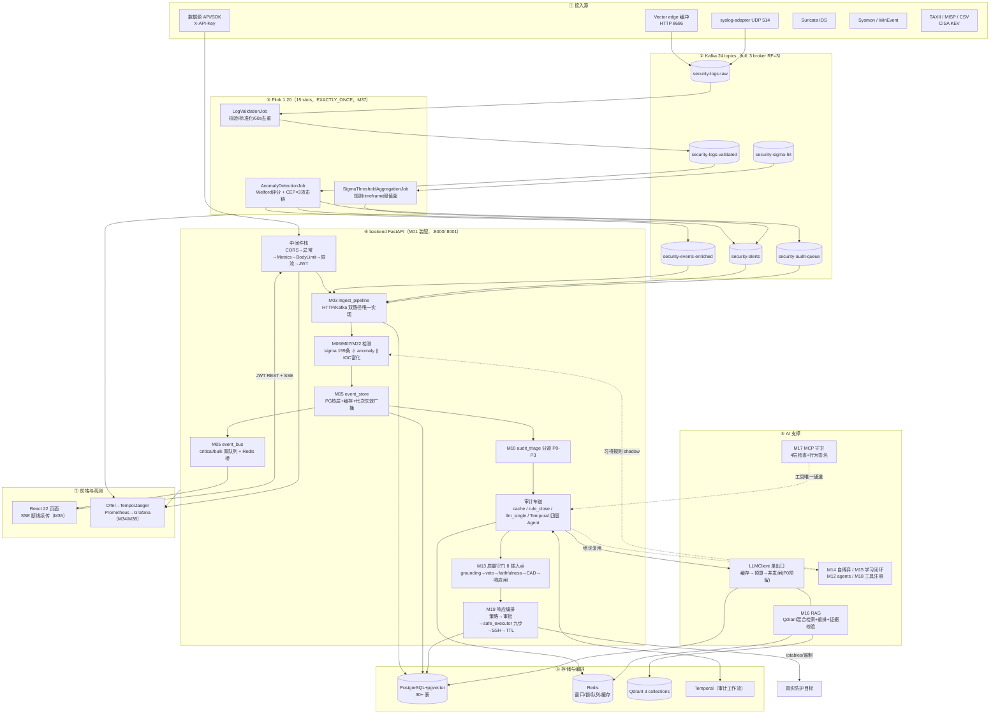

## 4. 全局数据流图

> 一条事件的完整生命周期（对应 M05「事件生命周期」+ M12「审计工作流编排」）：

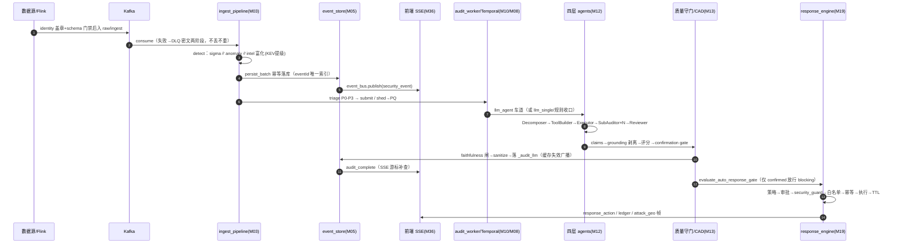

## 5. 分批次模块详解

（以下 B1–B14 章节由各批次精读结果填充）

### B1 应用入口 / 认证 / 接入 / Kafka（M01–M04）

#### M01 应用入口与运行时基座（backend/app.py, config.py, models.py, lifecycle.py, scheduler.py）

**职责**：app.py 是全局组装点：定义 FastAPI 实例与 lifespan（初始化/优雅停机）、注册认证/限流/请求体限制等中间件、挂载全部业务 Router、接入 Prometheus 与 OTel。config.py 用 pydantic-settings 提供 `settings` 单例（前缀 `SHARED_MEMORY_`）。models.py 定义 SQLAlchemy 异步 ORM（30+ 张表）、双连接池（OLTP/BG）与 schema 自检。lifecycle.py 实现停机顺序（采集引擎→Kafka→审计 worker→调度器→Redis→DB）。scheduler.py 以 asyncio 后台任务跑 20 个周期任务。

**对外接口**：
- `app`（FastAPI 实例，`lifespan`，app.py:513）；`shutdown_platform()`（lifecycle.py:51，app.py:502 调用）
- `settings: Settings`（config.py:625，全项目唯一配置入口）
- models.py：`async_session`/`async_session_bg`（:50-51）、`init_db()`（:1203）、`assert_schema_current()`（:1173）、`dispose_engines()`（:1216）、`get_session()`（:1222，FastAPI Depends 用）；表模型 `SecurityEvent`/`SecurityCase`/`WorkOrder`/`AppUser`/`DataSource`/`AgentTrace` 等
- `scheduler: Scheduler`（scheduler.py:1097），`await scheduler.start(db_session_factory)` / `stop()`；主要调用方：app.py:395 启动、lifecycle.py:106 停止

**依赖**：内部 — observability/logging_setup、http_guards、auth、metrics、capacity、source_registry、kafka_consumer/kafka_producer、response_engine、event_store、event_bus、temporal、audit_worker、routers/*（19 个）。外部 — FastAPI/Starlette、SQLAlchemy+asyncpg+pgvector、alembic、PyJWT、pydantic-settings、bcrypt、aiokafka、opentelemetry。

**调用关系**：uvicorn → app lifespan（初始化全部单例）→ routers/*（HTTP）→ 各业务模块；lifecycle.shutdown_platform ← app.py:502 → kafka/audit_worker/scheduler/event_bus/models 逐层停止；scheduler 各 `_*_loop` → anomaly_detector / event_store / correlation_engine / case_manager / work_order_service / feedback_loop / learn_loop / kpi_calculator / audit_pq / audit_worker / temporal.client / dlq_store / audit_trail / mcp_guard.call_logger / self_play.reviewer / causal_chain.store / demo_traffic。

**app.py 装配全景**（全局架构的权威组装点）
- 中间件（外→内）：`CORSMiddleware`（app.py:775，最后注册=最外层，allow_origins 来自 settings.allowed_origins）→ `RequestContextMiddleware` + 全局异常 `unhandled_exception_handler`（app.py:766-767，X-Request-ID）→ `MetricsMiddleware` + `/metrics` 端点（app.py:757-758）→ `ingest_body_limit_middleware`（app.py:673，/api/logs/ingest* 按 Content-Length 413）→ `rate_limit_middleware`（app.py:638，进程内滑窗，桶=api_key|XFF|client_ip，命名空间 crit/strict/std）→ `auth_middleware`（app.py:545：allowlist/mTLS 拦截 403；/api/* 除 `_PUBLIC_PATHS`（login/register/health/docs/metrics）外强制 JWT Bearer 或 `?token=`；剥离 Server 头）
- Router 挂载（app.py:714-737，prefix 实测）：auth=`/api`、sources=`/api/sources`、kafka=`/api`、dlq=`/api/dlq`、assets=`/api/assets`、logs=`/api`、chat=`/api`、audit=`/api`、response=`/api`、rag=`/api`、phishing=`/api`、ndr=`/api/ndr`、capabilities=`/api`、benchmark=`/api/benchmark`、edr_intel=`/api`、ops=`/api`、self_play=`/api/self-play`、causal=`/api/causal`；`demo_seed`=`/api/demo` 仅 `settings.demo_mode=true` 挂载（app.py:730）
- lifespan 启动序列（app.py:44-491）：① alembic upgrade head（fail-closed，:50-62）→ `assert_schema_current`（:65）→ `init_db`（:66）；② ApprovalQueue 恢复/清理（:70-79）；③ cost_tracker 从 llm_traces 重建当日用量（:81-107）；④ `sliding_window.connect()`（Redis）并注入 embedder/LLM 缓存/context_stream/anomaly_detector/rollback_store/event_store/event_bus/temporal.client/audit_pq（:108-135）；⑤ safe_executor+ttl_manager 初始化与 TTL 扫描器（:137-163）；⑥ SSH 响应传输 / SSH 防火墙配置（:199-263）；⑦ RAG 播种 + embedding 回填（:224-236）；⑧ `source_registry.load_from_config/load_from_db/_backfill_pending`（:239-244）；⑨ 资产缓存、Sigma 引擎、Self-Play overlay（:247-273）；⑩ NDR 五引擎（capture/flow_aggregator/pcap_store/dissector+4 parser/tls_session_collector 回调接线，:276-342）；⑪ EDR/IDS/情报/沙箱按开关（:344-367）；⑫ `schema_registry.register_all` + `kafka_producer.start` + `kafka_consumer_manager.start`（:369-385）；⑬ `audit_worker.start`（:390）→ `scheduler.start`（:395）→ ledger/attack_geo 广播（:400-412）→ OTel（:417）→ health/watchdog/tracer（:426-431）→ `recover_unanalyzed`（:435）→ `replay_dead_letters`（:445）→ stuck 事件自动清理（:453-490）
- 调度任务清单（scheduler.py:79-116）：基线快照(300s)、长链扫描(1800s)、CAD 上下文审计(3600s)、看门狗(600s)、工单 SLA(300s)、案例 SLA(300s)、误报/学习(3600s)、KPI 日快照(02:05 UTC)、LLM 预算重置(00:00 UTC)、stuck 审计收口(120s)、AuditPQ drain(0.2s)、Self-Play 审核、audit_trail/tool_call_log flush(60s)、因果学习、演示流量、embedding 回填巡检(300s)、DLQ 保留期(6h)、learn_loop 日闭环(02:15 UTC，可选)、情报源轮询(60s，intel_enabled 时)

**风险点**：
- [P2] app.py:561 — JWT 支持 `?token=` query 传参，令牌会落入访问日志/代理日志（SSE 兼容设计，仍是泄漏面）
- [P2] app.py:161-163 — SafeExecutor/TTL 初始化失败仅 `logger.error` 后继续对外服务；若 `execution_mode=live`，执行安全层可能缺位而进程照常接流量
- [P2] app.py:583 — `_rate_limit_store` 为进程内 dict，多 worker/多进程部署时限流配额按进程各算一份，全局限额失效
- [P3] app.py:739 — 日志写死 "Mounted 17 routers"，实际无条件挂载 19 个 + 条件 1 个
- [P3] config.py:604-621 — `_load_project_root_env` 把根目录 .env 中**任意无前缀键**灌入 os.environ，与 `env_prefix="SHARED_MEMORY_"` 体系并存双通道
- [P3] models.py:1180-1181 — `assert_schema_current` 只硬编码检查 2 张表+3 列，其余 schema 漂移不拦截
- [P3] scheduler.py:760-762 — `_drain_audit_pq_once` 每个 job 循环内 `await inflight_stats()`，批 20×0.2s 轮询下对 Temporal client 压力放大

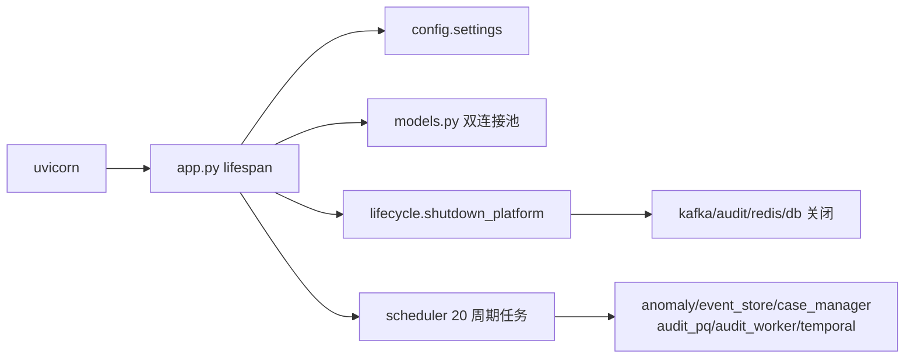

#### M02 认证与用户存储（backend/auth.py, user_store.py）

**职责**：auth.py 提供 HS256 JWT 签发/校验、jti 撤销（内存 + Redis 双写）、`get_current_user` 依赖与 `RequireRole` RBAC 类。user_store.py 提供 `app_users` 表的注册用户存取（bcrypt 哈希，异步 via to_thread）与用户名/密码校验。内置 admin 走环境变量，不入库（user_store.py:4）。

**对外接口**：`create_access_token(username, role)`（auth.py:116）、`decode_access_token(token)->dict`（auth.py:134，被 app.py auth_middleware:569 与所有 `Depends` 共用）、`get_current_user`（auth.py:156）、`RequireRole(*roles)`（auth.py:168）、`revoke_jti/revoke_username/remember_jti/is_jti_blocked`（auth.py:50-113）；user_store：`validate_username/validate_password`、`hash_password_async/verify_password_async`、`get_by_username/create_user`（user_store.py:25-87）。主要调用方：routers/auth.py（登录 :120/:139、注册、改密 :208）、全部 routers 的鉴权依赖。

**依赖**：内部 — config.settings（jwt_secret）、sliding_window（借 Redis 连接，auth.py:42-47）、models.AppUser。外部 — PyJWT、fastapi（HTTPBearer/Depends）、bcrypt、SQLAlchemy。

**调用关系**：app.py auth_middleware → `decode_access_token` → `is_jti_blocked` → Redis/内存；routers/auth.py login/register → `create_access_token` → `remember_jti`；routers/auth.py → user_store.`get_by_username`/`verify_password_async`/`create_user` → models.AppUser → PG。

**风险点**：
- [P2] auth.py:125 — `loop.create_task(remember_jti(...))` 返回的 task 未持强引用，可能被 GC 提前回收导致 Redis 侧 jti 集合缺录，全量吊销（revoke_username）漏吊
- [P2] auth.py:89 — `_blocked_jti` 只在被同 jti 再次查询时清理，被吊销后从未复查的 jti 永久驻留内存，长运行进程缓慢泄漏
- [P3] auth.py:16 — `SECRET_KEY` 在 import 期固化；`decode_access_token` 有空密钥 fail-closed（:137-141）但 `create_access_token` 无对应守卫，空密钥下仍签发必然无效的令牌
- [P3] auth.py:55-56 — 每用户 jti 超限时 `bucket.pop()` 丢任意元素（set 无序），兜底撤销面进一步缩小
- [P3] user_store.py:34-39 — 密码策略仅长度 ≥8，无复杂度/黑名单校验
- [P3] user_store.py:47-52 — `verify_password` 捕获全部异常返回 False，哈希格式损坏与密码错误不可区分

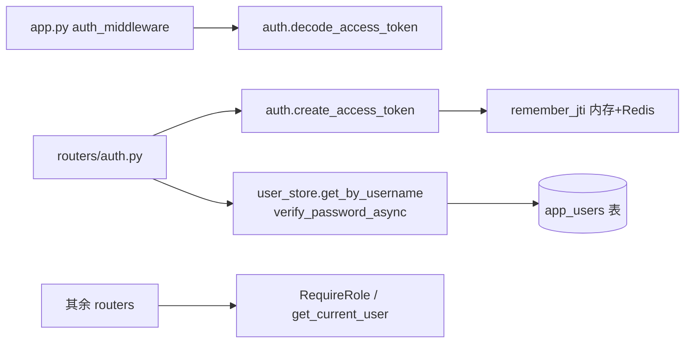

#### M03 日志接入与规范化（backend/log_ingestion.py, ingest_pipeline.py, normalization.py, source_registry.py, demo_traffic.py, demo_seed_b.py）

**职责**：log_ingestion.LogIngestor 是接入门面：字段名归一化（`_normalize_fields`，:124-202）、数字 severity 映射、审计状态 LRU 缓存、以及 Audit-LLM 编排（`_audit_pipeline`：Redis 认领 → triage 分级 → 结论缓存 → llm_single/Temporal/本地四层流水线 → 落库 + CAD + 自动响应闸门）。ingest_pipeline.py 是 detect（anomaly∥sigma 并行、Sigma 抬分、契约状态传播）→ persist_batch（PG 幂等批量写）→ dispatch（索引/FastPath/audit_worker/event_bus）的唯一权威实现，`run_one`/`run_many` 供 HTTP 与 Kafka 双路径。normalization.py 提供签名匹配前的 URL/message 受限解码视图。source_registry.py 管数据源 API Key（SHA256 落库 + 内存热缓存，fail-closed 认证）。demo_traffic.py/demo_seed_b.py 是演示数据注入。

**对外接口**：`log_ingestor.ingest(session, session_id, log_data)`（log_ingestion.py:204，routers/logs.py 调）、`ingest_batch`（:1383，切块+容量闸）、`get_status`、`get_audit_stats`（:264）、内部 `_audit_pipeline/_mark_analyzed/_fallback_analysis`（被 audit_worker.py:486 调用）；`ingest_pipeline.run_one/run_many/detect/persist_batch/dispatch`（ingest_pipeline.py:316-1113，kafka_consumer._ingest_python_batch:1629 调 run_many）；`canonical_matching_view(event)`（normalization.py:131，sigma_engine/engine.py:742,1098 接线）；`source_registry.authenticate(api_key)`（source_registry.py:307，routers/logs.py 接入认证）、`register/revoke/list_sources/stats`；`inject_demo_event(session)`（demo_traffic.py:21，scheduler._demo_traffic_loop:1088 调）；demo_seed_b.`main()`（CLI，仅增 Prometheus 计数）。

**依赖**：内部 — config、models、event_store、anomaly_detector、sigma_detector、memory_tree、sliding_window、event_bus、audit_worker/audit_pq/audit_triage/audit_cache/veto_gates/faithfulness_gate、temporal.client、agents(decomposer/tool_builder/executor/reviewer/audit_single)、response_engine、case_manager、capacity、retry_policy、event_identity、distributed_lock、dlq_store、field_cipher、schema_registry、core_metrics/metrics、audit_trail。外部 — SQLAlchemy asyncpg。

**调用关系**：routers/logs.py（HTTP ingest，先 `source_registry.authenticate`）→ log_ingestor.ingest → ingest_pipeline.run_one → detect（anomaly_detector.analyze + sigma_detector.detect_for_event@to_thread）→ persist_batch → event_store.store_batch → dispatch → audit_worker.submit / FastPath(response_engine.on_threat_detected) / event_bus.publish；audit_worker → log_ingestor._audit_pipeline → audit_triage → llm_single 或 temporal.start_audit_workflow 或 `_audit_pipeline_inner`（四层 Agent）→ `_persist_audit_result`（CAD + veto_gates 响应闸门）；kafka_consumer._ingest_python_batch → ingest_pipeline.run_many；scheduler._demo_traffic_loop → demo_traffic.inject_demo_event → log_ingestor.ingest。

**风险点**：
- [P2] demo_traffic.py:10-18 + ingest_pipeline.py:767-783 — DEMO_EVENT `confidence=85` 归一为 0.85 ≥0.7 → FastPath 判强信号 `allow_blocking=True`，而 `_demo` 标记在 ingest/FastPath/响应链路中无任何检查（grep 无消费点）；`execution_mode=live` 时演示事件可驱动真实封禁决策
- [P2] log_ingestion.py:64 — `FASTPATH_COOLDOWN_S` 直接读无前缀环境变量，绕开 `SHARED_MEMORY_` 配置体系，与 config.py 双通道
- [P3] log_ingestion.py:243-252 — `_audit_status_cache` 满容时每次插入线性扫描找可淘汰项，最坏 O(10000)/条
- [P3] source_registry.py:125 — `set(self._sources.keys())` 结果未赋值，是死语句
- [P3] source_registry.py:408-410 — `stats()` 的 `registered_sources = len(_sources)+len(_sources_by_hash)`，同源被明文与哈希双索引后重复计数
- [P3] normalization.py:127-128 — `_URL_AUTHORITY_RE` 仅匹配带端口的 authority，无端口 URL 无法补齐 dst_ip/dst_port（注释宣称 host:port，实为 port 必需）

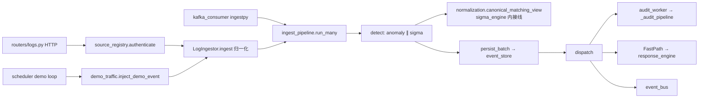

#### M04 Kafka 接入（backend/kafka_consumer.py, kafka_producer.py, kafka_security.py）

**职责**：kafka_consumer.KafkaConsumerManager 以 8-10 个受监督消费循环消费 enriched/audit-queue/alerts/behavior/rejected/cep-partial/audit-overflow/python-ingest（可选 retry topic）；实现连续水位手动提交（OffsetCommitTracker）、两阶段 DLQ（先密文落库再 broker acks=all，两步成功才提交 offset）、指数退避重试、消费 lag 监控。kafka_producer.KafkaProducerWrapper 负责审计结果/告警/Sigma 聚合候选/raw 批量回写，带 schema 校验 + field_cipher 加密 + 幂等 + 首启失败监督重试。kafka_security 统一输出 aiokafka 安全参数（PLAINTEXT 默认 / SASL_SSL）。

**对外接口**：`kafka_consumer_manager.start()/begin_drain()/stop()`（kafka_consumer.py:460-531，app.py:382 与 lifecycle.py:62-100 调）、`stats()/rejection_stats()/cep_partial_matches()`（:2353-2366，routers/kafka.py 读）；`kafka_producer.start()/stop()/flush()`（kafka_producer.py:88-158）、`publish_audit_result/publish_alert/publish_sigma_hit`（:188-313，audit_worker.py:411 与 sigma_engine/engine.py:1043 调）、`produce_raw/produce_raw_batch`（:337-432，routers/logs.py:156 调）、`is_active/health_snapshot`（routers/auth.py:263、routers/kafka.py 读）；`aiokafka_security_kwargs()`（kafka_security.py:50，全部 producer/consumer 构造点展开）。

**依赖**：内部 — config、kafka_security、dlq_store、field_cipher、metrics、retry_policy、event_identity、schema_registry、ingest_pipeline（run_many）、log_ingestion（facade）、event_store、memory_tree、audit_worker、response_engine、routers.assets（get_asset_weight）、core_metrics、capacity、sigma_engine.ENFORCEMENT_ACTIONS。外部 — aiokafka（ImportError 降级 HAS_KAFKA=False）、opentelemetry（tracer）。

**调用关系**：app.py lifespan → `kafka_producer.start` + `kafka_consumer_manager.start` → 各 `_consume_*` 循环（`_supervised_loop` 指数退避重启）；`_consume_loop/_consume_python_ingest` → `_poll_many`（审计高水位暂停拉取）→ `_settle_*` → `_ack_record` → `_process_message`（field_cipher.open_message → schema_registry.validate → handler 重试/DLQ）；handler：`_handle_enriched/_handle_audit_with_backpressure` → event_store.store → audit_worker.submit；`_handle_alert/_handle_behavior_alert` → response_engine.get_orchestrator().on_threat_detected；`_ingest_python_batch` → ingest_pipeline.run_many；`_send_to_dlq` → dlq_store.persist_dlq_failure → DLQ producer → `mark_kafka_acked`；lifecycle.shutdown → begin_drain → audit_worker.stop → producer.flush/stop → consumer.stop。

**风险点**：
- [P2] kafka_security.py:36-42 — SASL_SSL 但未配 `kafka_ssl_ca_file` 时 `verify_mode=CERT_NONE` 跳过证书校验并仅 warning，生产误配即静默降级为不验证加密链路
- [P2] kafka_consumer.py:1896-1914 — CEP-partial 循环中 DLQ 写失败 `break` 直接退出消费循环，DLQ 持续故障时形成带退避的永久重放热循环（fail-stop 语义，但无独立熔断/告警计数）
- [P2] kafka_consumer.py:1828 — cep-partial 消费者 `auto_offset_reset="latest"` 与其余消费者 `earliest`（:1106）不一致，消费组首次上线/rebalance 重建时丢失全部历史 CEP 部分匹配，且无注释说明是否有意
- [P3] kafka_consumer.py:1668-1679 — `_safe_py_handle` 全仓库无调用方（已 grep 验证），属遗留死代码
- [P3] kafka_consumer.py:2014-2016 — `_handle_enriched` 第二个 `idempotent → return` 分支不可达（:1993-1996 已 return），死代码
- [P3] kafka_consumer.py:91-108 — `KAFKA_CONSUME_CONCURRENCY` 等无前缀 env 优先于 settings（`_env_int`），与 config.py 前缀体系双通道易踩配置漂移
- [P3] kafka_producer.py:188-206 — `publish_audit_result` 丢弃 `_send_bounded` 返回值，发送失败无 metric（`publish_alert` 已补，此处未对齐）

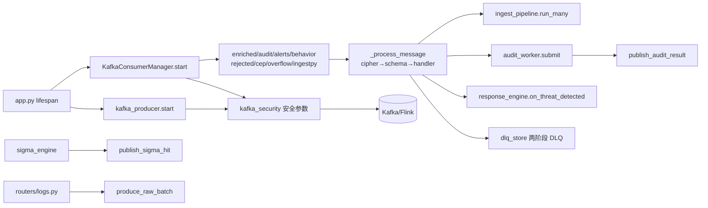

#### B1 批次总图

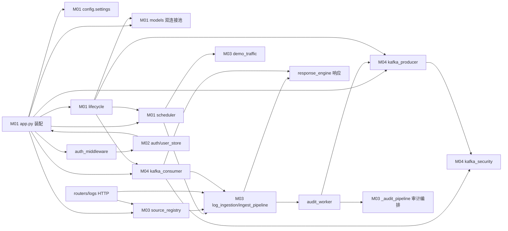

**关键结论**：ingest_pipeline 是 HTTP 与 Kafka 双路径的唯一检测/落库/分发实现（ingest_pipeline.py:1-23 契约注释 + kafka_consumer.py:1598-1629 实证）；log_ingestion 退化为门面 + Audit-LLM 编排载体（audit_worker.py:486 回调其 `_audit_pipeline`）；app.py lifespan 是 20+ 单例的初始化权威（见装配全景）；认证为全局中间件 + RBAC 依赖双层；主要横切风险集中在双配置通道（无前缀 env）、演示流量可触发真实封禁、进程内限流/撤销状态的多进程盲区。

### B2 事件总线与存储（M05）

#### M05 事件总线/存储/Schema（backend/event_bus.py, event_store.py, event_envelope.py, event_identity.py, event_replay.py, schema_registry.py, schema_compat.py, stats_counter.py, dlq_store.py, event_archive/【空目录，运行时创建】， contracts/）

**职责**：
- `event_bus.py`：进程内 SSE 通知总线（critical/bulk 双队列）+ Redis Pub/Sub 跨进程桥；`security_events.id` 为唯一业务游标，总线只是 at-most-once 提醒。
- `event_store.py`：安全事件持久化底座（PostgreSQL 热层）+ 进程内热缓存 LRU（代次 gen 失效协议 + Redis 跨进程失效广播）；幂等落库（eventId 唯一索引）。
- `event_identity.py`：event_id/correlation_id/trace_id/parent_event_id/stored_id 五种标识的解析、盖章（`ensure_identity`/`resolve`）、Kafka headers 编解码。
- `event_envelope.py`：跨系统消息信封（eventId/eventType/schemaVersion/occurredAt/producer/correlationId/payload）的 wrap/unwrap/stamp 与主版本兼容判定。
- `event_replay.py`：SSE 断线补查——以 DB 自增 id 为游标的分页回放 + 游标解析/刷新帧。
- `schema_registry.py`：topic→JSON Schema 绑定、消费/生产双侧校验、Confluent Schema Registry 注册（409 幂等判定）。
- `schema_compat.py`：CI 门禁——JSON↔Avro↔Java 字段对齐、相对 baseline 的 FULL 兼容、fixtures 校验。
- `stats_counter.py`：Redis 近似计数器（total/done/pending），低频 COUNT reconcile 兜底。
- `dlq_store.py`：Kafka 死信持久化索引（DB 索引列 + 整包密文）、错误脱敏、体积裁剪、dry-run、受控重放、按保留期清理。
- `contracts/`：schema 契约目录（README 变更流程、catalog.json 权威索引、baseline 兼容基线）。

**对外接口**（公开类/函数 → 调用方）
- `event_bus.event_bus: EventBus`（单例）：`publish(type,data)` ← ingest_pipeline.py:921、kafka_consumer.py、log_ingestion.py、ledger_broadcast.py:110、attack_geo_broadcast.py:85；`subscribe()/unsubscribe()` ← routers/chat.py:57/148、routers/phishing.py:336；`start_redis_bridge()/set_redis()` ← app.py:130/134；`hydrate_notice(evt)` ← routers/chat.py:130。
- `event_store.event_store: EventStore`：`store()/store_batch()` ← kafka_consumer.py:1979、ingest_pipeline.py:593/663；`get_by_id()/query()/get_unreviewed_anomalies()/get_stats()` ← routers/audit.py:446、routers/ops.py:1202/1315、cad.py:141；`commit_then_invalidate()/apply_event_update()` ← routers/audit.py:406、log_ingestion.py:1198、routers/logs.py:514；`start_invalidate_listener()` ← app.py:133。
- `event_replay`：`resolve_resume_cursor/load_sse_replay` ← routers/chat.py:70/82；`fetch_event_snapshot` ← event_bus.py:609。
- `dlq_store`：`persist_dlq_failure/mark_kafka_acked` ← kafka_consumer.py:580/631；`list_records/dry_run/replay_record` ← routers/dlq.py:56/86/129；`purge_expired` ← scheduler.py:133。
- `schema_registry.schema_registry.validate(topic,event)` ← kafka_consumer.py:1211（消费侧）、kafka_producer.py:224/300/363（生产侧）、dlq_store.py:541；`register_all()` ← schema_compat.py:456。
- `schema_compat.run_gate/main()` ← tools/check-schema-compat.py:11 → CI。
- `stats_counter`：`inc_insert` ← event_store.py:501/694；`inc_analyzed_done` ← log_ingestion.py:711/804/1175；`snapshot/reconcile` ← routers/chat.py:385。
- `event_identity.prepare_event/ensure_identity/derive_from/bus_fields/identity_headers/apply_headers` ← kafka_producer、kafka_consumer、网关链路；`event_envelope.stamp_identity` ← kafka_producer.py:195/223/362。

**依赖**：内部 — `models`（SecurityEvent/ResponseLog/DlqRecord）、`config.settings`、`field_cipher`（DLQ 整包加解密）、`core_metrics/metrics`（软依赖）、`sliding_window`（stats_counter 的 Redis 单例）、`kafka_consumer`（DLQ 重放 publisher）。外部 — SQLAlchemy（异步 PG）、Redis（pub/sub + 计数器 + 失效通道）、jsonschema（Draft7，可选）、httpx（Schema Registry REST）、Kafka（DLQ 重放）。

**调用关系**：采集/网关 → `stamp_identity/prepare_event` 盖章 → `kafka_producer`（`schema_registry.validate` 门禁）→ Kafka → `kafka_consumer`：失败 → `dlq_store.persist_dlq_failure`（→ PG DlqRecord → Kafka DLQ → `mark_kafka_acked`）；成功 → `event_store.store/store_batch`（→ PG SecurityEvent commit → `stats_counter.inc_insert` → 热缓存）→ `event_bus.publish("security_event")` → Subscriber 队列 → `routers/chat.py` SSE。审计链路 → `log_ingestion` 写回 → `event_store.commit_then_invalidate`（→ bump gen + Redis `soc:event_store:invalidate` 广播）→ `stats_counter.inc_analyzed_done` → `event_bus.publish("audit_complete")`。SSE 重连 → `resolve_resume_cursor` → `load_sse_replay` → `should_skip_live` 去重叠 → SSE。CI → `schema_compat.run_gate` → contracts/catalog.json + baseline → `schema_registry.register_all` → Confluent Registry。scheduler → `dlq_store.purge_expired`。

**风险点**：
- [P2] event_store.py:9-12,128-132 — 分层存储只有注释：温层 Parquet/冷层 S3 与「永久保留、永不删除」无任何实现，`event_archive/` 目录为空且无写入代码；实际只有 PG 单层，长期容量与归档承诺落空。
- [P2] event_bus.py:270-278 — critical 队列满且无可逐出的 replayable 事件时，无 event_id 的 critical（如缺 id 的 tool_anomaly）被静默丢弃，仅 `critical_lost` 计数，客户端无法补查。
- [P2] event_identity.py:63-64 — snake_case `event_id` 若为 ≤12 位纯数字会被 `is_stored_id` 判为库主键而跳过，`ensure_identity` 遂生成新 UUID，幂等键漂移 → 同一事件重复落库（camelCase `eventId` 不受影响）。
- [P2] dlq_store.py:320-328 — 无密钥部署时死信载荷以 `PLAIN:` 前缀**明文**入库（含原始安全事件/IP），属文档化的可用性取舍，但扩大了敏感数据落盘面。
- [P3] event_bus.py:283-287 — bulk 合并键对整个 deque 线性扫描且每元素调用两次 `coalesce_key`；`publish` 同步遍历全部订阅者（上限 256 × bulk 500），高频发布时事件循环内 CPU 放大。
- [P3] event_store.py:692-696 — `store_batch` 后逐条 `await inc_insert()`，一批 N 行产生 N 次串行 Redis 往返，未用 pipeline 合并。

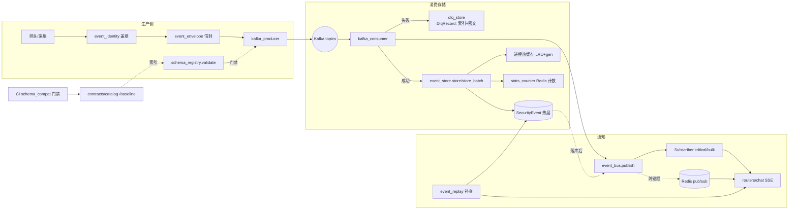

#### 事件生命周期

1. **盖章（生产入口）**：`event_identity.ensure_identity` 生成/保留 `eventId`（已有 ID 一律保留，重试不换 ID），补 `correlationId`（缺省=eventId）、`traceId`、`parentEventId`（仅派生事件）；`event_envelope.stamp_identity` 可再补 schemaVersion/occurredAt。派生走 `derive_from`：新 eventId + parent 指向原事件 + 继承 correlation_id。
2. **出站门禁**：`kafka_producer` 发送前 `schema_registry.validate(topic, body)`，有契约 topic 校验失败则 produced=0。
3. **消费分叉**：
   - **失败路径 → DLQ**：`persist_dlq_failure` 先把失败状态提交 PG（DlqRecord：topic/partition/offset 唯一，错误脱敏，载荷 `field_cipher.seal_payload` 整包密文，body 超过 512KB 走 `shrink_to_fit` 丢值保键名并置 `payload_complete=False`），成功后等 Kafka DLQ acks=all 再 `mark_kafka_acked`；任一步失败调用方**不得提交原消息 offset**。后续 `replay_record` 受控重放：置 `replaying`+claim 60s → 打开密文（密钥损坏/载荷不完整/undecodable 一律 blocked）→ 按原 topic 重发原 eventId → 成功置 `replayed`（幂等返回上次结果）；下游靠 eventId 幂等收敛。保留期 `dlq_retention_days=30`。
   - **成功路径 → 落库**：`event_store.store/store_batch` 按 eventId 幂等检查（SELECT 命中→复用旧行；并发撞 `security_events.event_id` 唯一索引→IntegrityError 回滚后返回已存在行）→ INSERT `SecurityEvent`（analyzed=False）→ commit → `stats_counter.inc_insert` → 写进程热缓存（LRU ≤2000 条，TTL≈20s，带代次 gen）。**此时事件才算"存在"**（stored_id 诞生，成为 API/SSE 游标）。
4. **实时通知（总线）**：落库后 `event_bus.publish("security_event", {event_id: stored_id,...})`：`classify_event` 定 lane（critical 9 类/bulk 界面状态）。BusEvent 进每个 Subscriber：critical 队列（≤200）满不踢已入队、带 id 的记入 `gap_ids`(≤32)；bulk（≤500）同键 coalesce 只留最新。Redis `soc:event_bus` 广播跨进程（at-most-once，origin+event_id 60s LRU 去重）。
5. **SSE 投递与断线补查**：`routers/chat.py` 严格按「先 subscribe → 再 `load_sse_replay` 查库 → `should_skip_live` 丢重叠实时副本」。游标 = `Last-Event-ID` 中的 SecurityEvent.id。补查分页 500/批、上限 2000；新连接只发最近 100 条；游标 > max_id → cursor_reset。`hydrate_notice` 对审计/响应通知回源 DB。**DB 是事实源：总线丢失靠游标补齐。**
6. **状态更新与缓存失效**：审计写回走 `apply_event_update/commit_then_invalidate`：**先** commit DB → `invalidate`（bump 本进程 gen + 丢本地缓存）→ Redis 广播（远端按 gen 比较，拒绝旧快照写回）。`get_by_id` 只信任「analyzed 且含 `_audit_llm` 且 gen 匹配且未过期」的缓存。随后 `inc_analyzed_done` + `publish("audit_complete")`。
7. **容量/TTL 汇总**：内存层——subscriber critical 200 / bulk 500、gap_ids 32、history 500、热缓存 2000×TTL≈20s；补查层——REPLAY_PAGE 500 / REPLAY_CAP 2000 / INITIAL_TAIL 100；DLQ 层——body 512KB / 保留 30 天；持久层——PG 无限保留（温/冷层未实现）。

#### B2 批次总图

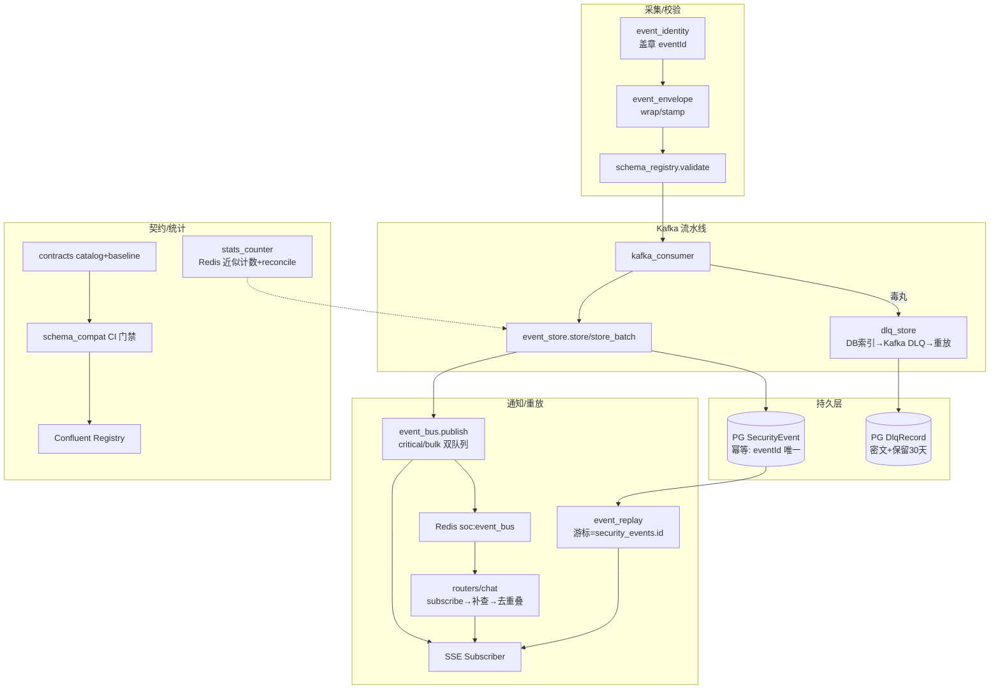

**关键结论**：架构核心是「**DB 为事实源、总线为提醒、游标为重放依据**」——`security_events.id` 贯穿 SSE 补查（event_replay），`eventId` 贯穿幂等落库（event_store 唯一索引）与 DLQ 重放（dlq_store），代次 gen 协议保证跨进程热缓存一致性。最需关注的风险是温/冷层归档未实现、无 id critical 的不可补查丢弃、以及 snake_case 数字 eventId 的幂等键漂移。

### B3 检测引擎 / Sigma / 流处理桥 / 迁移（M06–M09）

#### M06 检测引擎（backend/sigma_detector.py, correlation_engine.py, anomaly_detector.py, sliding_window.py, rule_manager.py, detection_contract.py, cad.py）

**职责**：
- `sigma_detector.py`：Sigma 风格单事件规则匹配（legacy 11 条内置规则 + 按配置 `sigma_engine` 分发到 pySigma 引擎），聚合滑动窗口、ATT&CK 提取（`extract_attack_techniques`）。
- `correlation_engine.py`：跨事件攻击链关联（11 个有序子序列模式 + 枢纽主机跨源串联 + 时间窗分组 + 共同目标实体关联），行为体归因（src_ip / 身份字段 / 不可归因三态）。
- `anomaly_detector.py`：统计异常检测（证据维度 statistical_deviation/rarity/target_concentration/severity_shift + 上下文维度 temporal/severity_prior，固定分母防冷启动误报），基线 Redis 持久化、基线代数、五态报告。
- `sliding_window.py`：会话消息滑动窗口（时间+数量淘汰），被淘汰消息入 evicted 列表供 Agent 回溯；Redis/内存双后端。
- `rule_manager.py`：Sigma 规则与响应策略的 CRUD/版本快照/回滚/沙箱回放测试/调优建议入口。
- `detection_contract.py`：五态检测结果契约（detected/not_detected/inconclusive/error/partial）与 `combine_status` 聚合。
- `cad.py`：审计监督三件套——穿透式验证器（证据 ID + 引用原文核验）、上下文审计器、跨进程熔断器（CLOSED/OPEN/HALF_OPEN，DB 单行 CAS 持久化）。

**对外接口**：
- `sigma_detector.sigma_detector.detect_for_event(log_data)->dict`（供 `ingest_pipeline.py:376` 线程池调用）；`detect/detect_batch/stats`；`extract_attack_techniques(log_data)->list[str]`。
- `correlation_engine.analyze(session, session_id, time_window_minutes)->CorrelationResult`，调用方 `routers/ops.py:1261`、`scheduler.py:373`、`agents/base.py:86`、`agents/agent_d.py:55`；`infer_threat_type/infer_threat_classification`（`temporal/activities.py:319`、`response_engine` 等）。
- `AnomalyDetector.analyze(event)->AnomalyReport`（`ingest_pipeline.py:352`）、`set_redis/load_baselines_from_redis`（app 启动）。
- `SlidingWindow.add_message/get_window/get_evicted`（`agents`、`tool_registry`）。
- `RuleManager.list/get/create/update/delete_rule、save_version/get_versions/rollback、sandbox_test、get_tuning_suggestions`（`routers/ops.py:1000-1057`）。
- `detection_contract.DetectionResult/AnalysisStatus.build/combine_status`（ingest_pipeline 融合层）。
- `cad.verifier.verify_claims(...)->list[VerificationReport]`、`circuit_breaker.get_status()/record_*`（`agents/agent_cad.py`、`routers/audit.py`、`observability/watchdog.py:180`、`temporal/activities.cad_verify:520`）。

**依赖**：内部 — `models`(SecurityEvent/RuleVersion/CadCircuitState)、`event_store`、`detection_contract`、`response_engine.threat_taxonomy`、`response_engine.policy_store`、`sigma_engine.store`、`feedback_loop`、`core_metrics`、`capacity.check_query_bounds`、`prompts`、`tool_registry`、`config.settings`。外部 — sqlalchemy(async)、redis.asyncio；（cad/规则）无 LLM 调用。

**调用关系**：事件接入 `ingest_pipeline` → `sigma_detector.detect_for_event`（写 `_sigma`）+ `anomaly_detector.analyze`（写 `_anomaly`）→ 审计/融合层（`veto_gates` 读 `_sigma/_anomaly`）→ 告警；`scheduler/routers/ops/agents` → `correlation_engine.analyze`（读 SecurityEvent 表）→ AttackChain → ops API / 响应编排；`routers/ops` → `rule_manager` → `sigma_engine.store` 写 YAML → `sigma_detector.reload()`；Temporal `cad_verify` → `cad.verifier/circuit_breaker` → 熔断状态 → `veto_gates` 阻断自动响应。

**风险点**：
- [P1] rule_manager.py:443-444 — 沙箱测试用 `SigmaDetector.__new__(SigmaDetector)` 绕过 `__init__`，而 `detect()` 无条件调 `self._maybe_cleanup()`（sigma_detector.py:343），实测复现 `AttributeError: '_last_cleanup'` → **sandbox_test 对任何事件必然抛异常**。
- [P2] sigma_detector.py:148 — 聚合窗口 `self._agg_windows` 纯进程内存；FastAPI 与 Temporal worker 多进程各持独立窗口，同一 src_ip 的暴破阈值计数被分片，聚合判定不可靠。
- [P2] correlation_engine.py:558-567 — 回溯查询 `limit(5000)` 截断静默：超 5000 条事件的会话被截掉的部分不产生任何 `partial`/截断标记，链匹配结果仍可报 `detected`。
- [P2] anomaly_detector.py:1000-1007 — 事件无时间戳时 `now_ts = time.time()`，无时间戳事件全部落入当前小时桶（200 条回填使 σ 顶到 10.0），误报方向。
- [P2] cad.py:624-631 — 熔断 CAS 版本冲突时重载权威副本并**丢弃本地增量**；安全闸门的熔断计数可能被并发写延迟。
- [P3] sigma_detector.py:627-631 — legacy 端口提取 `str(host).rsplit(":", 1)[-1]` 见冒号就拆，IPv6 目标会把地址段当端口误配 `host_port` 规则。
- [P3] rule_manager.py:133-151 — legacy 模式 `create_rule` 仅 `append` 内存列表，无 YAML/版本持久化，重启即丢；与 pySigma 模式语义分叉。

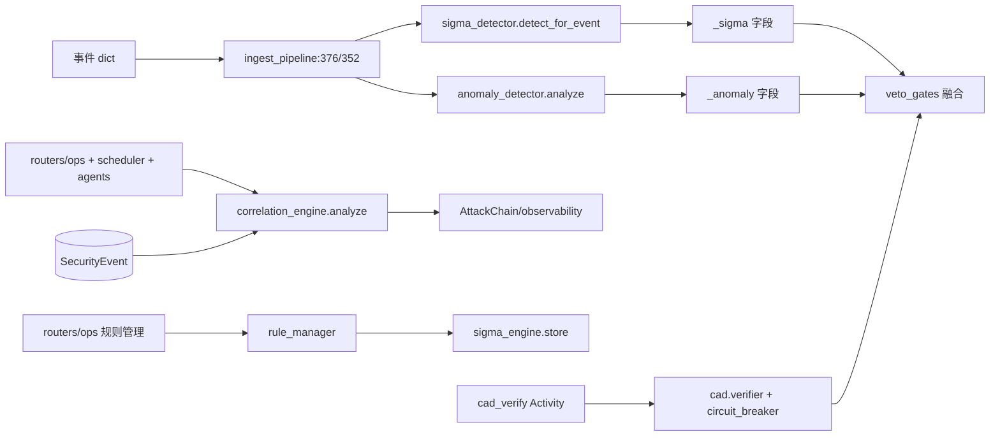

#### M07 Sigma 规则引擎（backend/sigma_engine/）

**职责**：
- `engine.py`：`PySigmaDetector` —— pySigma + 自定义 SQLite backend 把 YAML 规则编译成 SQL 谓词快照（不可变 `_SigmaSnapshot` + `_ConnLease` 引用计数释放），每事件建私有 `:memory:` 单行表逐规则求值；规则预筛（presence-必须列）、聚合候选发布（Kafka `sigma-hit` topic → Flink 阈值窗口）、降级 legacy 留痕。
- `store.py`：规则即文件的 CRUD（原子写 YAML，x-soc-* 扩展字段，x-soc-version 递增）。
- `mapping.py`：平台字段 → Sigma 标准字段别名表（url→cs-uri-query 等，哈希按算法路由）。
- `backend_keywords.py`：支持 keywords 全文搜索（文本 OR LIKE + 数值 CAST 相等）。
- `dry_run_import.py` + `tools/`：候选规则 dry-run 报告、拉 SigmaHQ 候选、造样本、灰度 promote。
- **规则规模**：`rules/` 20 个 yml（SIG-00x 自研）；`rules_community_active/` **139** 个 yml（SigmaHQ 灰度 C-00x）；`rules_community_candidate/` 0 个；`rules_selfplay_shadow/` 0 个。

**对外接口**：
- `sigma_engine.build_pysigma_detector(enforce=False)->PySigmaDetector`（唯一被 `sigma_detector._build_default_detector:706` 消费）；`detector.detect/detect_for_event/detect_batch/reload/stats`。
- `store.list_rules/get_rule/create_rule/update_rule/delete_rule/toggle/shadow`（`rule_manager` 调用）。
- `mapping.apply_mapping(event)->dict`（engine `_detect_with_snapshot:741-743`、dry_run）。

**依赖**：内部 — `sigma_detector.DetectionResult`、`normalization.canonical_matching_view`、`kafka_producer.publish_sigma_hit`、`core_metrics.record_ingest`、`self_play.sigma_export.repair_selfplay_yaml`、`config.settings.sigma_engine`。外部 — pysigma、sqlite3、yaml、kafka。

**调用关系**：`config.sigma_engine=pysigma` → `sigma_detector` 全局单例即 PySigmaDetector → 每事件：`canonical_matching_view` → `apply_mapping` → 私有 sqlite 单行表 → 139+ 条编译 SQL → 命中 → 聚合规则降级动作并异步发 `sigma-hit` 候选 → Flink 窗口凑满阈值 → 聚合告警回流 backend；CRUD（rule_manager→store）写 YAML 后 `reload()` 原子换快照。

**风险点**：
- [P2] engine.py:750-753 — 每事件新建 `sqlite3.connect(":memory:")` + DROP/CREATE/INSERT，139 条规则逐条 `cur.execute`；预筛仅能跳过"段死"规则，高吞吐下 CPU 成本线性放大。
- [P2] engine.py:440-447 — `_rule_files()` 在**加载期**调用 `repair_selfplay_yaml` 就地改写 `rules_selfplay_shadow/` 下 YAML：检测引擎读路径带写副作用，与 store CRUD 并发时存在文件竞争。
- [P2] store.py:229 — `delete_rule` 直接 `os.remove` 硬删规则文件；DB 版本快照可回滚，但文件级误删无回收站。
- [P2] engine.py:1046-1059 — `_main_loop` 缓存主事件循环供跨线程发布；uvicorn reload/loop 重建后陈旧 loop 使候选发布持续走 `schedule_error` 丢弃（有指标但无自愈）。
- [P3] engine.py:65 — `SIGMA_CONFIDENCE_NUM` 与 `audit_triage`/`ingest_pipeline` 三处手工复制同一映射，漂移即两条链路处置门槛不一致。
- [P3] tools/promote_to_shadow.py:86-88 — 灰度写入用裸 `open(...,"w")` 非原子写，中断留下半截 YAML 使该规则加载失败。

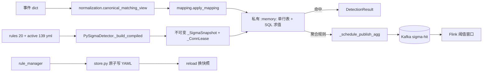

#### M08 流处理桥与稳定器（backend/temporal/, backend/stabilizer/）

**职责**：
- `temporal/`：把 4 层 Agent 审计编排（Decomposer→ToolBuilder→Executor→Reviewer）搬上 Temporal。`workflows.py` 定义 `AuditPipelineWorkflow`（多轮补审→save_result→cad_verify→veto 闸→trigger_response）与 `SelfPlayWorkflow`；`activities.py` 实现可重试 Activity（含 faithfulness 闸 fail-closed）；`client.py` 惰性连接 + Redis in-flight 准入（P0 专槽）+ shed/降级语义；`worker.py` 独立常驻进程（默认并发 12）。
- `stabilizer/`：LLM 脏输出 → 可执行工具调用的四阶段稳定器（JsonRepair → ToolResolver → ParamCoercer → Schema 校验），失败构造中文 feedback_to_llm。

**对外接口**：
- `temporal.client.start_audit_workflow(session_id, event_id, log_data, anomaly_score, anomaly_reasons, max_rounds, tier)->bool|"shed"|False`（`log_ingestion/scheduler/audit_pq/agents/audit_single` 调用）；`start_selfplay_workflow(cfg)`；`inflight_stats/pop_workflow_tier`。
- `temporal.worker.run_worker()`（`python -m temporal.worker` 入口）。
- `stabilizer.stabilizer.stabilize(raw_output)->StabilizerResult`；`JsonRepair.repair(raw)->(dict|None, err)` —— **生产唯一消费点**是 `audit_schemas.py:355` 的 JSON 兜底。

**依赖**：内部 — `agents.{decomposer,tool_builder,executor,reviewer}`、`veto_gates.{merge_audit_rounds,evaluate_auto_response_gate,extract_non_llm_signals}`、`faithfulness_gate`、`event_store/event_bus/audit_pq`（Redis 桥）、`correlation_engine.infer_threat_type`、`models`、`config.settings`、`metrics`。外部 — temporalio、redis.asyncio；stabilizer 自包含零依赖。

**调用关系**：事件命中审计条件 → `log_ingestion` → `client.start_audit_workflow`（in-flight 满→"shed"→PQ/降级）→ worker `AuditPipelineWorkflow` 循环 `audit_round` Activity（LLM 四层）→ `save_result`（merge+faithfulness+落库 `_audit_llm`）→ `cad_verify`（CAD 回源 DB）→ `evaluate_auto_response_gate` → 允许则 `trigger_response`；Temporal 不可用/超时 → 调用方回退进程内 async 编排。agents 执行工具时的 LLM 输出经 `audit_schemas`（必要时用 `stabilizer.JsonRepair` 兜底）解析。

**风险点**：
- [P2] stabilizer 模块整体 — grep 证实生产代码仅 `audit_schemas.py:355` 使用 `JsonRepair`；`FunctionCallStabilizer/ToolResolver/PARAM_SCHEMAS` 只被 tests 引用：编排器处于休眠状态，其工具白名单（tool_resolver.py:25-50）与 `tool_registry` 真实工具名**双份手工维护**，一旦启用即漂移。
- [P2] temporal/client.py:75-91 — in-flight 准入是 `GET` 后再 `INCR` 的 check-then-act，非 Lua 原子：并发 shed 判定可超卖名额；槽泄漏只能靠 3600s TTL 兜底。
- [P2] temporal/workflows.py:133 — Workflow 体内 `from veto_gates import evaluate_auto_response_gate`：veto_gates 及其传递依赖若在历史 run 重放期间变更，破坏 Temporal 确定性重放（活动/工作流代码版本无 pin）。
- [P2] temporal/activities.py:225-229 — `_merge_rounds` 与 log_ingestion._merge_rounds / veto_gates 为第三份拷贝，融合语义三处维护，漂移时 Temporal 与 async 路径裁决不同。
- [P3] temporal/workflows.py:48-53 — audit_round start_to_close 600s、最多 2 次重试：重试会整轮重跑 LLM 与工具调用，副作用型工具存在重复执行窗口（当前工具以只读为主）。
- [P3] stabilizer/json_repair.py:109 — 修复策略把所有未转义单引号替换为双引号，正文含撇号的英文文本（`it's`）会被破坏成非法/错误 JSON 语义。

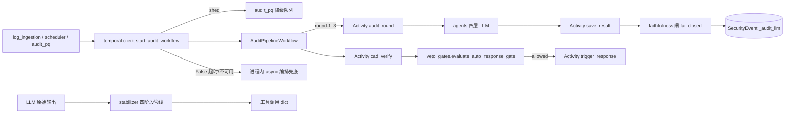

#### M09 数据迁移与修复脚本（backend/migrations/, migrate_pgvector_to_qdrant.py, migrate_qdrant_hybrid.py, fix_embeddings.py）

**职责**：
- `migrations/env.py`：Alembic async 迁移环境；`models.Base.metadata` 为唯一 schema 权威；URL 经 `-x db_url=` 覆盖。
- `migrations/versions/20261023_0001_baseline.py`：唯一 revision（0001_baseline）——空库 `create_all(checkfirst)` 全量建表 + 既有 PG 卷幂等补列（`_LEGACY_PG_STATEMENTS`，仅 postgresql 时执行），天然幂等免 stamp。
- `migrate_pgvector_to_qdrant.py`：把 pg 中 `knowledge_chunks`/`memories` 的 embedding 全量 upsert 进 Qdrant；维度不符向量用当前 embedder 重算并回写 pg。
- `migrate_qdrant_hybrid.py`：回填 hybrid collection（dense + BM25 sparse），补写 `search_lex`，不删旧 dense collection（可用 `rag_hybrid_enabled=false` 回滚）。
- `fix_embeddings.py`：批量为 `len(embedding)<768` 的知识块重算 embedding。

**对外接口**：`alembic upgrade head` / app lifespan 的 `AUTO_MIGRATE=true`；三个脚本均为手工运维 CLI，无被其他模块 import。

**依赖**：内部 — `models`、`config.settings`、`vector_store._ensure_memories_collection/_upsert_qdrant`、`qdrant_store`、`rag.lexical.{encode_sparse,build_search_lex}`、`summary_compression.embedder`。外部 — alembic、sqlalchemy async、qdrant-client。

**调用关系**：app 启动（AUTO_MIGRATE）→ `alembic.command` → `env.py` → `0001_baseline.upgrade`（create_all + PG 补列）；知识库切换 Qdrant 时：`migrate_pgvector_to_qdrant` → `qdrant_store`；启用 hybrid 检索前：`migrate_qdrant_hybrid` → sparse 回填；embedding 模型换档后：`fix_embeddings` → `embedder.embed_many` → 回写 pg。

**风险点**：
- [P2] migrate_pgvector_to_qdrant.py:48-51 — 调私有 `vector_store._upsert_qdrant(r)`，Qdrant 不可用时静默降级仍计入 `done`，迁移"完成"日志可能虚高。
- [P2] migrate_pgvector_to_qdrant.py:109-115 — 维度校验用 `len(new_vec) < expect_dim - 100` 才判失败：期望 768 时 **668~767 维**的降级向量会被写进 Qdrant 并回写 pg，造成检索期维度污染。
- [P2] fix_embeddings.py:21 — `len(r.embedding) < 768` 硬编码 768，未读 `settings.embedding_dim`；换 embedding 模型后脚本语义失效。
- [P2] migrate_qdrant_hybrid.py:37 — `select(KnowledgeChunk)` 全表无 limit/分页，知识库大时迁移进程 OOM 风险。
- [P3] migrations/env.py:33-40 — root logger 恢复逻辑仅在 `_saved_handlers` 非空时执行，alembic 的 console handler 可能残留到宿主进程。
- [P3] 迁移链仅单 revision：`_LEGACY_PG_STATEMENTS`（50+ 条）与新 ORM 模型需双处同步，漂移时 create_all 与补列语句不一致。

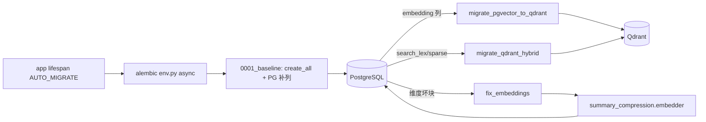

#### B3 批次总图：检测链路（事件流入 → 检测 → 告警流出）

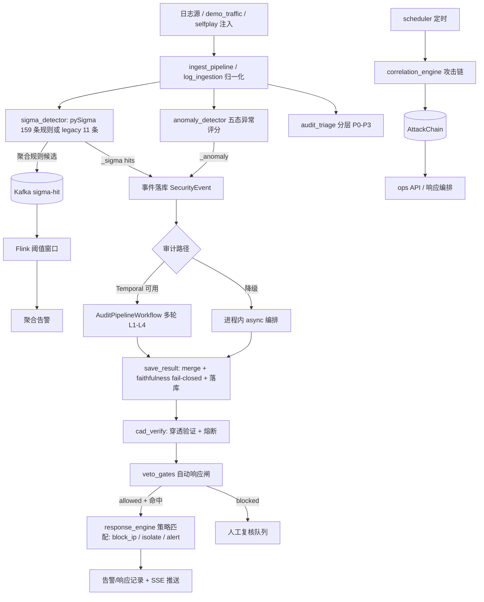

**关键结论**：检测主链（M06/M07）工程质量高——错误必留痕（五态契约、partial 语义、快照原子换装）；最严重的实测缺陷是 `rule_manager.sandbox_test` 的 `SigmaDetector.__new__` 绕过初始化导致必然 AttributeError（P1，已复现）；其次是稳定器编排器休眠且工具白名单双份维护、多进程聚合窗口/基线不分片两个架构性 P2。

### B4 审计链 / 广播地理（M10–M11）

#### M10 审计链（防篡改账本）（backend/audit_types.py, audit_schemas.py, audit_cache.py, audit_pq.py, audit_spill.py, audit_trail.py, audit_worker.py, audit_triage.py, audit_dead_letters.py）

**职责**：事件审计流水的不丢不漏基础设施 + 控制面操作审计的防篡改账本。子模块分工：`audit_types/audit_schemas` 定义 Audit-LLM 流水线数据结构与 LLM 输出的 Pydantic 强校验；`audit_triage` 按 L0/L1 信号打分分流（tier/lane）；`audit_worker` 有界 worker 池；`audit_pq` Redis ZSET 溢出池；`audit_spill` 本地 fsync 恢复日志；`audit_cache` 同签名结论复用；`audit_dead_letters` 丢任务死信闭环；`audit_trail` 操作审计哈希链（HMAC）。

**对外接口**：
- `audit_triage.score_event(log_data, anomaly_score, *, fastpath_strong, asset_criticality) -> TriageResult`；`admit(triage, *, usage_pct, over_budget, inflight_pct...) -> TriageResult`；`needs_llm/uses_temporal/uses_llm_single/lane_max_rounds/lane_timeout_s/pq_ttl_for_tier` — 调用方：log_ingestion.py:360-386、audit_worker.py:219/246、audit_pq.py:66-76
- `audit_worker.submit(*, session_id, event_id, log_data, anomaly_report, from_overflow) -> str`（返回 queued/shed/deferred/spilled/rejected/overflow/direct）、`cancel(event_id)`、`holds(event_id)`、`start()/stop()`、`recover_unanalyzed(limit)` — 调用方：log_ingestion、kafka_consumer、ingest_pipeline、scheduler、app、lifecycle、temporal/worker
- `audit_pq.enqueue(...)`、`pop_highest()`、`pop_first_runnable(agent_full, window)`、`depth()`、`purge_stale()` — 调用方：audit_worker.py:378-396、scheduler.py:766
- `audit_cache.get(log_data)/put(log_data, verdict)` — 调用方：log_ingestion.py:401/557
- `audit_spill.append_record/read_records/drop_event/compact/replace_records` — 仅 audit_worker
- `audit_dead_letters.record(event_id, reason, detail)`、`replay_dead_letters(limit)` — record 被 audit_pq._dead_letter 调；replay 由 app.py:444-445 启动时调
- `audit_trail.log_action(...)`、`log_action_sync`、`log_from_request`、`@audited(action=...)`、`flush_fallback(session)`、`verify_chain(session)`、`list_trail(session, ...)` — 调用方：case_manager、work_order_service、source_registry、asset_manager、mcp_guard/guard_server、routers/{audit,causal,logs,dlq,kafka,ops,response}、self_play/reviewer
- `audit_schemas.validate_sub_auditor_output / validate_synthesis_output / validate_reviewer_output(raw_text) -> (dict|None, errors)`、`extract_json` — 调用方：agents/*、self_play/*
- `audit_types.SubTask/ToolCall/ToolResult/AuditResult/FinalVerdict` dataclass 及 `AUDIT_DEPTH_*` 常量

**依赖**：内部 — config.settings、metrics/core_metrics、models、security_crypto（canonical_json/hmac_hex）、kafka_producer、drain、anomaly_detector（AnomalyReport）、veto_gates、log_ingestion（`_audit_pipeline`/`_audit_task_done`）、stats_counter、stabilizer.json_repair（schemas 兜底）。外部 — redis（异步，ZSET+Lua）、sqlalchemy、pydantic、prometheus_client、kafka。

**调用关系**：
- 写路径①（事件审计流水）：log_ingestion（ingest 后）→ `audit_triage.score_event`/`admit` → `audit_worker.submit` → [内存 PriorityQueue | `audit_pq.enqueue`(Redis) | kafka_producer overflow topic | `_p0_overflow` deque] → worker `_loop`×N → `log_ingestor._audit_pipeline` → 完成 `audit_spill.drop_event`（墓碑）；入审计前 `audit_cache.get` 命中则跳过，出结论后 `audit_cache.put`
- 写路径②（溢出/崩溃恢复）：scheduler._audit_pq_drain_loop → `audit_pq.pop_first_runnable` → 回灌 worker；`audit_pq._dead_letter` → `audit_dead_letters.record` → models.AuditDeadLetter；app 启动 → `replay_dead_letters` → `audit_worker.submit`；worker.start → `audit_spill.read_records` → 回放 → `replace_records`
- 写路径③（操作审计哈希链）：各业务服务/路由 → `audit_trail.log_action` → `_persist_entry`（取 `_latest_row_hash` → `_chain_for` → models.AuditTrail 落库 commit）；DB 失败 → `_enqueue_fallback`（内存 ≤500 条）→ scheduler 60s / POST /ops/audit-trail/flush → `flush_fallback`
- 下游：metrics（soc_audit_queue_depth、soc_audit_pq_*、soc_audit_dead_letter_*）、core_metrics.record_cache

**风险点**：
- [P1] audit_trail.py:353-386 — `verify_chain`（防篡改验证的唯一入口）在生产代码中零调用方，grep 仅 backend/tests/test_audit_chain.py 引用；链断了没有任何运行时告警路径，防篡改承诺依赖人肉跑测试。
- [P2] audit_trail.py:91-104 — `_chain_for` fail-open：`except → return "", ""`，哈希计算失败时**空哈希照常落库**；verify_chain 自认空 row_hash 行会计为断点，即攻击者/故障可制造断链且业务无感知。
- [P2] audit_trail.py:78-88 + 231-251 — `_latest_row_hash` 取链尾与 `session.add/commit` 之间无锁无唯一约束：两个并发 `log_action` 拿到同一 prev_hash → 哈希链分叉；分叉后 verify_chain 判断链但无修复/告警闭环。
- [P2] audit_dead_letters.py:119-135 — 重放判定把 `resubmit:deferred` 记为终态并写 `replayed_at`，但 deferred 可能只是进了**易失** `_p0_overflow` deque（Redis PQ 与 Kafka 均失败时）；进程崩溃后该任务实际丢失，死信已标记"已重放"，形成假闭环。
- [P2] audit_dead_letters.py:89-116 — `replay_dead_letters` 逐行重放、未按 event_id 去重：同一事件因不同 reason 产生多条死信时会重复 `submit`，同一事件被双重审计。
- [P3] audit_worker.py:503 — `asyncio.current_task().cancelling()` 是 Python 3.11+ API，低版本直接 AttributeError 使 `_run_job` 的取消保护失效。

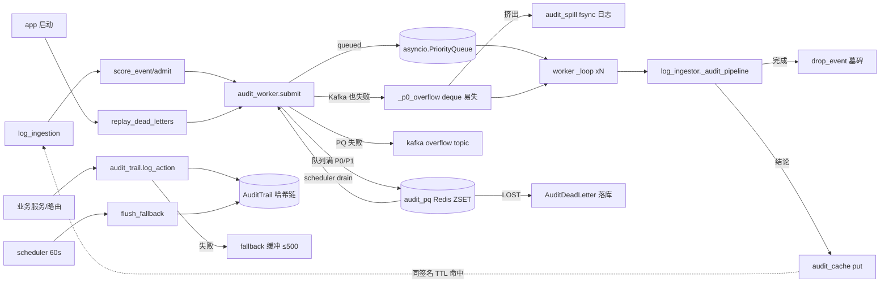

#### 审计链机制

**1. 哈希链/签名构造（audit_trail.py）**：每条 `AuditTrail` 行携带 `prev_hash`/`row_hash`：`row_hash = hmac_hex(canonical_json({actor, action, target_type, target_id, before, after, reason, prev_hash, created_at}))`。HMAC 密钥来自 `security_crypto.control_hmac_key()`（缺密钥 fail-closed 抛异常）；`canonical_json = json.dumps(sort_keys=True, separators=(",",":"))` 保证可重算。`prev_hash` 按 `id desc` 取库中最新一行的 `row_hash`，首条为 64 个 `'0'`（GENESIS）。注意这是**对称 HMAC** 而非非对称签名：能拿到 HMAC 密钥的一方可以重算整条链，防篡改强度取决于密钥保管。

**2. 写入路径**：入口 `log_ingestion` 先查 `audit_cache.get`（key=type|src|dst|sigma_rules|sev|sha256(msg)[:16]，TTL 默认 600s，内存 LRU 4096 + 可选 Redis）；未命中 → `audit_triage` 定 tier/lane → `audit_worker.submit`：队列未满 → 内存 PriorityQueue；队满且 P0/P1（never_drop）→ 依次尝试 Redis ZSET → Kafka overflow topic → 进程内 `_p0_overflow` deque（易失，容量 10000，被挤出时逐条 `_persist_volatile`：先 Kafka 再 `audit_spill.append_record` fsync，全失败记 `lost`）；P2/P3 队满 → 返回 `overflow`。**spill 恢复日志**：追加式 JSONL，普通行=任务、`_drop:true`=墓碑；>1MB 时 compact（临时文件+fsync+`os.replace` 原子替换）。**崩溃恢复三路**：worker.start 重放 spill 日志；`recover_unanalyzed` 扫 `SecurityEvent.analyzed==False` 重新 submit；启动时 `replay_dead_letters`。优雅停机把队列剩余+inflight 全部 `_persist_volatile`，返回 `{spilled, volatile_lost, ...}`。

**3. 工作线程模型**：单进程 asyncio 协程池（N=`audit_workers` 默认 12 个 `_loop` + PriorityQueue max 2000 + `_inflight` 字典 + `_p0_overflow` deque）。Redis PQ 的出队只有一条路：scheduler `_audit_pq_drain_loop`（间隔 0.2s、批量 20，agent 槽满时 `pop_first_runnable(agent_full=True)` 跳过队头 Temporal-agent 任务）——因此 enqueue 与 dequeue 天然不对称，判断积压要看 `soc_audit_queue_depth`+`soc_audit_pq_depth`+drain 阻塞计数三件套。

**4. triage 与 dead letter 语义**：融合 sigma 命中（`requires_aggregation` 不计入融合置信度）、anomaly 分、事件置信度取 max 为 fused_conf，加权得 priority(0-100)。分档：**P0 需 ≥2 强信号** → llm_agent(Temporal 深度)；P1 → llm_single；流量型（DDoS/扫描/flood）默认 P2/tools_only 零 LLM；其余 P3/rule_close。检测器不完整 → priority+20 且禁止 rule_close（把"未分析"与"真阴性"区分开）。`admit` 按预算水位降车道：soft 只关 P3；hard/超预算时 P0 降为 llm_single 最小 1 hop（**永不关死 P0**），P1→tools_only，P2/P3→rule_close。dead letter：Redis PQ 三个不可恢复丢失点（payload_missing/payload_corrupt/expired）→ `AuditDeadLetter` 表，(event_id, reason) 唯一幂等。

**5. 防篡改如何验证**：`verify_chain(session)`：按 id 升序遍历全部 AuditTrail 行，双重检查——①行内完整性：用行字段+行内 prev_hash 重算 HMAC 比对 `row_hash`；②链接完整性：`row.prev_hash == 前一行.row_hash`。返回 `{ok, checked, first_break_id}`。事件审计流水的"防丢失"不靠哈希链，而是靠：spill 墓碑日志 + PQ 闭合恒等式 + 死信落库闭环 + 启动三路恢复；两套机制分别覆盖控制面与数据面。

#### M11 广播与 IP 地理（backend/ledger_broadcast.py, attack_geo_broadcast.py, geo_ip.py, ip2region/, geo_data/）

**职责**：面向无 JWT 大屏 kiosk 的 SSE 免鉴权数据通道。`ledger_broadcast` 每 `ledger_interval_s` 秒把"入队=落库+幂等吸收"账本等式帧推上 event_bus 的 `ledger` 频道；`attack_geo_broadcast` 定时取最近 N 条事件的 src_ip 聚合，经 `geo_ip`（ip2region v4 xdb 离线库，~11MB 全内存 buffer 模式）解析为省/国坐标点，推 `attack_geo` 频道；`ip2region/` 是官方 binding 的 vendored 副本。

**对外接口**：`ledger_broadcast.start()`（lifespan 调）；`attack_geo_broadcast.start()`（lifespan 调）；`geo_ip.lookup(ip) -> dict|None`（lru_cache 8192）、`geo_ip.resolve_point(ip) -> {lat,lon,label,...}|None` — 调用方：attack_geo_broadcast.py:42/72（唯一生产调用方）；`ip2region.searcher.new_with_buffer(version, c_buffer) -> Searcher`、`Searcher.search(ip) -> str`。

**依赖**：内部 — config.settings、event_bus.publish、stats_counter.snapshot、models（SecurityEvent+async_session）、prometheus_client REGISTRY。外部 — 无外呼（geo_data/ip2region.xdb 本地文件，10.6MB）。

**调用关系**：app.py lifespan → `ledger_broadcast.start()` → `_tick`：`_sample(...)` Prometheus 指标 + `stats_counter.snapshot()` → `event_bus.publish("ledger", frame)` → SSE → 大屏；`attack_geo_broadcast.start()` → `_tick`：SQL 取 SecurityEvent 最近 window 条 → src_ip Counter 聚合 → `geo_ip.resolve_point`（→ ip2region Searcher buffer 二分）→ `event_bus.publish("attack_geo", {home, points,...})` → SSE → 态势图。

**风险点**：
- [P2] geo_ip.py:146-147 — `if not ip or ":" in ip: return None`：IPv6 源一律返回 None，态势图对 v6 攻击来源**静默归零**（ip2region/util.py:155 已定义 IPv6 支持，属于能力浪费 + 数据盲区）。
- [P2] geo_ip.py:44-45 — xdb 加载失败后 `_searcher = False` 永不重试：文件修复必须重启进程才能恢复地理解析，期间所有 points 为空且无独立告警。
- [P2] ledger_broadcast.py:91/101-105 — 各窗口增量全部 `max(0, ...)` 钳位：计数器回退（Redis 重置、进程重启错位）造成的**负差异被吞掉**，账本等式永远"闭合"，真实对账异常不可见——与"对账"目的相悖。
- [P2] geo_ip.py:152-153 + 140 — `lookup` 持全局 `threading.Lock` 执行 `s.search`，且在 async `_tick` 中同步调用：cache miss 并发时全部串行等锁并阻塞事件循环。
- [P3] ledger_broadcast.py:35-50 — `_sample` 每帧遍历 REGISTRY 全部指标的全部样本线性求和，指标增长时每 tick 开销线性上升。
- [P3] attack_geo_broadcast.py:62 — `_SEV_ORDER` 字典在 for 循环体内每行重建（应提为模块常量）。

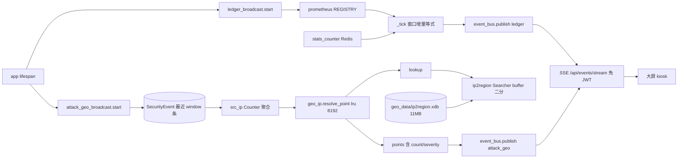

#### B4 批次要点

M10 是"控制面 HMAC 哈希链 + 数据面多级溢出（内存 PQ→Redis ZSET→Kafka→fsync 日志→死信表）+ 三路启动恢复"的双层账本；最大缺口是 `verify_chain` 无运行时暴露（P1）与哈希链并发分叉/fail-open 空哈希（P2）。M11 两个广播模块结构同构（定时 tick→聚合→event_bus→SSE），主要风险在 IPv6 静默丢失、xdb 加载失败不重试、账本钳位吞掉对账异常。

### B5 多智能体编排 / 质量守门（M12–M13）

#### M12 多智能体编排（LLM）（backend/agents/、llm_enhancer.py、llm_limiter.py、context_stream.py、memory_tree.py、summary_compression.py、prompts/）

**职责**：
- Audit-LLM 四层流水线组件：Decomposer（定深+子任务）→ ToolBuilder（子任务→工具调用的确定性映射）→ Executor（并行工具→Chunker 分块→SubAuditor 并行子审核→LLM 汇总→deep 档 deep_analyze/recheck）→ Reviewer（复核、只准降级）。
- 旧 A/B/C/D 会话式 Agent（`BaseAgent.process`）：A 分析、B 决策、C 报告、D 兜底审查（找前序遗漏），当前为兼容保留路径。
- CADAgent（独立监督）：穿透式验证 evidence_trail 断言 + 上下文审计 + 熔断器，不参与内容生产。
- audit_single：`llm_single` 车道本进程单次 LLM 快审（1 次调用、15s 超时、禁 Temporal）。
- LLM 基础设施：`summary_compression.LLMClient`（缓存/预算/重试/降级契约的唯一出口）、`llm_limiter`（全局 HTTP 并发闸+P0 预留槽+每分钟限速）、`llm_fallback`（降级响应识别）、`llm_enhancer`（旁路 LLM 增强的模块预算+业务缓存）、`context_stream`（Redis 持久化上下文流）、`memory_tree`（无压缩记忆索引树）、`prompts/loader`（Jinja2 模板集中渲染，默认严格变量校验）。

**对外接口**：
- `BaseAgent.process(session, user_input, session_id, agent_context) -> dict`；`build_security_context(...) -> str`；`llm_chat(messages)`（base.py:28/40/153）；`BaseAuditComponent.llm_chat(messages)`（base.py:191）。
- `Decomposer.decompose(event, session_id, anomaly_score, anomaly_reasons, mode, missed_threats) -> dict{audit_depth, sub_tasks, llm_analysis, depth_reason, param_truncations}`（agent_decomposer.py:275）。
- `ToolBuilder.build(sub_tasks, session_id) -> list[ToolCall]`（agent_tool_builder.py:51）。
- `Executor.execute(tool_calls, session, session_id, raw_event, depth) -> AuditResult`（agent_executor.py:95）。
- `Reviewer.review(raw_event, decomposer_output, audit_result, tool_data_raw) -> FinalVerdict`（agent_reviewer.py:42）。
- `SubAuditor.audit(chunk, knowledge_chunks) -> ChunkVerdict`（sub_auditor.py:155）；`Chunker.chunk(events, chain_event_ids) -> list[AuditChunk]`（chunker.py:61）。
- `CADAgent.audit_pipeline(session, event_id, audit_llm_data) / audit_context() / check_circuit_breaker() / reset_circuit_breaker()`（agent_cad.py:47/210/250）。
- `audit_single.run(event_id, session_id, log_data, anomaly_report, timeout_s=15) -> dict`（audit_single.py:222）。
- `LLMClient.chat(messages, temperature) -> str`（summary_compression.py:205）；`EmbeddingClient.embed/embed_batch`；`cost_tracker`（日预算）。
- `LlmLimiter.acquire(tier, timeout)` 异步上下文管理器（llm_limiter.py:145）。
- `llm_fallback.is_llm_fallback(text)->(bool,reason)`、`parse_llm_json`、`should_short_circuit_for_tier(tier)`。
- `llm_enhancer.enhance(*, module, cache_key, prompt_messages, budget_cost_yuan, ...) -> Optional[dict]`（llm_enhancer.py:168）+ `enhance_traffic/.../enhance_sandbox` 便捷入口。
- `ContextStream.load/add/save/linearize`；`MemoryTree.add_leaf/link_to_group/reconstruct_context/find_related`；`prompts.render(name, **vars)`。

**依赖**：内部 — `summary_compression`（所有 LLM/embedding 出口）、`tool_registry`、`audit_types`、`veto_gates`、`grounding_verifier`、`quality_scoring`、`audit_schemas`、`rag/*`、`event_store`、`correlation_engine`、`sliding_window`、`vector_store`、`memory_guard`、`trace_hook`、`cad`、`observability.thought_events`。外部 — httpx（LLM/embedding HTTP）、SQLAlchemy AsyncSession、Redis、Jinja2。

**调用关系**：log_ingestion/temporal → `decomposer.decompose` → `tool_builder.build` → `executor.execute`（内部 `chunker.chunk` → `sub_auditor.audit`×N 并行 → `_synthesize_from_chunks`/`_llm_deep_analyze`/`_llm_recheck`）→ `reviewer.review`；`cad_agent.audit_pipeline` 在落库阶段被调。所有 `llm_chat` → `LLMClient.chat`（缓存→预算→`llm_limiter.acquire`→HTTP）→ 降级时返回 `{"fallback":true,...}` → `llm_fallback.is_llm_fallback` 识别 → 各组件保守收口；SubAuditor → `grounding_verifier.verify_chunk` + `veto_gates.strip_ungrounded_claims`；旧 A/B/C → `sliding_window`/`vector_store`/`memory_tree` 落记忆。

**风险点**：
- [P2] agents/agent_a.py:55-60 — `embedder.embed` 失败返回全零向量（summary_compression.py:632-634），此处未用 `is_degraded_vector` 过滤即 `store_memory`，向量库可积累"看似正常"的零向量脏数据（agent_b.py:58-63 同型）。
- [P2] agents/agent_executor.py:960-991 — SubAuditor 单块异常包装为 `hallucination_risk=1.0` 的保守 verdict，多块同时失败会推高 `avg_hallucination_risk` 触发 hop 早停，整轮退化为 budget_exhausted+人审；容量异常只靠日志可见。
- [P2] memory_tree.py:237-240 — `find_related` 用 timezone-aware `cutoff` 与 DB 读出的 `n.created_at` 比较，若后端返回 naive datetime 将抛 TypeError，攻击链回溯路径中断。
- [P3] agents/agent_reviewer.py:61-63 — `sub_tasks`/`llm_analysis` 取出后未使用（死变量）；:166 `audit_json` 全量注入 prompt 无截断，大 AuditResult 有 prompt 膨胀风险。
- [P3] llm_enhancer.py:73-75 — `unlimited = getattr(settings, "llm_budget_unlimited", True)` 缺省即不限额，超限拦截分支在默认配置下不可达，模块日预算实际只记账。
- [P3] agents/agent_cad.py:187,252 — 外部直接调用私有 `circuit_breaker._load_persisted()`，封装被破坏，重构熔断器 API 时易漏改。

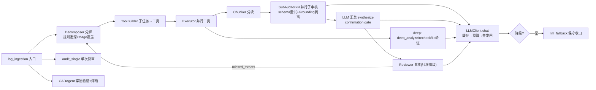

#### M13 质量守门（backend/faithfulness_gate.py, grounding_verifier.py, quality_scoring.py, veto_gates.py, feedback_loop.py）

**职责**：
- grounding_verifier：程序化字段级溯源（无 LLM），Layer1 ID 存在性 / Layer2 evidence_quotes 逐字溯源（核心权重 0.40）/ Layer3 实体一致性 / Layer4 知识库支撑 / Layer5 新鲜度 / Layer6 跨源冲突 / Layer7 链完整性；P0-C-1 五类硬否决（空证据、伪造 ID、引文全假、幻影实体、跨源冲突）直接判 ungrounded。
- veto_gates：程序化硬约束集 —— P0-1 `strip_ungrounded_claims`（ungrounded 不进投票）、P0-3 `apply_confirmation_gate`（confirmed 必须非 LLM 信号+admitted claim+未弃权）、P0-4 `merge_audit_rounds`（禁 OR 合并、未完成≠false_positive）、P0-8 `HopStats` 早停与 `clamp_reviewer_conclusion`（Reviewer 只准降级）、严重度封顶 `cap_reported_severity`、幻影 MITRE 剥离 `sanitize_merged_audit`、tools-only `deterministic_non_llm_verdict`、唯一自动响应权威 `evaluate_auto_response_gate`。
- quality_scoring：`score_verdicts` 是证据质量评分唯一实现（executor 与 veto_gates 共用）；`BudgetLedger` hop 账目。
- faithfulness_gate：合并后/响应前的忠实度闸 —— 词法支撑、ATT&CK/CVE 编号在"可信证据"（排除攻击者可控 message）中的词边界校验、三类失败细分、失败时硬降级（无信号）或软降级（有信号→suspicious+人审）、fail-closed 调 `sanitize_merged_audit`。
- feedback_loop：运营反馈→FP 率统计（分母仅 fp+tp）→ 7 天 FP>15% 自动降级 alert_only → 调优建议；LLM 结论不得自动写回规则。

**对外接口**：
- `grounding_verifier.verify_chunk(claims, events, knowledge_chunks, chunk_id) -> GroundingReport`（grounding_verifier.py:171），单例 `grounding_verifier`。
- `strip_ungrounded_claims(claims, claim_reports) -> (admitted, discarded)`（veto_gates.py:75）；`extract_non_llm_signals(...)`（:208）；`apply_confirmation_gate(...)`（:315）；`merge_audit_rounds(all_rounds, signals) -> dict`（:605）；`hop_stats_from_verdicts(...)`（:792）；`executor_conclusion_floor`（:841）、`clamp_reviewer_conclusion`（:857）、`filter_missed_threats`（:885）、`classify_terminal_state`（:571）、`deterministic_non_llm_verdict`（:944）、`sanitize_merged_audit`（:506）、`evaluate_auto_response_gate(merged, *, cad_report, supervision_ok, ...) -> AutoResponseGate`（:1054）。
- `quality_scoring.score_verdicts(verdicts) -> QualityScore`、`budget_for(chunks, ...)`（quality_scoring.py:160/200）。
- `compute_faithfulness(answer, contexts, query, trusted_evidence) -> dict`、`apply_faithfulness_gate(merged, *, answer, contexts, abstain, non_llm_signals) -> dict`（faithfulness_gate.py:131/277）。
- `feedback_loop.submit_feedback / maybe_auto_downgrade / review_feedback / get_fp_statistics / generate_tuning_suggestions / list_feedback`。
- 调用方：sub_auditor.py:283-307、agent_executor.py:1035-1245、agent_reviewer.py:65-101、log_ingestion.py:1050/:1248、temporal/activities.py:29、cad.py、routers/feedback。

**依赖**：内部 — eval_metrics（词法支撑/实体抽取）、quality_scoring、cad.circuit_breaker、ops_loop（apply_rule_downgrade）、models。外部 — 无直接外部依赖（纯标准库+SQLAlchemy）。

**调用关系**：SubAuditor → grounding_verifier → veto_gates.strip_ungrounded_claims；Executor → quality_scoring/veto_gates(confirmation gate)；Reviewer → veto_gates(floor/clamp)；log_ingestion 合并轮次 → veto_gates.merge_audit_rounds → faithfulness_gate.apply_faithfulness_gate；CAD 报告 + merged → veto_gates.evaluate_auto_response_gate → response_engine；运营反馈 → feedback_loop → ops_loop 降级规则。

**风险点**：
- [P2] faithfulness_gate.py:346-371 — `sanitize_merged_audit` 抛异常时 fail-closed 直接 `threat_detected=False`、severity 降 medium：即使 Sigma/异常强信号背书的真实威胁也会被整体吞成非威胁（防误封与防漏报的取舍偏向前者，且仅 error 日志）。
- [P2] feedback_loop.py:68-72 — `submit_feedback` 收到 false_positive 反馈即把事件 status 置 false_positive，无需经过 `review_feedback` 确认，运营误点即改写事件结论。
- [P3] veto_gates.py:915 — `_STRONG_SIGNAL_REASONS` 常量定义后未被使用，`_strong_signal_basis`（:918-931）手写同义前缀过滤，两处易分叉（死代码）。
- [P3] faithfulness_gate.py:113-128 — wrong_conclusion 判定靠中英文肯定/否定关键词表，措辞规避后一律归入 unsupported_claim。
- [P3] grounding_verifier.py:519-535 — 引文溯源为归一化子串匹配，超长引文截断或近义改写可能通过；实际防线依赖 P0-C-1 硬否决兜底。
- [P3] veto_gates.py:665-672 — 多轮合并置信度权重固定 `[0.6,0.3,0.1]`，`max_rounds` 调大时新增轮次对置信度几乎无贡献。

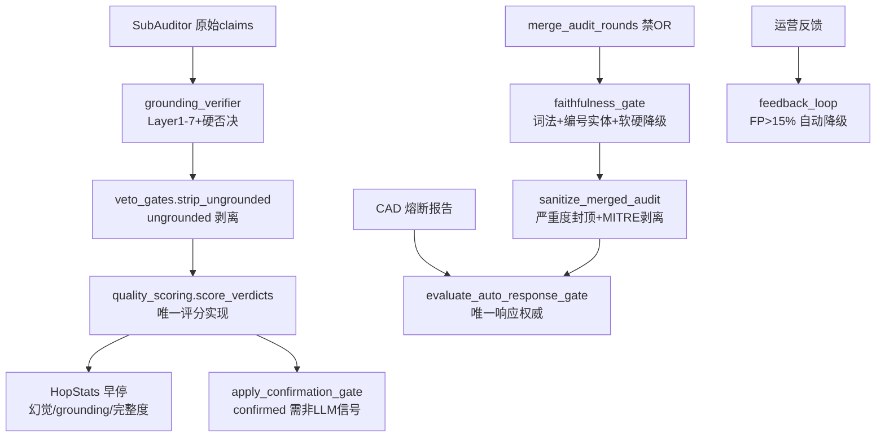

#### 审计工作流编排（事件→结论全链路）

1. **入口分道（triage）**：事件经 `audit_triage` 标定 tier（P0-P3）与 lane；`_audit_pipeline` 按 lane 分派——cache（读缓存结论）、tools_only/rule_close（不进 LLM，`_fallback_analysis` 确定性收口）、llm_single（`audit_single.run` 恰 1 次 LLM）、llm_agent（Temporal 4 层流水线）。
2. **A/B/C/D 旧编排水线**（兼容路径）：A=分析 → B=决策 → C=报告；D=审查独立于流水线事后运行：专查"前序认为安全但危险"的遗漏，输出 missed_events/false_positives JSON。
3. **四层编排（每事件最多 max_rounds 轮）**：Round1 Decomposer full 模式——`_rule_based_depth`（critical/anomaly>0.7/检测器命中/高危类型→deep）+ triage `force_depth` 覆盖；ToolBuilder 确定性映射（含 `llm.deep_analyze`/`llm.recheck` 两个伪工具）；Executor 并行跑 data 工具（每工具独立 DB session，`security_denied`/`timed_out`/`param_rejected` 三类失败独立记账）→ Chunker（攻击链优先→按 IP→30 分钟时间窗）→ SubAuditor 并行审核每块（schema 校验失败重试 1 次，降级响应禁重试）→ 质量评分/hop 早停 → deep 档：kb 交叉验证 + deep_analyze + recheck → `synthesize` LLM 汇总（置信度三重惩罚、confirmation gate）→ 终态分类（completed/budget_exhausted/security_denied，非 completed 强制人审且禁 false_positive）。Reviewer：仅 deep 走 LLM 复核，结论被 `clamp_reviewer_conclusion` 限制只准降级；轮末 `filter_missed_threats` 后若有遗漏进入 supplement 轮。
4. **LLM 调用与降级链路**：所有调用收敛于 `LLMClient.chat`——响应缓存（命中零成本且置于预算门禁前）→ 日预算门禁（→fallback JSON）→ API key 检查 → `llm_limiter.acquire(tier)`（全局并发默认 8，非 P0 最多占 `limit-llm_p0_reserve` 个槽，每分钟限速；限速/超时均立即返回 `retryable` fallback）→ HTTP 层：429 短重试 1 次、5xx 不重试、指数退避+全抖动。任何降级返回 `{"fallback":true,...}`，消费端语义：SubAuditor 不重试、给保守 verdict；synthesize→insufficient_evidence+人审；deep_analyze→正文丢弃；reviewer→abstain；audit_single→回退规则收口。`should_short_circuit_for_tier`：硬预算下 P0 永不关闭 LLM。
5. **质量守门 8 个插入点**：① 块内 grounding 剥离（P0-1）；② 汇总 confirmation gate（P0-3）；③ hop 早停（P0-8）；④ Reviewer 只准降级；⑤ 多轮合并禁 OR（P0-4）；⑥ faithfulness gate（合并后/落库前：词法支撑<0.75 或幻影实体→硬降级或软降级，随后 `sanitize_merged_audit`，失败即 fail-closed）；⑦ CAD 穿透验证+熔断趋势；⑧ auto response gate 唯一权威（response_blocked/needs_human_review/schema_invalid/cad_circuit_tripped/supervision_failed 任一命中即拒，且仅 verdict=confirmed 才 `allow_blocking`）；⑨ 事后 feedback_loop 闭环（FP>15% 自动降级 alert_only）。

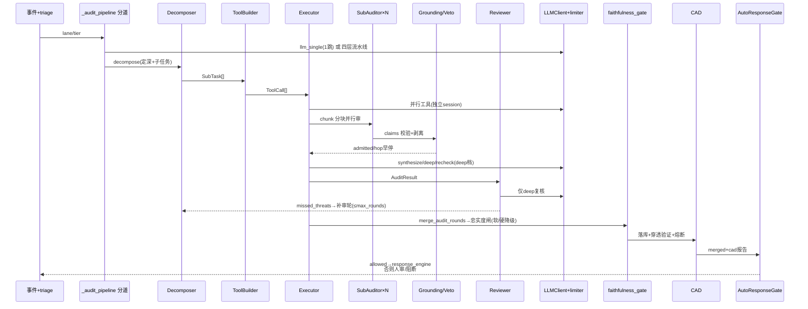

#### B5 批次总图

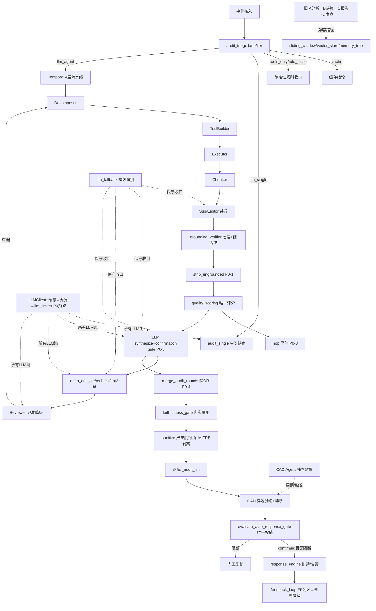

**关键发现摘要**：编排主干是 log_ingestion `_audit_pipeline` 的车道分派（cache/规则/llm_single/Temporal 四层）+ 四层流水线 max_rounds 轮迭代；所有 LLM 调用经 `LLMClient.chat` 单一出口，降级以 `{"fallback":true}` JSON 契约由 `llm_fallback` 识别后各消费端保守收口；质量守门共 8 个插入点，全部为程序化判定、不依赖 LLM。

### B6 自博弈 / 学习评测 / MCP / 工具注册（M14–M15, M17–M18）

#### M14 红蓝自博弈（backend/self_play/ + red_agent.py + ops_loop.py）

**职责**：红蓝对抗闭环仿真。红队 `RedAgent` 按 `CurriculumPolicy` 下发的 `RoundGoal`（课程学习，LLM 可选）生成仿真攻击计划（不执行真实攻击）；`SimEnv` 把 `AttackStep` 物化为带 ground-truth 的日志；`BlueObserver` 用 Sigma 引擎 + `RuleOverlay`（学到的规则）评分，可选注入真实 ingest→Audit-LLM 流水线；`BlueLearner` 对漏报样本生成候选规则并经 `rule_lifecycle`（泛化→去重→FPR 验证）进 overlay；`orchestrator` 串起整局对局并按 P(level_clear) 升降级；`reviewer` 做 candidate→shadow→promoted 的审核门与 Sigma YAML 落盘（`sigma_export`）；`metrics/novelty` 提供 ASR/Recall/MTTD/分层新颖度/雷达图与胜负判定；`store` 持久化到 `SelfPlayMatch/SelfPlayRound/SelfPlayLearnedRule`。`ops_loop.py` 是独立运营闭环助手：CAD 定位流水线第一个失败 hop、LLM 风险档位钳制、KB 新鲜度过滤、7 天 FP>15% 规则降级。

**对外接口**：
- `self_play.orchestrator.orchestrator.run_match(cfg: MatchConfig|dict) -> dict`（单例，一次跑完整局）；`init_match/play_round/finalize(state)`（供 Temporal activities `selfplay_init/selfplay_round/selfplay_finalize`）；`live_match(id)/live_matches()/request_stop(id)`。
- `RedAgent.plan_attack(*, match_id, round_num, level, blue_coverage, last_outcome, decoy_ratio, use_llm, curriculum, blue_view, goal) -> AttackPlan`（backend/red_agent.py 仅 re-export）。
- 其它调用方：routers/self_play.py（启动/停止/详情/审核 API）、scheduler.py:1037-1042（定时 `reviewer.drain()`）、app.py:269-270（启动 `seed_global_overlay`）、sigma_engine/engine.py:442（`repair_selfplay_yaml`）。
- CLI：`python -m self_play --rounds 8 [--llm] [--inject] [--full-attack]`。
- `ops_loop`：`locate_first_failed_hop(audit_llm_data)`、`clamp_llm_risk_level(rule_level, llm_level)`、`llm_may_open_work_order(...)`、`kb_chunk_is_fresh/filter_fresh_chunks`（rag.retriever 调用）、`apply_rule_downgrade(rule_id)`（learn_loop/apply.py 调用）。

**依赖**：内部 — models（SelfPlay* 表/SecurityEvent）、sigma_detector、sigma_engine.store、log_ingestion、rag.retriever、rag.knowledge_base、prompts+audit_schemas+summary_compression（LLM）、event_bus、audit_trail、config.settings、response_engine.response_policies（ops_loop）。外部 — pyyaml（sigma_export）；MITRE 快照数据 self_play/data/enterprise_techniques.json。

**调用关系**：routers/self_play.py / Temporal / __main__ → `orchestrator.run_match` → `CurriculumPolicy.select_goal` → `RedAgent.plan_attack`（catalog→RAG→LLM 或目录；`ExecutablePlanner.constrain_steps` 收敛 LLM 输出）→ `SimEnv.materialize_plan` → `BlueObserver.observe_many`（sigma_detector + overlay.detect_scoring/detect_candidates，inject 时 log_ingestor.ingest→轮询 `_wait_audit`）→ `metrics.score_round` → `BlueLearner.learn_from_misses`→`rule_lifecycle.ingest_learned_rule`→overlay.add → `policy.update/maybe_advance` → `store.save_round/save_learned_rules` → 事件 `selfplay_round/selfplay_match` 发布。异步支路：scheduler → `reviewer.drain` → `review_one`（G0-G5 门）→ `apply_review` → sigma_export.write_selfplay_rule + overlay.add(GLOBAL_KEY) + audit_trail。

**风险点**：
- [P2] self_play/orchestrator.py:25,457-462 — `_LIVE` 对局快照只在 `finalize` 里 update、从不删除，长期运行内存无界增长。
- [P2] self_play/blue_observer.py:100-109,118-136 — `observe_many` 逐事件串行，`inject+wait_audit` 时每事件最多轮询 8s 且每 0.25s 新开一个 DB session；N 个事件一轮最坏 N×8s，阻塞整局。
- [P2] self_play/reviewer.py:242-244,283-285 — G4（LLM 语义门）与 G5（回放门）异常时 fail-open（`passed=True`），LLM/回放故障窗口内不合格 candidate 可全门通过进入 shadow。
- [P3] self_play/reviewer.py:273,281 — `without = sum(1 for e in attacks if False)` 恒为 0，G5 的 `baseline_hits` 是死数据，`delta_recall` 实为"命中率"而非提升量。
- [P3] self_play/metrics.py:249-250 — `merge_metrics` 聚合时 `evasion_n` 丢失，雷达图的 novelty_response/robustness 在多回合聚合层失真。
- [P3] self_play/overlay.py:37-43 + orchestrator.py:85 — overlay 命中用子串 `p.upper() in text`（短 token 易误配，靠 FPR 门兜底）；orchestrator 直写 `CurriculumPolicy._seen` 私有属性，跨模块强耦合。

```mermaid
flowchart LR
  API[routers/self_play + Temporal] --> ORC[orchestrator.run_match]
  ORC --> CUR[curriculum.select_goal]
  CUR --> RA[RedAgent.plan_attack]
  RA --> CAT[catalog / enterprise_pool]
  RA --> EP[ExecutablePlanner.constrain_steps]
  ORC --> ENV[SimEnv.materialize_plan]
  ENV --> OBS[BlueObserver.observe_many]
  OBS --> SIG[sigma_detector]
  OBS --> OVL[RuleOverlay.detect_scoring]
  OBS --> INJ[log_ingestor + wait_audit]
  ORC --> MET[metrics.score_round]
  ORC --> BL[BlueLearner.learn_from_misses]
  BL --> RL[rule_lifecycle generalize/dedup/validate]
  RL --> OVL
  ORC --> ST[store.save_round/rules]
  SCH[scheduler] --> REV[reviewer.drain]
  ST --> REV
  REV --> SE[sigma_export write/reload]
  REV --> OVL2[overlay.add GLOBAL]
```

#### M15 学习闭环与评测（backend/learn_loop/ + eval_service.py + eval_repository.py + eval_metrics.py + eval_datasets/）

**职责**：两条闭环。① 每日学习闭环 `learn_loop`：`harvest` 收割七类机制证据（baseline/reputation/feedback/degrade/tune/postmortem/case）→ `models_stats`（Wilson 区间/EWMA 反馈统计）、`models_cluster`（确定性贪心 Jaccard 聚类）、`models_sequence`（案例内一阶马尔可夫转移，对齐 KILLCHAIN_RANK 与 CEP 已知模式去重）→ `propose` 生成 `LearningAction` 提议（24h 去重键，`llm:` 前缀结论强制人工）→ `apply` 按白名单自动落地（补复盘草稿/shadow 规则/基线衰减/信誉先验/开跟进工单）或留人工，`store` 落 `LearningRun/LearningAction`，全程对调度器 fail-open。② 评测：`eval_metrics`（无 LLM 启发式：中英 tokenize、词法重叠、实体蕴含 IP/CVE/ATT&CK/端口、embedding 余弦）+ `eval_service`（RAG 检索质量与忠实度在线评估）+ `eval_repository`（EvalRun/EvalScore 持久化、AgentTrace 轨迹统计/token 成本分账）+ `eval_datasets/`（离线标定脚本：detection/behavior/grounding 阈值扫描、rag BM25、scale-window 矩阵、attack-coverage 对账、ablation 消融、evasion-retention、三个公开数据集回放；fixtures/ 9 个提交入库数据文件）。

**对外接口**：
- `learn_loop.run_cycle(session, *, trigger="daily", window_start=None, window_end=None) -> dict`（scheduler.py:556-557 hourly、667-668 daily、routers/ops.py:921 手动触发）；`learn_loop.apply.apply_action(session, row, *, actor, auto)`、`rollback_action(session, row)`；`propose(harvest, stats, clusters, sequences, *, existing_keys)`；`build_clusters/build_sequences/analyze_feedback` 纯函数。
- `eval_service.evaluate_rag_retrieval(...)`、`evaluate_faithfulness(...)`（routers/rag.py:427,443,474）。
- `eval_repository.save_evaluation_run/list_evaluation_runs/get_evaluation_run/evaluation_report`（routers/rag.py:491-513）；`get_traces/get_trace_stats/get_event_token_aggregation/get_daily_token_usage/get_cost_by_caller/get_cache_channel_stats`（routers/ops.py:36-107）。
- CLI：`python -m eval_datasets.evaluate_detection|evaluate_behavior|evaluate_grounding|evaluate_rag|evaluate_scale_window|ablation|evasion_retention|replay_* [--out dir]`。

**依赖**：内部 — models、feedback_loop、post_mortem_service、work_order_service、ops_loop、anomaly_detector（含私有 `_save_baselines_to_redis`）、sigma_engine/sigma_detector、correlation_engine、case_manager.KILLCHAIN_RANK、threat_intel.reputation、self_play.novelty.tokenize（只读复用）、zeroday_detect.variant_cluster.jaccard_similarity、event_bus、cost_tracker。外部 — SQLAlchemy、pyyaml；评估侧无 LLM 依赖（确定性）。

**调用关系**：scheduler（daily/hourly）→ `run_cycle` → `harvest`（7 子收割，单键 fail-open）→ `_step_stats/_step_clusters/_step_sequences` → `propose` → `store.insert_actions` → 白名单行 `apply_action`：`draft_post_mortem`→post_mortem_service、`shadow_rule`→ops_loop.apply_rule_downgrade、`decay_baseline_entity`→anomaly_detector.decay_entity、`update_reputation_prior`→ReputationPrior upsert、`open_review_work_order`→work_order_service；routers/ops.py 读 `store.get_run_with_actions`。评测侧：routers/rag → eval_service → eval_metrics + eval_repository；eval_datasets 各 CLI 自驱动（复用 PySigmaDetector/AnomalyDetector/CorrelationEngine/mcp_guard 真引擎）。

**风险点**：
- [P2] eval_repository.py:73-77 vs 129 — `list_evaluation_runs(run_type=...)` 的 `stmt` 从未按 run_type 过滤，`evaluation_report` 传入 run_type 取 `recent_runs` → 报告里"最近运行"混入其它类型（如 rag 报告混入 faithfulness 行）。
- [P2] learn_loop/propose.py:113-127 + apply.py:167-191 — 窗口内 `fp>0` 的任意 src_ip 自动（auto=True）触发基线衰减且"衰减不可回滚"；单条误报反馈即可让实体基线减半，信誉先验同轮 upsert，误点反馈会被放大。
- [P3] learn_loop/apply.py:181 — 直接调用私有 API `anomaly_detector._save_baselines_to_redis(force=True)`，跨模块侵入内部实现。
- [P3] learn_loop/orchestrator.py:110,153 — `want_ids[:5000]` 静默截断，大窗口下聚类/序列只覆盖最新 5000 事件，无任何提示字段。
- [P3] eval_datasets/evaluate_detection.py:57 — 模块导入即 `LOOP = asyncio.new_event_loop()` 且从不关闭，脚本被当作库导入时留下副作用。
- [P3] eval_service.py:68-75,131-148 — 在线评估阈值（0.7/0.8/0.1/0.4/0.75）全部硬编码于代码，与 eval_datasets 的标定结论无联动，属于未标定常数。

```mermaid
flowchart TB
  SCH[scheduler daily/hourly] --> RC[learn_loop.run_cycle]
  RC --> HV[harvest 7 keys fail-open]
  HV --> MS[models_stats Wilson]
  HV --> MC[models_cluster 贪心Jaccard]
  HV --> MQ[models_sequence Markov]
  MS & MC & MQ --> PR[propose 24h dedup]
  PR --> APS[store.insert_actions]
  APS --> APL[apply.apply_action 白名单]
  APL --> PM[post_mortem_service]
  APL --> OL[ops_loop.apply_rule_downgrade]
  APL --> AD[anomaly_detector.decay_entity]
  APL --> RP[ReputationPrior upsert]
  APL --> WO[work_order_service]
  RAG[routers/rag] --> ES[eval_service]
  ES --> EM[eval_metrics 启发式]
  ES --> ER[eval_repository EvalRun/Score]
  OPS[routers/ops] --> ER2[eval_repository traces/cost]
  CLI[eval_datasets CLI] -.读取真引擎.-> SIGE[sigma_engine/anomaly/correlation/mcp_guard]
```

#### M17 MCP 守卫服务器（backend/mcp_guard/）

**职责**：Agent 与工具之间的唯一安全通道（UEBA-for-AI）。`McpGuardServer.call_tool` 四层检查：Registry（防幻觉工具，未注册即拒）→ PermissionManager（内联 RBAC：admin/security_operator/analyst/viewer）→ ParamValidator（Pydantic 强类型+规范化）→ PolicyEngine（内联规则 R001-R004 + 风险升级，输出 allow/deny/require_confirmation）；第 4.5 层 `BehaviorDetector` 行为签名（(tool,caller) 指纹：Welford 参数分布/小时桶/caller 级 Markov 序列/工具直方图，四维加权，shadow/confirm/deny 三模式，只升不降 `escalate_decision` 全平台唯一来源）；require_confirmation 入内存 `ApprovalQueue`；`CallLogger` 消毒后内存 ring(500)+异步落库 tool_call_log。

**对外接口**：
- `mcp_guard.mcp_guard: McpGuardServer` 单例（__init__.py:20，失败置 None）；`call_tool(request: ToolCallRequest) -> dict`（同步，async 侧需 `asyncio.to_thread`）；`list_tools()`。
- `BehaviorDetector.observe_pre_exec(rec) -> SignatureReport|None` / `observe_post_exec(rec, report)`（被 guard_server、tool_registry._pre_execute_check、telemetry 共用）；`escalate_decision(current, report) -> (decision, reason)`（唯一升级规则，guard_server.py:251 与 tool_registry.py:232 两处执行点）；`recent_anomalies/list_signatures/stats/get_signature`。
- `ApprovalQueue.create_ticket/approve/deny/list_*`（routers/audit.py:182-238 审批 API）。
- `telemetry.ingest_tool_call(...)`（security_guard、agent_executor 等三链共用）。

**依赖**：内部 — config.settings（tool_signature_* 配置）、audit_trail.log_action_sync（veto 审计）、event_bus（tool_anomaly/alert SSE）、trace_hook、observability.thought_events；外部调用方：tool_registry.py、agents/agent_executor.py、security_guard、asset/discovery、eval_datasets、routers/audit、routers/ops。外部 — pydantic。

**调用关系**：调用方（audit API / agent_executor / security_guard）→ `mcp_guard.call_tool` → registry.get_tool → permission.check → validator.validate → policy.evaluate → `detector.observe_pre_exec` → `escalate_decision` 升级 → allow 则 `registry.execute`（模拟执行器，诚实返回 `status="simulated"`）/ require_confirmation 则 `approvals.create_ticket` → `detector.observe_post_exec` 学习 → `call_logger.log` 落库。旁路：tool_registry._pre_execute_check 与 telemetry.ingest_tool_call 复用同一 detector 与升级规则。审批：routers/audit → approvals.approve/deny（仅改状态）。

**风险点**：
- [P2] mcp_guard/approval_queue.py:5-24 + guard_server.py:346-353 — 工单纯内存存储（重启即丢、多进程不共享）；且 `approve()` 只把状态改 approved，没有任何路径回放执行该工具，require_confirmation 的调用"审批通过后仍不执行"，与模块 docstring 不符。
- [P2] mcp_guard/behavior_detector.py:200,217-219 + guard_server.py:89 — `BehaviorDetector()` 默认 `persist=False`，guard_server 构造时不传；`_dirty` 集合全仓无 flush 消费者 → 指纹只存内存，重启归零重新冷启动。
- [P2] mcp_guard/guard_server.py:329-335 — 检测器故障时仅 `tool_signature_mode=deny` 才 fail-closed；默认 confirm 模式下 decision 原样放行（fail-open），只发一条 `tool_signature_degraded` SSE。
- [P3] mcp_guard/tool_registry.py:39-132 + permission_manager.py:21-55 + validator.py:98-105 + policy_engine.py:31-70 — 工具元数据/RBAC/参数模型/策略规则四处内联重复声明，新增或改风险等级需同步 4 处。
- [P3] mcp_guard/behavior_detector.py:324 — `rec.ts.timestamp() if rec.ts else time.time()` 结果被丢弃（死表达式）。
- [P3] mcp_guard/policy_engine.py:142-146 — 风险升级仅在"无任何规则命中"时生效，若后续新增宽松规则命中，HIGH/CRITICAL 工具的默认确认保障被跳过。

```mermaid
flowchart TB
  CALLER[audit API / agent_executor / security_guard] --> GS[McpGuardServer.call_tool]
  GS --> R1[ToolRegistry 未注册即拒]
  R1 --> R2[PermissionManager RBAC]
  R2 --> R3[ParamValidator Pydantic]
  R3 --> R4[PolicyEngine R001-R004]
  R4 --> BD[BehaviorDetector.observe_pre_exec]
  BD --> ESC[escalate_decision 只升不降]
  ESC -->|allow| EXE[registry.execute simulated]
  ESC -->|require_confirmation| AQ[ApprovalQueue 内存工单]
  AQ --> API[routers/audit approve 仅改状态]
  ESC -->|deny| LOG[CallLogger]
  GS --> POST[observe_post_exec 学习指纹]
  GS --> CL[CallLogger ring+DB]
  TR[tool_registry 审计链] -.共用.-> BD
  TEL[telemetry.ingest_tool_call] -.共用.-> BD
```

#### M18 工具/能力注册与工单（backend/tool_registry.py, capabilities_registry.py, work_order_service.py, case_manager.py, post_mortem_service.py）

**职责**：① `tool_registry.py`：Audit-LLM Tool Builder/Executor 的统一工具注册表（11 个只读查询/分析工具：event_store.query、anomaly.baseline、correlation.*、causal.graph、vector.search、knowledge.search、memory_tree.related、sliding_window.*），执行前必经 `_pre_execute_check`（未知工具拒绝、风险等级决定 fail-closed/降级放行、行为签名共用 escalate_decision），执行强制 `timeout_ms` + `capacity.BoundedGate` 并发闸，参数上界越界抛 `ToolParameterRejected`。② `capabilities_registry.py`：读 `capabilities.yaml` 作为能力状态唯一事实源（verified/experimental/disabled + 证据链接），与 config 运行开关分离。③ `work_order_service.py`：持久化工单（disposition/approval/review/rollback 四类，SLA 按优先级 4/8/24/72h，超时扫描 + SSE + sla_tracker 上报；审批通过后仅推 case→responding，不执行响应动作）。④ `case_manager.py`：案例聚合（同 session 优先/同 IP 30min/同 type+dst 6h）、状态机、杀伤链标题升级、单案例 500 事件封顶、高优案例自动派单、处置结论→FeedbackRecord 反哺学习闭环、关闭/误报自动补复盘草稿、SLA 重计时。⑤ `post_mortem_service.py`：复盘草稿（幂等，timeline+FP 统计自动生成，LLM 根因分析可选），publish 时把 rule_improvements 转投 feedback_loop。

**对外接口**：
- `tool_registry.tool_registry: ToolRegistry` 单例；`await tool_registry.execute(name, **kwargs)`（agents/agent_executor.py、agent_decomposer.py、cad.py、grounding_verifier.py、asset/discovery.py 调用）；`register/get_info/list_tools/risk_level/estimate_duration`；`init_tool_registry()`（模块导入即执行，幂等）。
- `capabilities_registry.load_registry(path=None) -> dict`、`runtime_enabled(cap, settings_obj) -> bool`。
- `work_order_service.work_order_service` 单例：`create_order(session, case_id=None, order_type="disposition", title, description, priority, assignee, created_by) -> WorkOrder`、`update_status/assign/approve/reject/list_orders/check_sla_breaches`。
- `case_manager.case_manager` 单例：`auto_create_case(session, event)`（log_ingestion 摄入路径调用）、`create_case/update_status/assign/set_disposition/get_case/list_cases/get_case_timeline/try_auto_resolve/auto_resolve_idle_cases`；模块级 `KILLCHAIN_RANK`。
- `post_mortem_service.post_mortem_service`：`create_post_mortem(session, case_id, author="") -> dict`（幂等）、`get_post_mortem/update_post_mortem/publish`。

**依赖**：内部 — models、event_store、anomaly_detector、correlation_engine、vector_store、memory_tree、sliding_window、summary_compression.embedder、rag.retriever、causal_chain、memory_guard、asset.asset_correlator、core_metrics、audit_trail、event_bus、ops_metrics.sla_tracker、config.settings、mcp_guard（tool_registry 复用 detector+escalate）、capacity、feedback_loop。外部 — SQLAlchemy、pyyaml。

**调用关系**：log_ingestion → `case_manager.auto_create_case`（聚合或新建 + `_maybe_auto_dispatch`→work_order_service.create_order + case 推 responding）；routers/ops → `update_status/assign/set_disposition`（audit_trail 留痕；closed/false_positive → `schedule_draft_post_mortem`；disposition → `_record_disposition_feedback`→FeedbackRecord→learn_loop.harvest）；disposition 工单 completed → `_maybe_resolve_case`→case 推 resolved；scheduler → `check_sla_breaches`/`auto_resolve_idle_cases`；审计链 → `tool_registry.execute` → `_pre_execute_check`（mcp_guard.detector）→ capacity 闸 → 工具函数；routers → `load_registry()` 展示能力状态。

**风险点**：
- [P2] work_order_service.py:143-149,269-307 — `approve()` 后 `_execute_approved_actions` 只把 case 置 responding，**不执行任何响应动作**；系统并存两套审批（内存 approval_queue 真执行 vs DB 工单不执行），运维在工单页批准会产生"已处置"的错觉。
- [P2] case_manager.py:176-192 — `_LOCAL_SESSION_LOCKS` 以 `(id(loop), session_id)` 为键，CPython id 复用可能让新 loop 撞旧锁；超 4096 时只回收未持有锁，被持有的旧锁泄漏。锁仅进程内，不解决跨进程并案。
- [P3] case_manager.py:887 — `_add_event_to_case` 对每个并入事件 `await session.commit()` 一次，扫描型攻击下逐事件提交放大 DB 写。
- [P3] tool_registry.py:712-799 — 模块导入即执行 `init_tool_registry()` 并在顶部 import event_store/anomaly_detector/correlation_engine 等重模块，任何一侧重构都可能在 import 期炸掉全链。
- [P3] tool_registry.py:262-277 — 审计命名空间对 `escalate_decision` 返回的 require_confirmation"按记录放行"，`tool_signature_mode=confirm` 对 11 个审计工具实际只有记录效果。
- [P3] capabilities_registry.py:39-44 — `runtime_enabled` 对没有 `runtime_setting` 的能力视为常开，新增能力若忘配 runtime_setting 会与 disabled 状态语义混淆。

```mermaid
flowchart LR
  ING[log_ingestion] --> CM[case_manager.auto_create_case]
  CM -->|聚合/新建| SC[(SecurityCase)]
  CM -->|high/critical| AD[_maybe_auto_dispatch]
  AD --> WO[work_order_service.create_order]
  OPS[routers/ops] --> CM
  OPS --> WO
  WO -->|approve| RESP[case→responding 不执行动作]
  WO -->|completed disposition| CM2[case→resolved]
  CM -->|closed/FP| PMS[post_mortem_service 草稿]
  CM -->|disposition| FB[FeedbackRecord]
  FB --> LL[learn_loop.harvest]
  PMS -->|publish| FL[feedback_loop]
  AUD[audit_llm Executor] --> TRE[tool_registry.execute]
  TRE --> PEC[_pre_execute_check]
  PEC -.复用.-> MG[mcp_guard.detector]
  TRE --> GATE[capacity BoundedGate]
  TRE --> TOOLS[11 只读工具]
  CAP[routers] --> CR[capabilities_registry load_registry]
  CR --> YML[(capabilities.yaml)]
```

#### B6 批次总图

```mermaid
flowchart TB
  subgraph SP[M14 红蓝自博弈闭环]
    CUR[curriculum] --> RA[RedAgent] --> ENV[SimEnv] --> OBS[BlueObserver]
    OBS --> MET[metrics] --> CAP[CapabilityState P_level_clear]
    CAP --> CUR
    OBS -->|miss| BL[BlueLearner] --> RLC[rule_lifecycle] --> OVL[RuleOverlay]
    OVL -->|下一回合评分| OBS
    ST[store] --> REV[reviewer drain] --> SIGY[sigma YAML shadow/promote] --> SIGD[sigma_detector]
  end
  subgraph LL[M15 学习闭环与评测]
    SCH[scheduler] --> RUN[learn_loop.run_cycle] --> HAV[harvest 7 机制] --> PROP[propose] --> APL[apply 白名单]
    APL --> OL2[ops_loop.apply_rule_downgrade]
    OL2 --> SIGD
    APL --> PM[post_mortem] --> FL[feedback_loop]
    CASE[case_manager disposition] -->|FeedbackRecord| HAV
    EVAL[eval_datasets CLI] -.标定阈值.-> MGD & SIGD
    ESVC[eval_service] --> EREP[eval_repository]
  end
  subgraph MG[M17 MCP 守卫]
    GD[McpGuardServer 4层+签名] --> AQ[ApprovalQueue]
    BD[BehaviorDetector escalate_decision]
  end
  subgraph T18[M18 工具/能力/工单]
    TR[tool_registry 审计工具] --> MGX[复用 detector]
    WO[work_order_service] --> CMG[case_manager]
    CMG --> PMS2[post_mortem_service]
    CAPY[capabilities.yaml]
  end
  REV -->|promoted| SIGD
  BL -->|persist_kb| KB[rag.knowledge_base]
  ST --> REV
  TR -.pre_execute_check.-> BD
  GD --> TREXE[registry.execute simulated]
  MGX --> TR
  CMG -->|closed/FP 草稿| PM
  WO -->|open_review_work_order 由 APL| PM
```

（说明：M17 的审批工单批准后不回放执行、M18 的工单审批不执行响应动作，两处均为源码注释中登记的产品语义待决项；以上风险均有对应文件行号证据。）

### B7 RAG 知识库（M16）

#### M16 RAG 知识库（backend/rag/、qdrant_store.py、vector_store.py）

**职责**：
- 知识全生命周期：入库审批（`KnowledgeBaseManager`）→ 安全专用分块（`SecurityChunker`）→ 词法索引列 `search_lex`（`build_search_lex`）→ 受管 embedding 回填 + Qdrant 双写（`seeder`）。
- 检索管线：规则/LLM 查询扩展 + HyDE（`query_transform`）→ 混合检索（Qdrant RRF / pgvector+ts_rank 进程内 RRF / 精确词注入，`retriever`）→ 重排（HTTP cross-encoder→特征分→LLM，`reranker`）→ 审批/时效过滤（`_drop_unapproved`）。
- 消费侧：`RAGContextBuilder` 格式化注入 LLM 上下文；`EvidenceVerifier` 用知识库校验 LLM 断言（防幻觉）。
- 向量后端封装：`qdrant_store`（知识库 knowledge_chunks，双 collection）与 `vector_store`（agent 记忆 agent_memories，Qdrant 优先 + pgvector 兜底）。
- 外部知识导入：`mitre_importer`/`capec_importer` 拉 GitHub STIX JSON；`import_status` 单例进度供前端轮询。

**对外接口**（公开类/函数 + 调用方）：
- `kb_manager: KnowledgeBaseManager` — `add_document(session,title,content,source,...)->dict`（routers/rag.py、self_play/blue_learner.py:152、两个 importer、seeder）；`approve_document`（第二人审批）；`search_documents`（列表 + importer 去重）；`delete_document`（同步删 Qdrant）；`get_stats`/`list_sources`。
- `retriever: Retriever` — `retrieve(session,query,query_embedding,threat_type,severity,source,top_k,min_score,skip_llm,rewrite,hyde,rerank)->RetrievalResult`（tool_registry.py:659 `knowledge.search` 工具、routers/rag.py /api/rag/search、self_play/red_agent.py:283、EvidenceVerifier）；`retrieve_for_threat`、`rerank`。
- `transform_query(query,*,rewrite,hyde,skip_llm,empty_hits)->dict`（仅 retriever.py:66 调用）。
- `expand_query_text/tokenize/build_search_lex/encode_sparse/rrf_fuse/lexical_needles/lexical_overlap_rank`（retriever、chunker、qdrant_store、reranker）。
- `rerank_chunks(query,chunks,top_k,skip_llm)->(chunks,backend)`（retriever.py:133）；`http_cross_encoder_rerank`、`feature_rerank`。
- `rag_context_builder: RAGContextBuilder` — `build_context(result,max_tokens)->str`（agent_executor.py:728）；`evidence_verifier.verify_claim/verify_batch`（agent_executor.py:808、routers/rag.py /api/rag/verify）。
- `security_chunker.chunk_document(...)->list[dict]`（seeder、两个 importer、routers/rag.py）。
- `seed_knowledge_base(session)`（app.py:226 启动播种）；`launch_embedding_backfill(scope)`（app.py:232、scheduler 周期巡检）；`has_missing_embeddings`。
- `import_enterprise_attack(...)`、`import_capec(...)`（routers/rag.py import 端点）；`get/set_import_status`。
- `qdrant_store: QdrantStore` — `ensure_collection/upsert_chunk/upsert_chunks_batch/search/query_hybrid/delete_by_doc_id/delete_by_chunk_ids/count/hybrid_enabled/chunk_point_id`（retriever、knowledge_base、seeder、dependency_health.py:84、迁移脚本）。
- `vector_store: VectorStore` — `store_memory/search_similar/delete_memory`（tool_registry.py:634、agents/agent_a.py:56、routers/logs.py:596）。

**依赖**：内部 — `config.settings`（qdrant_*、rag_*、embedding_dim=768 等）、`models`、`summary_compression`（embedder/llm/is_degraded_vector）、`memory_guard`（kb_source_is_signed/kb_is_retrievable/content_hash）、`ops_loop.kb_chunk_is_fresh`、`prompts.render`、`trace_hook`。外部 — Qdrant（`settings.qdrant_url`）；embedding API（MiniMax embo-01 协议 + OpenAI 兼容双格式，失败返回全零向量）；cross-encoder HTTP 服务 `rag_rerank_url`（docker soc-bge-rerank/Infinity，BAAI/bge-reranker-v2-m3）；LLM chat（rewrite/HyDE/verify/rerank）；GitHub raw STIX（MITRE enterprise-attack.json / stix-capec.json）；Postgres+pgvector（主数据与兜底）；可选 fastembed `Qdrant/bm25`。

**调用关系**：HTTP `routers/rag.py` → kb_manager/retriever/evidence_verifier/importer；Agent 编排 `tool_registry.knowledge_search` → `retriever.retrieve` → `agent_executor` → `rag_context_builder.build_context` 注入汇总 prompt → `evidence_verifier.verify_batch`；启动 `app.py` → `seed_knowledge_base` → `launch_embedding_backfill`；`scheduler` 周期巡检。入库：importer/seeder → `kb_manager.add_document`（PG KnowledgeDoc）→ `security_chunker.chunk_document` → 写 KnowledgeChunk（embedding=None + search_lex）→ `launch_embedding_backfill` → `embedder.embed` → pg `embedding` 列 → `_sync_all_to_qdrant` → `qdrant_store.upsert_chunks_batch`（dense + hybrid v2 双写）。删除：`kb_manager.delete_document` → 删 PG chunks/doc → `qdrant_store.delete_by_doc_id`。

**风险点**：
- [P1] qdrant_store.py:274-296 — `delete_by_doc_id`（及 `delete_by_chunk_ids`）只删 dense collection，不删 hybrid v2 collection；`rag_hybrid_enabled=True`（config.py:61 默认 True）时 hybrid RRF 检索仍可召回已删知识，且 `_hydrate_chunks`:161-170 在 PG 行已删时回退用 payload.content 拼装 chunk，被删内容可借 payload 进入候选。
- [P1] qdrant_store.py:285-287 — `delete_by_doc_id` 用 `limit=1000` 列点再删，文档 chunk 数 >1000 时残留脏向量（无分页循环）。
- [P2] mitre_importer.py:213-218 与 capec_importer.py:206-211 — 去重用 `kb_manager.search_documents(query=tech_id)`，而匹配是 `content.ilike(f"%{query}%")`：任何已导入文档正文里出现过该 ID/子串即判"已存在"而 skip，导致大量技术/攻击模式被误跳过漏导。
- [P2] reranker.py:135-138 — 目标 rerank URL 非本地主机时，自动把 `llm_api_key`/`embedding_api_key` 填进 `Authorization: Bearer` 发给 `rag_rerank_url` 指向的任意主机；配置误填即向第三方泄露凭据。
- [P2] evidence_verifier.py:108 — `json.loads(resp)` 直接解析 LLM 原文，模型输出带 ```json 围栏即抛异常，落入 except 把本可支撑的断言判成 `unsupported`（hallucination_risk 虚高）。
- [P2] vector_store.py:294-297 — pgvector 兜底 `return filtered if filtered else rows[:1]`：全表低于 `min_score` 时返回任意一条记录当"相关记忆"交给 LLM；与同文件 Qdrant 路径"检索不可用必须表现为空"的修复自相矛盾。
- [P2] retriever.py:442-477 — `_drop_unapproved` 是检索后过滤：未审批 chunk 先占满 top_k 名额再被丢弃，恶意/未审内容可"挤占"合法结果；且 Qdrant/SQL 查询本身不带 approval_status 条件，投毒文本始终进入重排打分阶段。
- [P3] retriever.py:538-542 与 :462 — 两处死代码；seeder.py:950 `if count > 10` 以 chunk 总数判定已播种，1~10 条残留时走全量重播种而 add_document 无标题去重 → 文档重复入库稀释检索。

```mermaid
graph TD
  subgraph ingestion[知识入库链路]
    MIT[mitre_importer<br/>GitHub STIX] --> KB
    CAPEC[capec_importer<br/>GitHub STIX] --> KB
    SEED[seeder 22篇内置知识] --> KB
    KB[kb_manager.add_document<br/>PG knowledge_docs 审批态] --> CH
    CH[security_chunker] --> CK[(knowledge_chunks<br/>search_lex/embedding=None)]
    CK --> BF[seeder.launch_embedding_backfill]
    BF --> EMB[embedder.embed<br/>MiniMax embo-01]
    EMB --> PG[(pg embedding列)]
    PG --> SYNC[_sync_all_to_qdrant] --> QS
  end
  subgraph store[Qdrant 双 collection]
    QS[qdrant_store.upsert] --> C1[(soc_knowledge_chunks dense)]
    QS --> C2[(soc_knowledge_chunks_v2<br/>dense+bm25sparse IDF)]
  end
  MEM[vector_store] --> C3[(agent_memories dense)]
```

#### RAG 检索管线

**查询链路**（retriever.retrieve，retriever.py:40-148）：
1. 查询变换 `query_transform.transform_query`：先规则扩展 `lexical.expand_query_text`（CVE/ATT&CK/哈希/IP 抽取 + 别名表）；`rag_query_rewrite=llm` 时再调 LLM 产出 rewritten/step_back/keywords；`rag_hyde=empty_only`（默认）仅在双路为空后重试时生成 HyDE 假想文档。
2. Dense 查询向量：`embedder.embed(dense_text, type_="query")`。
3. 混合检索（`rag_hybrid_enabled` 默认 True）：优先 Qdrant 服务端 RRF——`qdrant_store.query_hybrid` 在 `soc_knowledge_chunks_v2` 上 dense+bm25 双 Prefetch→`Fusion.RRF`（原生 RRF 不可用则双路查询后进程内 `rrf_fuse`）；词法稀疏向量由 `lexical.encode_sparse` 生成（默认 builtin blake2b 哈希 TF）。
4. Qdrant 命中后 `_hydrate_chunks` 回查 PG 补全元数据，再 `_inject_exact_terms` 用 ILIKE 把 CVE/T-ID 精确命中并到候选最前。
5. 兜底链：Qdrant 不可用/无结果 → PG 进程内融合（pgvector `<=>` + ts_rank → `rrf_fuse`）→ 仍空 → `_inject_exact_terms`。
6. `_drop_unapproved`：只保留 `kb_is_retrievable`（approved/signed_import）且 `kb_chunk_is_fresh`（valid_until 未过期）的文档。
7. 重排：`rerank_chunks` = HTTP cross-encoder（15s 超时）→ `feature_rerank`（RRF 分+词重叠+标题命中+精确词）→（非 skip_llm 且特征分无区分时）LLM list-rerank。
8. 消费：`rag_context_builder.build_context` 按 token 预算截断注入 LLM；`evidence_verifier.verify_claim` 对 LLM 断言再检索 top3 并让 LLM 判 supported/contradicted/unsupported。

**外部服务与集合名**：Qdrant 三 collection：`soc_knowledge_chunks`（dense 默认）、`soc_knowledge_chunks_v2`（hybrid，dense 768 维 COSINE + bm25 sparse Modifier.IDF）、`agent_memories`；embedding 提供方 `embedding_base_url`（MiniMax embo-01，dim 768，Redis 缓存）；rerank 服务 `rag_rerank_url`；LLM 网关 `llm_base_url`。

```mermaid
graph LR
  Q[查询 query] --> QT[query_transform<br/>规则扩展/LLM rewrite/HyDE]
  QT --> EMB[embedder.embed type=query<br/>MiniMax]
  QT -- lexical_query --> SP[lexical.encode_sparse]
  EMB --> HY{rag_hybrid?}
  SP --> HY
  HY -- 是 --> QH[qdrant.query_hybrid<br/>v2: dense+bm25 Prefetch→RRF]
  HY -- 否/降级 --> PGF[pgvector <=> + ts_rank<br/>进程内 rrf_fuse]
  QH --> HYD[_hydrate_chunks 回查PG]
  QH --> EX[_inject_exact_terms<br/>CVE/T-ID ILIKE 置顶]
  PGF --> EX
  EX --> DROP[_drop_unapproved<br/>审批+valid_until 过滤]
  DROP --> RR{rerank}
  RR --> CE[HTTP cross-encoder<br/>soc-bge-rerank]
  RR --> FE[feature_rerank]
  RR --> LR[LLM list-rerank]
  CE --> CTX[rag_context_builder<br/>token预算截断]
  FE --> CTX
  LR --> CTX
  CTX --> LLM[注入审计/汇总 LLM]
  LLM --> EV[evidence_verifier<br/>断言再检索+LLM判定]
```

#### B7 批次总图

```mermaid
graph TB
  subgraph entry[上游入口]
    HTTP[routers/rag.py<br/>/api/rag/*]
    TOOL[tool_registry.knowledge_search]
    APP[app.py 启动播种]
    SCH[scheduler 巡检回填]
    SP[self_play red/blue agent]
  end
  entry --> RET[Retriever.retrieve]
  HTTP --> KBM[kb_manager]
  HTTP --> IMP[mitre/capec_importer]
  APP --> SEED[seeder]
  SCH --> SEED
  SEED --> BF[embedding backfill] --> EMB[EmbeddingClient<br/>MiniMax]
  IMP --> KBM --> CHUNK[SecurityChunker] --> PGDB[(PG knowledge_docs/chunks)]
  BF --> PGDB --> SYNC[_sync_all_to_qdrant]
  RET --> QT[query_transform] --> LEX[lexical]
  RET --> QDR[qdrant_store<br/>soc_knowledge_chunks(_v2)]
  RET --> RR[reranker<br/>soc-bge-rerank HTTP]
  RET --> GUARD[memory_guard/ops_loop<br/>审批+时效闸门]
  RET --> CTX[RAGContextBuilder]
  CTX --> AGEX[agent_executor 汇总]
  AGEX --> EV[EvidenceVerifier]
  EV --> RET
  TOOL --> RET
  SP --> RET
  SP --> KBM
  subgraph mem[Agent 记忆旁路]
    VS[vector_store] --> C3[(Qdrant agent_memories)]
    VS --> PGM[(pgvector memories)]
  end
  TOOL --> VS
```

关键结论：检索默认走 Qdrant 服务端 RRF（`soc_knowledge_chunks_v2`），Qdrant/PG 双层降级链完整；主要风险集中在删除不清理 hybrid v2 集合（P1）、importer 基于正文子串的去重漏导（P2）、reranker 凭据回填（P2）与 pg 记忆兜底返回任意记录（P2）。

### B8 响应引擎 / 安全护栏 / 运行时守卫（M19–M21）

#### M19 响应编排引擎（backend/response_engine/）

**职责**：
- `response_orchestrator`：编排入口。威胁事件 → `policy_engine.match` 策略匹配（含 uncertain 兜底）→ 双轨门槛（`allow_blocking=False` 只留 `send_alert`）→ 分级审批强制（CRITICAL 动作一律人工，HIGH 可被策略 auto_execute 豁免并记 AUTO_EXECUTED 工单）→ `_guarded_execute`（security_guard 审查后交给 executor）→ 写回 `SecurityEvent.raw_data._response`。
- `response_policies`：威胁类型/置信度/severity → 动作列表。决策序：per-IP 聚合冷却 → leaf 精确 → 父类 category → 良性 NO_ACTION → Uncertain 短封模板（5 分钟 block_ip + P1 告警）；mtime 热加载 YAML 策略。
- `policy_store`：`policies/*.yml`（22 个 POL-*.yml）的 CRUD+校验+回滚，失败清单可见。
- `response_registry`：动作注册表（severity→审批阈值、`needs_approval`、`has_critical_action`）+ 16 个动作实现（`_block_ip/_isolate_host/_dns_sinkhole/_rate_limit/kill_session/send_alert` 等），全部经 `safe_executor.execute(mode_override=_execution_mode())`。
- `safe_executor`：SSH 唯一安全通道，9 步链（grounding→白名单→参数→资产→幂等→模式→live→后验证→TTL→审计），live+幂等不可用 fail-closed。
- `command_whitelist` / `asset_whitelist` / `ps_templates`：默认拒绝命令白名单（GLOBAL_FORBIDDEN 注入子串 + LX/WIN 正则 + Base64 解码模板指纹）；受保护资产（内置仅 loopback）；PowerShell EncodedCommand 解码后逐字模板匹配。
- `execution_modes` / `preview`：`dry_run`（默认）/`mock`/`live` 路由；`preview_actions` 用 ContextVar 协程局部强制 dry_run。
- `human_approval`：审批工单（actions 摘要 + HMAC 签名 + TTL 分档 + write-behind 落库 + restore 重启恢复）。
- `response_executor`：批次执行（prepend forensic_snapshot、威胁上下文参数注入、脱敏 params、`RollbackStore` 内存+Redis 7 天、逆向幂等回滚）。
- `ssh_firewall`（paramiko iptables 双栈，known_hosts 失败关闭）与 `transport`（系统 ssh + EncodedCommand）。
- `ttl_manager`：Redis zset 索引 TTL 自动解封，多副本 zrem 认领、指数退避重试、启动恢复。
- `response_log`：全量审计。
- `threat_taxonomy`+`taxonomy.yml`：中文别名/关键词 → leaf/category 两级解析（不调 LLM）；`containment/`：host（杀进程/隔离文件/快照，受保护 PID/路径黑名单）、directory（LDAP 禁账号，krbtgt/administrator 保护）、mail（Graph 撤信，注入转义）、store（ContainmentRecord 台账 fail-open）。

**对外接口**：
- `response_orchestrator.on_threat_detected(session, threat_info, event_id=None, session_id="", allow_blocking=None) -> dict`；`execute_approved_action(ticket_id)`；`rollback_response(token)`
- `policy_engine.match(threat_type, confidence, severity, src_ip, category) -> ThreatActionMap`；`mark_executed(policy_name, src_ip)`；`reload()`
- `response_registry.execute(name, **kwargs) / rollback(name, **kwargs) / needs_approval(name) / has_critical_action(actions)`
- `safe_executor.execute(action_name, command, params, platform, live_fn, ttl_seconds, rule_id, verify_fn, idempotency_key, mode_override, ...) -> dict`
- `command_whitelist.check(command, platform) -> (allowed, rule_id, reason)`；`asset_whitelist.check(ip, action) -> (is_protected, reason)`
- `approval_queue.submit(threat_info, policy_name, actions, timeout_minutes, priority, match_status) / approve(id, by, sig) / reject(id, reason) / restore()`
- `response_executor.execute_actions(actions, threat_info) / rollback_batch(batch_token)`
- `ttl_manager.register(rule_id, action_name, params, ttl_seconds) / set_rollback_callback(fn)`
- `preview_actions(actions, threat_info)`；`policy_store.create_policy/update_policy/delete_policy/load_all_with_errors`
- `response_logger.log_threat/log_action/query_logs`

**依赖**：内部 — `config.settings`、`models`、`security_guard.security_guard`、`security_crypto`、`metrics/core_metrics`、`correlation_engine.infer_threat_classification`、`event_store`。外部 — paramiko（可选）、redis、sqlalchemy、pyyaml。

**调用关系**：上游：`log_ingestion.py`/`ingest_pipeline.py`/`kafka_consumer.py`/`temporal/activities.py`（Audit-LLM 完成后调 `on_threat_detected`，FastPath severity-only 传 `allow_blocking=False`）；`work_order_service.py`；`routers/response.py`。本模块：`on_threat_detected` → `policy_engine.match` → `approval_queue.submit` 或 `_guarded_execute` → `security_guard.inspect` → `response_executor.execute_actions` → `response_registry.execute` → `safe_executor.execute` → `ssh_firewall`/`transport`/containment adapters → `post_validator.verify` → `ttl_manager.register` → `response_logger.log_action` + `_update_event_response`。

**风险点**：
- [P2] response_orchestrator.py:445-453 — submit() 已按 PENDING 落库后，就地把工单改成 `AUTO_EXECUTED` 再 `persist_ticket`；persist 失败仅 warning，DB 停留 PENDING → 重启 `restore()` 把已自动执行的工单拉回待审，approve 即二次封禁（失败路径无补偿）。
- [P2] response_registry.py:729-741 — Redis 不可用时 TTL 注册降级为进程内 `asyncio.create_task(_auto_rollback)`，进程重启静默丢失自动解封，iptables DROP 规则永久留存（无补偿扫描）。
- [P2] safe_executor.py:328-344 — live 模式幂等 fail-closed 受 `require_idempotency_for_live` 配置开关控制；配置关闭后 Redis 故障时放行 → 告警重放触发重复封禁无任何拦截。
- [P3] ssh_firewall.py:288 — `connect()` 的探测命令含 `;`（GLOBAL_FORBIDDEN 成员），靠 `_exec(skip_whitelist=True)` 绕过白名单；该旁路路径仅靠调用点自觉。
- [P3] human_approval.py:104 — `_auto_approve_timeout_minutes` 与 `ApprovalStatus.AUTO_APPROVED` 全库零使用，超时自动批准未实现（配置语义为死代码）。
- [P3] response_orchestrator.py:518-586 — `_poll_approval` 轮询任务存内存；重启后 restore() 只恢复 PENDING 工单、不重建轮询，已 APPROVED 未执行的工单无人再触发（API 可手动补救）。

```mermaid
flowchart LR
    UP[log_ingestion / kafka_consumer / temporal] --> ORC[ResponseOrchestrator.on_threat_detected]
    ORC --> PE[policy_engine.match 冷却/leaf/category/uncertain]
    PE -->|SKIPPED/NO_ACTION/FILTERED| RET[可观测返回 不执行]
    PE --> HA[approval_queue.submit HMAC+TTL]
    PE --> GE[_guarded_execute]
    GE --> SG[security_guard.inspect 意图/序列/频率/上下文]
    SG -->|拦截| DROP[跳过动作]
    SG --> EXE[response_executor.execute_actions 前置快照+参数注入]
    EXE --> REG[response_registry.execute]
    REG --> SAFE[safe_executor 9步安全链]
    SAFE --> FW[ssh_firewall paramiko iptables]
    SAFE --> TR[transport 系统ssh/EncodedCommand]
    SAFE --> CT[containment host/ldap/mail]
    SAFE --> PV[post_validator 后验证]
    SAFE --> TTL[ttl_manager Redis 自动解封]
    EXE --> LOG[response_logger + _update_event_response]
    HA -->|approved 轮询/API| GE
```

#### M20 安全护栏与密码学（backend/security_guard/、data_security/、security_crypto.py、field_cipher.py）

**职责**：
- `security_guard/`：动作执行前四维审查编排器。`intent_checker`（威胁等级↔允许动作矩阵）、`sequence_guard`（5 分钟 3 次 isolate_host / 1 分钟 5 次 block_ip 阻断）、`rate_limiter`（滑动窗口单动作+全局 30/min，check 时同步占坑防竞态）、`context_manager`（同 IP 300s 重复封禁≥3 次拦截）；`record()` 事后更新追踪器，telemetry 进 `mcp_guard`。
- `data_security/llm_classifier.py`：HTTP 会话命中敏感规则后 LLM 复核（PII/financial/credentials 分类），高置信（≥0.8）且规则先命中才开 review 工单（LLM 不得单独处置）。
- `security_crypto.py`：控制面 HMAC（审批工单签名/校验、actions 摘要、audit 哈希链）；`control_hmac_key()` prod 拒绝回退 jwt_secret，缺钥 fail-closed。
- `field_cipher.py`：Kafka 消息敏感字段 Fernet 加解密（`ENC:` 前缀）；fail-closed 全覆盖——密钥损坏态拒发拒收、密文无法解密抛 `FieldCipherRejected`、启用加密后明文敏感字段拒绝、DLQ 整包 seal/open。

**对外接口**：
- `security_guard.inspect(action_name, threat_info) -> {allowed, reason, checks, requires_approval}`；`security_guard.record(action_name, threat_info, result)` — 调用方：`response_orchestrator._guarded_execute`
- `classify_session(http_summary, sensor_id) / classify_and_broadcast(...)` — 调用方：http_linker 经 `llm_enhancer.safe_dispatch`
- `control_hmac_key() / hmac_hex/hmac_ok / actions_digest(actions) / sign_approval(...) / verify_approval(...)` — 调用方：`human_approval`、audit_trail
- `field_cipher.encrypt_message/open_message/decrypt_message/seal_payload/open_sealed/reload` — 调用方：`kafka_producer`、`kafka_consumer`、`dlq_store`

**依赖**：内部 — `config.settings`、`llm_enhancer.enhance_data_security`、`prompts.render`、`event_bus`、`ops_loop.llm_may_open_work_order`、`work_order_service`、`mcp_guard.telemetry`。外部 — hmac/hashlib（标准库）、cryptography.fernet（可选，缺库+有钥=broken fail-closed）。

**调用关系**：响应编排器（M19 `_guarded_execute`）→ `security_guard.inspect/record`；Kafka 生产/消费链 → `field_cipher`；审批队列 → `security_crypto` 签名链；http_linker 敏感规则命中 → `classify_and_broadcast`。`FieldCipherRejected` 被 `retry_policy.classify_exception` 归为 permanent → 直接 DLQ 不重试。

**风险点**：
- [P1] security_crypto.py:28-46 — dev/test 未配 `control_hmac_key` 时回退 `jwt_secret` 给审批工单签名；JWT 密钥一处泄露即可伪造审批签名绕过人工审批（仅 prod fail-closed）。
- [P2] security_guard/rate_limiter.py:85-94 — 频率占坑是进程内 list；多 worker/多容器部署下 30/min 全局限额按进程翻倍失效。
- [P2] security_guard/security_guard.py:152-160 — `requires_approval` 只出现在返回 dict；编排层注释承认需审批动作仍加入执行列表（依赖编排层 CRITICAL 强制，护栏本身的审批信号未被消费）。
- [P2] field_cipher.py:31-35 — 敏感字段靠固定名字枚举，新增字段名不在 `_SENSITIVE`/`_CONTAINERS` 内即可明文过链路，无兜底扫描。
- [P3] data_security/llm_classifier.py:77-82 — 缓存键仅 `method+url[:200]+rule_hit`，同 URL 不同 body 复用同一 LLM 判定缓存。
- [P3] security_guard/intent_checker.py:40-48 — `resolve_threat_level` 兜底 severity，上游若传非枚举值统一落 unknown 走告警-only，可能把 high 事件降级为只告警。

```mermaid
flowchart TD
    ORC[orchestrator._guarded_execute] --> NORM[normalize_threat_info threat_level/reason]
    NORM --> IG{inspect 四检不短路}
    IG --> IC[intent_checker 等级矩阵]
    IG --> SQ[sequence_guard 危险序列]
    IG --> RL[rate_limiter 占坑/释放]
    IG --> CM[context_manager 重复封禁]
    IC & SQ & RL & CM -->|任一 failed| DENY[拦截+telemetry deny]
    IC & SQ & RL & CM -->|全过| EXEC[执行后 record 确认]
    subgraph CRYPTO[控制面/数据面密码学]
        SC[security_crypto HMAC] --> HA[approval sign/verify]
        FC[field_cipher Fernet] --> KP[kafka_producer encrypt]
        FC --> KC[kafka_consumer open fail-closed]
        FC --> DLQ[dlq seal/open]
    end
    DS[data_security LLM] -->|高置信+规则先命中| WO[review 工单]
```

#### M21 运行时守卫（backend/net_guard.py, memory_guard.py, http_guards.py, distributed_lock.py, retry_policy.py, capacity.py, dependency_health.py, drain.py）

**职责**：
- `net_guard.py`：出网 URL SSRF 校验共享门面，re-export `zeroday_detect.sandbox_status.validate_submittable_url`，强制威胁情报拉取链路统一接入。
- `memory_guard.py`：记忆/日志投毒门——注入模式正则 + 超长 base64 blob 检测、`sanitize_untrusted_text`/`wrap_untrusted`、来源信任分过滤、签名知识库源校验。
- `http_guards.py`：HTTP 源守卫——关键前缀（/api/response/*、/api/firewall）IP allowlist、可选 service token、可选 mTLS 头；限流策略表（只读豁免 + 高危写动作 crit 桶 + 嵌套规则），`rate_limit_decision` 是 app.py 中间件唯一判定点。
- `distributed_lock.py`：Redis `SET NX EX` 锁 + Lua token 释放；Redis 不可用返回 None，fail-open/closed 由调用方决定。
- `retry_policy.py`：临时/永久错误分类（FieldCipherRejected/明文绕过=permanent）、`EventOutcome`（`committable()` 决定 offset 提交）、指数退避+预算上限、Kafka strict/unordered 顺序语义。
- `capacity.py`：资源准入闸——`BoundedGate`（活上限+Condition 等待）、四闸（db_write/kafka_produce/batch_fanout/background）、审计队列水位 `note_pressure` 暂停 Kafka 拉取、`admit_http`、批次硬顶/切块、`snapshot` 可观测。
- `dependency_health.py`：postgres/redis/qdrant/kafka 真实探针（1.5s 超时）+ LLM 配置态，汇总 degraded。
- `drain.py`：三态停机控制器（running/draining/stopped）。

**对外接口**：
- `net_guard.validate_submittable_url(url) -> (ok, reason)` / `UrlRejected` — 调用方：`threat_intel/stix_taxii.py`
- `memory_guard.sanitize_event_for_llm / wrap_untrusted / filter_memories_for_llm / structured_memory_content / kb_source_is_signed` — 调用方：`agents/*`、`vector_store`、`memory_tree`、`tool_registry`
- `http_guards.rate_limit_decision(path, method) / allowlist_blocks(request) / service_token_ok(request) / mtls_blocks(request) / client_ip` — 调用方：`app.py`（中间件）
- `distributed_lock.try_acquire(key, ttl_s) -> True/False/None` / `release(key)` — 调用方：`log_ingestion.py`（审计认领）
- `retry_policy.classify_exception(exc) / outcome_from_verdict / backoff_delay / gather_results / count_statuses` — 调用方：`ingest_pipeline.py`、`kafka_consumer.py`
- `capacity.BoundedGate.acquire/release / db_write_gate() / kafka_produce_gate() / admit_http(direct) / note_pressure() / ensure_batch_allowed(count) / snapshot()` — 调用方：`app.py`、`kafka_producer/consumer`、`ingest_pipeline`、`routers/logs`、`tool_registry` 等
- `dependency_health.probe_dependencies() -> dict` — 调用方：`routers/auth.py`（/api/health）
- `drain.accepting / begin() / mark_stopped()` — 调用方：`audit_worker`、`lifecycle`、`routers/logs`

**依赖**：内部 — `config.settings`、`sliding_window`（共享 Redis 客户端）、`models`、`qdrant_store`、`kafka_producer`、`zeroday_detect.sandbox_status`。外部 — fastapi.Request、redis、ipaddress/hmac。

**风险点**：
- [P2] http_guards.py:292-300 — `trust_proxy=True` 时 `client_ip` 信任 `X-Forwarded-For` 首段；`allowlist_blocks` 对 /api/response/* 等关键前缀的 IP 白名单可被伪造头绕过（需反代覆写该头才能成立）。
- [P2] distributed_lock.py:47-66 — Redis 不可用返回 None；审计认领侧选 fail-open，多副本部署同一事件重复审计（双倍 LLM 成本）仅靠指标可见。
- [P3] http_guards.py:344-351 — mTLS 判定依赖反代注入的 `X-SSL-Client-Verify` 头；若后端端口可直连，攻击者可自带该头冒充证书验证成功（部署上必须隔离直连路径）。
- [P3] dependency_health.py:84-94 — `_probe_qdrant` 在 async 探针里直接调用同步 `QdrantClient.collection_exists`（未 `to_thread`），存储抖动时阻塞事件循环。
- [P3] memory_guard.py:52-53 — base64 blob 阈值 200 字符，合法长证书/令牌正文会被误判注入而降 trust/消毒；注入正则仅覆盖英文句式与两条中文。
- [P3] capacity.py:118-142 — `BoundedGate.acquire` 用单 Condition 无公平队列，`GateTimeout` 被 `retry_policy` 归为 transient → 过载时上游按退避反复重试，风暴下闸门等待者可能饥饿。

```mermaid
flowchart LR
    HTTP[FastAPI 请求] --> HG[http_guards 决策]
    HG -->|crit/strict 桶| RLM[rate_limit_middleware]
    HG -->|关键前缀| AL[allowlist / service_token / mTLS]
    AL -->|拒绝| R403[403/429]
    HTTP --> DR{drain.accepting?}
    DR -->|draining| R503[不再入内存]
    CAP[capacity 闸门] --> ING[ingest_pipeline]
    ING --> RP[retry_policy classify]
    RP -->|permanent/FieldCipherRejected| DLQ[DLQ]
    RP -->|transient| BO[backoff 重试]
    LLMC[agents/LLM 链] --> MG[memory_guard 消毒/信任过滤]
    MG --> VEC[vector_store / memory_tree]
    TI[threat_intel 拉取] --> NG[net_guard SSRF 校验]
    AU[log_ingestion 审计认领] --> DLOCK[distributed_lock SET NX]
    H[rand /api/health] --> DH[dependency_health 探针]
```

#### 响应执行安全链（动作请求 → 校验 → 审批 → 执行模式 → 传输 → 验证 → 日志/TTL）

1. **策略匹配门** `policy_engine.match`（response_policies.py:691）— 拦截：per-IP 聚合冷却→SKIPPED；阈值不足→NO_ACTION；良性类型→NO_ACTION；未匹配非良性→UNCERTAIN（5 分钟短封模板+P1 工单）。`policy_store` 校验非法 YAML 策略不入集。
2. **双轨门槛**（response_orchestrator.py:339-367）— `allow_blocking=False`（FastPath 仅 severity 触发时）删除除 `send_alert` 外全部动作；uncertain 剩告警也强制建 P1 工单。
3. **分级审批门**（response_orchestrator.py:405-486 + response_registry.py:217-223）— `has_critical_action`（isolate_host/disable_account 等 CRITICAL）无论策略如何必须人工审批；HIGH（block_ip）允许策略显式 auto_execute 先执行、工单记 AUTO_EXECUTED 供事后审查；`approval_queue.approve` 拦截：过期→EXPIRED、非 PENDING 重放→拒绝、actions 摘要不符（篡改）→拒绝、HMAC 校验失败→拒绝。
4. **SecurityGuard 四维审查** — 意图矩阵不符/理由敷衍→拦；危险序列→拦；频率超限（全局 30/min）→拦；同 IP 重复封禁≥3 次/300s→拦；任一失败跳过该动作。
5. **预览（旁路）** `preview_actions` — ContextVar 局部强制 dry_run，只返回 `would_execute` 结果；不做 SecurityGuard/审批/落日志（无副作用设计）。
6. **SafeExecutor 九步链**（safe_executor.py:114-467）：⓪ grounding 硬门控（<0.4 拒；未提供如实记 not_evaluated）→ ① 命令白名单（GLOBAL_FORBIDDEN 子串→拒；不匹配 LX/WIN 正则→默认拒绝；WIN-004 解码后不命中 ps_templates 模板→拒；`skip_whitelist=True` 必须写 reason 留审计）→ ② 参数强校验（IP/CIDR 非法、数值越界、字符串>512 → 拒）→ ③ 资产白名单（受保护清单→拒）→ ④ 幂等占位（Redis SET NX——已有完成标记→idempotent_skip；已有 in_progress 锁→跳过；Redis 不可用→unavailable）→ ⑤ live fail-closed（MODE_LIVE 且幂等 unavailable 且 `require_idempotency_for_live=True` → 拒）→ ⑥ 模式路由（非 live → dry_run 预览/mock 仿真，无副作用并释放占位锁；live 无 live_fn → 拒）→ ⑦ 真实执行（`ssh_firewall._exec` 再次白名单+按 rc 判成败；`transport.run` 下发前对最终 EncodedCommand 形态再查白名单；known_hosts 缺失且未显式允许→拒）→ ⑧ 后验证（post_validator 只读查询确认规则真实存在/已删除，失败仅标 `verified=False` 不自动回滚）→ ⑨ TTL 注册 + 幂等标记。
7. **执行器包装**（response_executor.py:295-391）— 含 forensic_snapshot 动作的批次自动前置取证快照；威胁上下文参数注入；params 落日志前脱敏；超时上报 `outcome=unknown` 并保留幂等锁（防重放重复封禁）。
8. **日志/TTL/回滚收口** — `response_logger.log_action`（写失败计数+error，不静默）；`_record_containment` 落台账（dry_run/idempotent_skip 不入账）；`ttl_manager._process_expired` 到期 zrem 原子认领→`ttl_rollback` 按 rule_id 删全部匹配行→失败指数退避重试 10 次；`rollback_batch` 逆向回滚、不可逆动作记 skipped、幂等标记防重复删除。

```mermaid
flowchart TD
    REQ[响应动作请求 on_threat_detected] --> PM{policy_engine.match}
    PM -->|冷却/良性/阈值不足| STOP1[SKIPPED/NO_ACTION 可观测返回]
    PM --> AB{allow_blocking?}
    AB -->|False| AONLY[仅留 send_alert]
    AONLY --> APR
    AB -->|True| APR{needs_approval / has_critical?}
    APR -->|CRITICAL 或策略要求| TICK[submit 工单 HMAC+摘要+TTL]
    TICK --> POLL[轮询 approve/reject/expire]
    APR -->|HIGH+auto_execute 豁免| GE
    POLL -->|approved 校验 HMAC/防重放/防篡改| GE[_guarded_execute]
    GE --> SG{security_guard 四检}
    SG -->|任一失败| STOP2[跳过动作]
    SG --> EXE[response_executor 前置快照+注入+脱敏]
    EXE --> REG[response_registry 动作函数]
    REG --> SE[safe_executor]
    SE --> G0{grounding <0.4?} -->|是| BLOCK0[拒绝]
    SE --> W{命令白名单+模板指纹} -->|不匹配| BLOCK1[默认拒绝]
    SE --> P{参数校验} -->|非法| BLOCK2[拒绝]
    SE --> A{资产白名单} -->|命中受保护| BLOCK3[拒绝]
    SE --> I{幂等 NX / live fail-closed} -->|重复或 Redis 挂| BLOCK4[idempotent_skip/拒绝]
    SE --> M{execution_mode}
    M -->|dry_run/mock| SIM[预览/仿真 无副作用]
    M -->|live| TX[ssh_firewall paramiko / transport ssh]
    TX --> POSTV[post_validator 只读确认 verified]
    TX --> TTLREG[ttl_manager.register Redis TTL]
    TX --> RL[response_log + containment 台账]
    TTLREG -->|到期| RB[ttl_rollback 按规则删 退避重试]
    API[/rollback API/] --> RBS[rollback_batch 逆向+幂等]
```

#### B8 批次要点

M19 的响应执行是一条 8 道门的纵深防御链（策略→双轨→审批→Guard→白名单→资产→幂等→模式→传输→后验证→TTL→审计），所有真实写入点都经过 `safe_executor`；主要残余风险集中在「Redis 故障降级路径」（进程内 TTL 丢解封、AUTO_EXECUTED 工单落库竞态、幂等 fail-closed 可配置关闭）与「单进程假设」（security_guard 频率占坑、审批轮询任务不扛重启）；M20 密码学两侧均为 fail-closed 设计，最大风险是 dev/test 下审批 HMAC 与 JWT 共钥；M21 守卫职责单一、显式声明 fail-open/closed 决策权归调用方，风险主要是 `trust_proxy` 下的 XFF 伪造与 qdrant 同步探针阻塞事件循环。

### B9 威胁情报 / EDR / 0day / 协议 / IDS（M22–M26）

#### M22 威胁情报（backend/threat_intel/：intel_enricher、ioc_ingest、ioc_matcher、llm_context、reputation、stix_taxii）

**职责**：外部情报源拉取（TAXII 2.1 / MISP REST / 本地 CSV / HTTP CSV / CISA KEV JSON / STIX Bundle）→ 规范化 upsert 落库 `threat_iocs`（唯一写入口）→ 内存缓存实时 IOC 匹配（精确/CIDR/域名通配）→ IP/域名多源信誉评分（含 learn_loop 先验）→ 检测主链路事件富化与 KEV 命中提级。

**对外接口**：
- `TaxiiClient.poll_feed(feed_config) -> list[dict]`（stix_taxii.py:53，六种 feed_type 分支）；`ALLOWED_FEED_TYPES`（被 routers/edr_intel.py:203 引用为白名单）
- `store_iocs(session, entries, source) -> dict`（ioc_ingest.py:99）、`poll_feed_and_store(session, feed_config)` — 调用方：scheduler.py:200、routers/edr_intel.py:185/246
- `IocMatcher.match(ip, domain, file_hash, url, cve, session) -> list[IocHit]`（ioc_matcher.py:139）、`refresh_cache(session)` — 调用方：intel_enricher、reputation、scheduler.py:215、routers/edr_intel.py:157、app.py:362（启动预热）
- `ReputationEngine.score_ip / score_domain`、`set_prior_cache`（learn_loop/apply.py）、`load_priors_into_cache`
- `enrich_event_if_enabled(event) -> dict`（intel_enricher.py:159，统一富化入口）— 调用方：ingest_pipeline.py:543-544、kafka_consumer.py:1971-1972
- `llm_context.llm_summarize_threat_context`（llm_context.py:38）— 生产零调用方（dormant）

**依赖**：内部 — `models`、`net_guard.validate_submittable_url`（SSRF 校验）、`metrics`、`learn_loop`（先验 delta）、`config.settings`。外部 — TAXII 2.1 Server（BasicAuth）、MISP（`/attributes/restSearch`）、免费 feed（abuse.ch Feodo / OpenPhish 等）、CISA KEV JSON；GeoLite2 mmdb 文件（硬编码 `/data/geoip/GeoLite2-Country.mmdb`）；aiohttp / httpx / geoip2（可选）。

**调用关系**：scheduler._poll_due_feeds / routers `/intel/feeds/{id}/poll` → `poll_feed` → `store_iocs` → `threat_iocs`；scheduler → `ioc_matcher.refresh_cache` → 内存缓存；ingest_pipeline.detect / kafka_consumer → `enrich_event_if_enabled` → `ioc_matcher.match` + `reputation_engine.score_ip/score_domain` → 写入 `event.raw_data.threat_intel`（KEV 命中 → `_bump_severity` 提级）→ 随 event_store 落库；learn_loop.apply → `set_prior_cache` → 信誉评分偏置。

**风险点**：
- [P2] reputation.py:224 — GeoLite2 路径硬编码，非该路径部署必然 `Reader()` 失败 → `_geoip_failed=True` 永久闩死，GeoIP 因子静默归零。
- [P2] reputation.py:23 — `_HIGH_RISK_COUNTRIES = {"RU","CN","KP","IR","SY"}` 把 CN 列为高风险来源，国内 IP 一律 +0.15，评分带系统性偏向。
- [P2] intel_enricher.py:133 — `enrich_flow` 的 domain 参数取 `app_protocol=="DNS"` 时的 app_protocol 值（即字符串 "DNS" 而非查询域名），流级域名 IOC 匹配形同虚设。
- [P2] stix_taxii.py:229 / 481 — 本地文件白名单用 `str(p).startswith(str(root)+os.sep)` 字符串前缀校验，Windows 下未统一大小写/短路径（8.3 名）变体可绕过。
- [P3] ioc_matcher.py:90-107 — 缓存上限 50,000 条按 `last_seen` 截断，大体量源超出部分静默不参与检测。
- [P3] llm_context.py 全文件休眠（test_dormant_modules_guard.py:150 登记），"LLM 情报上下文摘要"能力未接线。

```mermaid
flowchart LR
  EXT[TAXII/MISP/abuse.ch/CISA KEV] -->|poll_feed + SSRF校验| TX[taxii_client]
  TX -->|entries| ING[store_iocs]
  ING --> DB[(threat_iocs)]
  SCHED[scheduler._poll_due_feeds] --> TX
  SCHED -->|refresh_cache| MAT[ioc_matcher 内存缓存]
  DB --> MAT
  MAT --> REP[reputation_engine 评分]
  LL[learn_loop 先验 delta] --> REP
  PIPE[ingest_pipeline.detect / kafka_consumer] -->|enrich_event_if_enabled 独立session+800ms超时| EN[intel_enricher]
  MAT --> EN
  REP --> EN
  EN -->|raw_data.threat_intel + KEV提级| STORE[(event_store 落库)]
  API[/routers/edr_intel: /intel/match 等/] --> MAT
```

#### M23 EDR 情报融合（backend/edr_fusion/：edr_adapter、cross_correlator、sysmon_parser、winevent_parser、llm_correlation）

**职责**：EDR 遥测统一接入（Kafka Sysmon/Winevent Topic 消费 + HTTP API），Sysmon XML/JSON 与 Windows Security/System 事件解析（EventID→MITRE ATT&CK 映射、高危命令行/父子进程启发式），落库 `edr_events`，每 60s 定时执行 EDR×NDR 跨源关联（可疑进程外联 / SMB 横向移动 / 数据外泄）。

**对外接口**：
- `EdrAdapter.start() / stop() / ingest(event_dict, source_type="auto") / ingest_xml(xml, source_type) / persist(session, event_dict) / get_stats()` — 调用方：app.py:345-346 启动、lifecycle.py:30 停止、routers/edr_intel.py:77-86（POST /api/edr/ingest）
- `SysmonParser.parse(xml) / parse_dict(d) -> SysmonEvent`（sysmon_parser.py:142/169）
- `WinEventParser.parse / parse_dict -> WinEvent`（winevent_parser.py:116/154）
- `CrossCorrelator.correlate(session, time_window=None) -> list[CorrelationResult]`（cross_correlator.py:82）— 调用方：edr_adapter._correlation_loop（:261）
- `llm_correlation.llm_narrate_correlation`（llm_correlation.py:38）— dormant，无生产调用方

**依赖**：内部 — `models`（EdrEvent/NetworkFlow）、`kafka_security`、`event_bus.publish`、`metrics`、defusedxml（XXE 防护）。外部 — Kafka topics `sysmon_kafka_topic` / `winevent_kafka_topic`（SASL_SSL）。

**调用关系**：Kafka(edr-sysmon/edr-winevent) 或 POST /api/edr/ingest → `edr_adapter.ingest` → `sysmon_parser.parse_dict/_detect_threats` 或 `winevent_parser` → `EdrEvent` 落库；edr_adapter._correlation_loop → `cross_correlator.correlate`（三条规则）→ confidence≥0.7 → `_emit_alert` → `event_bus.publish("edr_correlation", ...)`。

**风险点**：
- [P2] edr_adapter.py:274-281 — 关联告警只发布到 event_bus 的 "edr_correlation" 主题，全仓无任何生产订阅者，高置信度关联结果无下游消费者 → 告警黑洞，不进 UI/通知。
- [P2] edr_adapter.py:234-237 — Kafka 每条消息新建一个 `async_session` 写一条记录，Sysmon 高频事件下连接/事务开销线性放大；`persist` 失败仅 return None，消息已消费不重投 → 静默丢数据。
- [P2] edr_adapter.py:269-270 — 关联循环异常 `logger.debug`，生产 INFO 级别下完全不可见。
- [P3] cross_correlator.py:156-158 — 规则 1 用 `proc.src_ip == flow.src_ip` 关联，但 Sysmon ProcessCreate 报文本身无 SourceIp 字段 → proc.src_ip 恒空串，规则 1 实际几乎不可能触发。
- [P3] winevent_parser.py:177 — `user` 字段取 `SubjectUserName or TargetUserName`，4624 登录事件里两者语义不同，关联描述/登录用户歧义。
- [P3] llm_correlation.py 全文件 dormant（test_dormant_modules_guard.py:164），"LLM 攻击叙事"能力未接线。

```mermaid
flowchart LR
  SYSM[Win 客户端 Sysmon/Winlogbeat] -->|Kafka sysmon/winevent topic| ADP[edr_adapter]
  HTTPIN[POST /api/edr/ingest] --> ADP
  ADP -->|parse_dict + _detect_threats| P1[sysmon_parser]
  ADP --> P2[winevent_parser]
  P1 --> DB[(edr_events)]
  P2 --> DB
  ADP -->|每60s| CC[cross_correlator 三条规则]
  FLOWS[(NetworkFlow NDR流)] --> CC
  CC -->|conf>=0.7 _emit_alert| BUS[event_bus: edr_correlation]
  BUS -.无生产订阅者.-> X[告警黑洞]
```

#### M24 0day 检测（backend/zeroday_detect/：sandbox_connector、sandbox_status、variant_cluster、behavior_analyzer、llm_behavior）

**职责**：CAPE/Cuckoo 沙箱 REST 对接（文件/URL 提交、状态轮询、报告获取、有界重试+逐跳重定向校验、高危告警自动提交）；沙箱任务状态契约（`SandboxOutcome` 八态）与 URL/task_id 安全校验（平台级 SSRF 校验单点）；沙箱报告行为分析（签名/网络/文件 IOC、ATT&CK 映射、恶意度评分）；样本行为特征 Jaccard 单链接聚类（变种/家族识别）。

**对外接口**：
- `SandboxConnector.submit_file / submit_url / submit_file_outcome / submit_url_outcome / poll_outcome / fetch_report_outcome / wait_outcome / auto_submit_outcome / lookup_by_hash / observability / get_status` — 调用方：routers/edr_intel.py:298（GET /sandbox/status）、:312-315（POST /sandbox/submit）；app.py:366
- `validate_submittable_url(url, *, allow_private=False, resolve_dns=True)`、`validate_task_id(task_id)`、`map_cape_status(raw)`、`SandboxOutcome`（sandbox_status.py:225/286/84/92）— 调用方：net_guard.py:13（全平台出网校验再导出）、response_engine/response_registry.py:1388
- `BehaviorAnalyzer.analyze(report) -> BehaviorAnalysis`（behavior_analyzer.py:130）— 生产零调用（dormant）
- `VariantCluster.add_sample / find_similar / get_cluster_info / get_unclustered`、`jaccard_similarity` — VariantCluster 本体生产零引用；仅 `jaccard_similarity` 被 learn_loop/models_cluster.py:35 复用（部分休眠）
- `llm_behavior.llm_interpret_behavior`（llm_behavior.py:39）— dormant

**依赖**：内部 — `config.settings`、`metrics`、`net_guard`（反向依赖：net_guard 再导出 sandbox_status 校验器）。外部 — CAPE/Cuckoo API（`settings.sandbox_api_url` 默认 `http://localhost:8090`，Bearer api_key）；aiohttp。

**调用关系**：POST /sandbox/submit（人工）/ auto_submit_outcome（高危告警，当前无生产触发点）→ `sandbox.submit_url_outcome` → `validate_submittable_url` → CAPE API；轮询 `poll_outcome` → `map_cape_status` → `fetch_report_outcome` → 报告 dict。下游断裂点：报告本应进入 `behavior_analyzer.analyze` → `variant_cluster.add_sample` → verdict，但 analyze 无生产调用方。旁路输出：`validate_submittable_url` → net_guard → TAXII/MISP/处置封禁等全平台出网校验。

**风险点**：
- [P1] behavior_analyzer.py 全文件 + variant_cluster.py:163（VariantCluster 类）— 生产零调用（test_dormant_modules_guard.py:141-144、176 钉死）：沙箱报告返回后没有任何代码调 `analyze()` 产出 verdict，"0day 行为判定+变种聚类"主分析链路断裂，平台只有提交/状态表可看。
- [P2] sandbox_connector.py:82,553-554 — `self._by_hash` 样本指纹缓存只进不出、无淘汰上限，长期运行内存无界增长。
- [P2] sandbox_status.py:210 — `_host_to_ips` 用同步 `socket.getaddrinfo` 阻塞事件循环，位于异步校验热路径（net_guard 全平台复用），DNS 慢时拖住整个 worker。
- [P3] sandbox_status.py:276-283 vs sandbox_connector.py:113-117 — URL 校验时解析一次 DNS，`_request` 实际请求时 aiohttp 再独立解析，存在 TOCTOU/DNS rebinding 窗口。
- [P3] sandbox_connector.py:313-315 — URL 样本指纹 = URL 文本 SHA-256 而非落地内容指纹，同 URL 重复提交被视作同一样本。
- [P3] behavior_analyzer.py:169 — 私网判断 `ip.startswith(("10.","192.168.","172."))` 把 172.0-15/32-255 等公网段当私网（漏报方向）。

```mermaid
flowchart LR
  USER[POST /api/sandbox/submit] --> SB[sandbox_connector]
  EV[高危告警事件] -.auto_submit 无生产触发.-> SB
  SB -->|validate_submittable_url| V[sandbox_status 校验]
  SB -->|aiohttp + Bearer + 逐跳重定向复检| CAPE[CAPE/Cuckoo API :8090]
  CAPE -->|report| SB
  SB -->|SandboxOutcome| T[(SandboxTask 表)]
  SB -.报告无下游.-> BA[behavior_analyzer.analyze 休眠]
  BA -.-> VC[variant_cluster 聚类 休眠]
  V -->|net_guard 再导出| PLAT[全平台 SSRF 校验入口]
  LL[learn_loop] -->|jaccard_similarity| VC
```

#### M25 协议解析（backend/protocol_parser/：dissector、dns_parser、http_parser、smb_parser、tls_parser）

**职责**：NDR 捕包引擎的应用层协议分发与纯字节深度解析——端口/payload 魔数识别 HTTP/DNS/TLS/SMB，提取请求/应答元数据与安全特征（SQLi/路径遍历/敏感路径、DNS 隧道熵检测、SMB 敏感共享/匿名会话、TLS SNI/ALPN/JA3 原始字段/证书链），产出统一 `ProtocolMessage`。

**对外接口**：
- `ProtocolDissector.register_parser(protocol, parser) / on_message(cb) / on_packet(pkt) / get_stats()`、模块函数 `identify_protocol(dst_port, src_port, payload) -> str`（dissector.py:94-175）— 调用方：app.py:324-336（注册 4 个 parser + `capture_engine.register_handler(dissector.on_packet)` + `dissector.on_message(tls_session_collector.on_message)`）
- `DnsParser.parse(pkt) / HttpParser.parse(pkt) / SmbParser.parse(pkt) / TlsParser.parse(pkt) -> Optional[ProtocolMessage]` — 调用方：dissector.on_packet 分发；`TlsParser._extract_cert_info`（tls_parser.py:294）另被 encrypted_traffic/cert_analyzer.py:61 复用

**依赖**：内部 — 上游 `traffic_capture.capture_engine`（PacketInfo）；下游 `encrypted_traffic.session_collector`（仅消费 TLS）；JA3 计算委托 encrypted_traffic.ja3_fingerprint。外部 — 无（纯字节解析，RFC 1035/5246/8446/MS-SMB2 自实现）。

**调用关系**：capture_engine 每包 → `dissector.on_packet` → `identify_protocol` → 各 parser.parse → 回填五元组 → 回调链 → `tls_session_collector.on_message`（仅 TLS）→ TlsSession 落库 / ja3_fingerprint / cert_analyzer。**DNS/HTTP/SMB 的 ProtocolMessage 到回调后无人消费**。

**风险点**：
- [P2] dissector.py:91+106 — `_HTTP_RESPONSE = b"HTTP/1."`（7 字节）与 `payload[:8]`（8 字节切片）比较恒为 False，HTTP 响应的 payload 特征识别完全失效，只能靠端口映射兜底；非标端口上的 HTTP 响应流全部落到 UNKNOWN。
- [P2] dissector.py:167-171 + app.py:334 + session_collector.py:36 — 全平台唯一注册的回调 `tls_session_collector.on_message` 只处理 TLS 消息：DNS 隧道 flags、HTTP SQLi/遍历 flags、SMB 敏感共享 flags 产出后即丢弃，检测特征生成-消费断链。
- [P2] tls_parser.py:152-154/166-168 — ClientHello 的 `sid_len`/`comp_len` 直接 `payload[offset]` 读单字节后跳转，畸形长度在部分分支无边界预检，靠外层 except 兜底并 `logger.debug` 静默丢包（解析失败不可观测）。
- [P3] dns_parser.py:75 — 域名标签按 ascii decode errors=replace，非 ASCII 字节变替换符后再做熵检测，可能扰动 high_entropy 判定。
- [P3] http_parser.py:135 — `int(parts[1])` 对畸形状态行抛 ValueError，被 except 吞为 debug 日志。
- [P3] smb_parser.py:196 — SMB1 direction 以 `status != 0` 判定 response，而非 flags 位。

```mermaid
flowchart LR
  CAP[capture_engine PacketInfo] -->|register_handler| DIS[dissector identify_protocol]
  DIS -->|TLS| T[tls_parser ClientHello/ServerHello/Cert]
  DIS -->|HTTP| H[http_parser SQLi/遍历检测]
  DIS -->|DNS| D[dns_parser 隧道熵检测]
  DIS -->|SMB| S[smb_parser 敏感共享检测]
  T -->|on_message 回调| SC[encrypted_traffic.tls_session_collector]
  SC --> JA3[ja3_fingerprint / cert_analyzer / TlsSession 落库]
  H -.唯一回调只收 TLS.-> X1[flags 丢弃]
  D -.-> X1
  S -.-> X1
```

#### M26 IDS 连接器（backend/ids_connector/suricata_connector.py）

**职责**：消费 Suricata EVE JSON（Kafka topic `suricata-eve`），解析 alert/dns/tls/http/flow 五类事件；alert 转平台 `SuricataAlert` → `to_security_event()`，签名+源宿 60s 去重，经默认处理器走 `ingest_pipeline.detect` 检测（含 ATT&CK 提取）后 `event_store.store` 落库；带监督重启的消费循环（1s→30s 指数退避）。

**对外接口**：
- `SuricataConnector.start() / stop() / process_eve(eve: dict) -> Optional[SuricataAlert] / on_alert(cb) / get_stats()`（suricata_connector.py:90/133/147/86/284）
- `SuricataAlert.to_security_event() -> dict`（:53）
- 调用方：app.py:355-356（`suricata_enabled && kafka_enabled` 时启动）、lifecycle.py:29（stop）、eval_datasets/replay_pcap_suricata.py:53（pcap 回放评测）

**依赖**：内部 — `ingest_pipeline.detect`、`event_store.store`、`models.async_session`、`kafka_security`、`config.settings`。外部 — Kafka（`settings.suricata_eve_topic`，SASL_SSL）；Suricata 侧需自行将 eve.json 产出对接到该 topic。

**调用关系**：Suricata eve.json → Kafka topic → `_consume_loop`（监督+退避）→ `process_eve` → `_process_alert`（severity 映射 + `_dedup` 60s 去重）→ 告警回调链 → `_default_alert_handler` → `alert.to_security_event()` → `ingest_pipeline.detect(event)` → `event_store.store` 落库。

**风险点**：
- [P2] suricata_connector.py:158-165 — dns/tls/http 事件只计数不入库不分析（注释写"可送入 dns_parser/tls_metadata"未实现），Suricata 侧 DNS/TLS 元数据整体丢弃，与 M25 解析能力零联动。
- [P2] suricata_connector.py:195-201 — 去重 key 不含 dst_port/协议方向，同签名同源宿 60s 内对不同端口的告警（如端口扫描细分）被合并丢弃；`_dedup` 清理条件 `len % 500 == 0` 依赖插入时刻整除，低流量下过期 key 长期滞留。
- [P2] suricata_connector.py:248 — `auto_offset_reset="latest"`，连接器重启/断线重连窗口内产生的 EVE 告警全部跳过（漏报）。
- [P3] suricata_connector.py:30 — `_SEVERITY_MAP` 仅覆盖 1-4，Suricata severity>4 落到默认 "medium"，未知严重度被抬为 medium。
- [P3] suricata_connector.py:128-131 — `_default_alert_handler` 中 detect/store 失败仅计数 + warning，无重试与死信，该告警即永久丢失。
- [P3] suricata_connector.py:105 — `start()` 未做幂等保护，重复调用会创建第二个消费 task。

```mermaid
flowchart LR
  SUR[Suricata 引擎 eve.json] -->|外部采集对接| K[Kafka suricata-eve]
  K -->|监督循环+退避| CON[suricata_connector]
  CON -->|去重60s| PA[_process_alert]
  PA -->|to_security_event| DEF[_default_alert_handler]
  DEF -->|detect| PIPE[ingest_pipeline.detect 含情报富化]
  PIPE --> ES[(event_store 落库)]
  REPLAY[eval_datasets pcap 回放] --> CON
```

#### B9 批次总图：情报/感知子系统

```mermaid
flowchart TB
  subgraph EXT[外部源]
    TAXII[TAXII 2.1]
    MISP[MISP REST]
    FREE[abuse.ch/OpenPhish CSV]
    KEV[CISA KEV JSON]
    SURIC[Suricata IDS]
    SYSM[Sysmon/WinEvent]
    CAPE[CAPE/Cuckoo 沙箱]
    GEO[GeoLite2 mmdb]
  end
  subgraph SENSE[感知接入 B9]
    MAT[M22 ioc_matcher 缓存匹配]
    ENR[M22 intel_enricher 富化]
    DIS[M25 dissector+4解析器]
    IDS[M26 suricata_connector]
    EDR[M23 edr_adapter+cross_correlator]
    SBX[M24 sandbox_connector]
  end
  TAXII & MISP & FREE & KEV -->|poll_feed/store_iocs + net_guard SSRF| MAT
  GEO -.硬编码路径易失效.-> REP[M22 reputation_engine]
  MAT --> REP --> ENR
  CAP[capture_engine] --> DIS
  DIS -->|仅TLS| SES[TlsSession/JA3 落库]
  DIS -.DNS/HTTP/SMB 特征无消费.-> LOST1[旁路断链]
  SURIC --> IDS --> DET[ingest_pipeline.detect]
  SYSM --> EDR --> EV[(edr_events)]
  EV -->|每60s关联| BUS[event_bus edr_correlation]
  BUS -.无订阅者.-> LOST2[告警黑洞]
  DET --> ENR -->|KEV提级/信誉提级| ST[(security_events)]
  CAPE --> SBX
  SBX -.报告无 analyze 下游.-> LOST3[0day 判定休眠]
  ST --> NEXT[下游: 因果链/告警/处置]
```

**批次结论**：M22 拉取-落库-匹配-富化链路完整且防御到位（SSRF 校验、demo 隔离、fail-open 富化、缓存惊群锁）；M26 已接线进主检测链路；M23/M24/M25 各存在一条"产出无消费"断链（关联告警无订阅者、沙箱报告无分析调用方、DNS/HTTP/SMB 特征无回调），是本批最值得优先接线的能力缺口。

### B10 加密流量 / 基线 / 捕获 / 会话重建（M27–M30）

#### M27 加密流量分析（backend/encrypted_traffic/：ja3_fingerprint、cert_analyzer、tls_metadata、session_collector、llm_tls_analyzer、mitm_proxy）

**职责**：TLS 会话级加密流量识别与风险评估。session_collector 按五元组关联 dissector 产出的 ClientHello/ServerHello/Certificate 三消息；tls_metadata 聚合为 TlsSessionData 并做五维评分（JA3/证书/协议版本/弱密码/SNI 异常）；ja3_fingerprint 计算 JA3/JA3S/JA4 指纹并查已知恶意指纹库（CSV）；cert_analyzer 做证书链风险评分（自签名/过期/弱签名/可疑 TLD/IP SAN）；llm_tls_analyzer 对 risk_score≥0.6 的会话做 LLM 语义判定（识别 Cobalt Strike/Sliver 等）；mitm_proxy 可选启动 mitmdump 子进程做内网 TLS 解密。

**对外接口**：
- `tls_metadata.build_session(client_hello_msg, server_hello_msg, cert_msg, src_ip, dst_ip, dst_port, timestamp) -> TlsSessionData`；`score_session(session) -> TlsSessionData` — 调用方 session_collector._flush
- `ja3_engine.compute_ja3(fields) -> str` / `compute_ja3s` / `compute_ja4` / `lookup(hash)` — 调用方 tls_metadata
- `cert_analyzer.analyze(cert_info: dict) -> CertRiskReport` — 调用方 tls_metadata.score_session
- `tls_session_collector.on_message(msg) (async)` — 调用方 app.py:330 经 `dissector.on_message(...)` 注册
- `should_trigger_llm(session_data) -> bool`、`llm_analyze_tls_session(**kwargs) -> Optional[dict]` — 调用方 session_collector._flush（safe_dispatch fire-and-forget）
- `mitm_proxy.start()/stop()/on_decrypted(cb)/get_status()` — 无生产调用方（dormant）

**依赖**：内部 — config.settings（ja3_db_path、tls_risk_unknown_ja3、mitm_*）、models.TlsSession、llm_enhancer（safe_dispatch/enhance_encrypted_traffic）、prompts.render、core_metrics、上游 protocol_parser 的消息对象；外部 — mitmdump 可执行文件（FileNotFoundError 时降级）；不依赖 tcpdump/tshark。

**调用关系**：protocol_parser.dissector.on_packet → tls_session_collector.on_message → tls_metadata.build_session → ja3_engine.compute_ja3/compute_ja3s + cert_analyzer.analyze → tls_metadata.score_session → session_collector._persist（models.TlsSession 落库）→ llm_enhancer.safe_dispatch(llm_analyze_tls_session)。app.py:277-333 完成全部接线；routers/ndr.py 暴露 /api/ndr/tls 读库。

**风险点**：
- [P1] session_collector.py:45 — 会话 key 为 `(src_ip, dst_ip, dst_port)`，缺 src_port：同一源 IP 上多个进程并发连同一 dst:443 时，后一条 ClientHello 触发 flush 把前一未收齐会话提前收走，且不同端口的握手消息相互串扰。
- [P1] mitm_proxy.py:166 — addon 脚本 POST 到 `http://localhost:8001/api/v1/mitm/flow`，但 routers/ 与 app.py 中不存在该路由，且 addon :193-194 `except Exception: pass` 静默吞错 → 解密流量全部丢弃且无任何日志。
- [P2] mitm_proxy.py:118-122 — 子进程 stderr=PIPE 创建后从未读取，mitmdump 大量写 stderr 时管道缓冲区写满会阻塞子进程。
- [P2] ja3_fingerprint.py:44-54 — 指纹库仅在进程启动 import 时加载一次，`settings.ja3_db_path` 默认 `""`（config.py:434），无 reload 机制；为空时 lookup 恒 None，所有会话按 unknown_ja3 +0.4 记分，已知恶意 JA3 永不命中。
- [P2] session_collector.py:64-66 — 仅 Certificate 到达即 flush；TLS 1.3 证书加密传输，dissector 产不出 Certificate 消息的会话只能等 30s 超时，高峰期依赖 _MAX_PENDING=2000 驱逐路径。
- [P3] tls_metadata.py:126-127 — JA3S 计算时 version 硬编码 `0x0303`，与服务端实际协商版本不符；cert_analyzer.py:94-95 日期解析 ValueError 静默 pass，格式异常的过期证书漏检。

```mermaid
flowchart LR
    DIS[protocol_parser.dissector] -- "TLS握手消息" --> SC[session_collector.on_message]
    SC -- "三消息聚合" --> TM[tls_metadata.build_session]
    TM --> J3[ja3_engine.compute_ja3/ja3s/ja4]
    TM --> CA[cert_analyzer.analyze]
    TM --> SS[tls_metadata.score_session]
    SS --> DB[(models.TlsSession)]
    SS -- "risk>=0.6" --> LLM[llm_analyze_tls_session<br/>safe_dispatch异步]
    MP[mitm_proxy] -- "mitmdump子进程" --> ADDON[addon POST<br/>/api/v1/mitm/flow<br/>路由不存在]
```

#### M28 流量基线（backend/traffic_baseline/：traffic_profiler、peer_group、seasonal、llm_anomaly）

**职责**：主机流量基线建模与异常检测。traffic_profiler 按 IP 维护 24 小时桶带宽/连接率/协议/端口/通信对画像，Welford 在线方差 + 3σ 偏离检测；peer_group 按 /24 子网编组做组内 2.5σ 偏离检测（拟检测被攻陷主机）；seasonal 用小时均值估计季节分量、残差 3σ 判异常（docstring 称 STL，实际是简化小时均值法）；llm_anomaly 在 is_anomaly 且 |z|≥3.0 时经 llm_enhancer 异步派发 LLM 语义判定（c2_beacon/data_exfil/dns_tunnel/normal_burst），verdict 白名单校验后回写 network_flows.raw_data.llm_verdict。

**对外接口**：
- `traffic_profiler.update(flow) / check_deviation(flow) / get_profile(ip)` — **无生产调用方**（test_dormant_modules_guard.py:159 列为 dormant）
- `peer_group.add_host(ip, metrics, group_id) / detect_deviations()` — **无生产调用方**（dormant）
- `seasonal_detector.add_observation(ip, metric, value, ts) / detect(ip, metric, current_value) -> dict` — 调用方 routers/phishing.py:233
- `should_trigger_llm(detect_result)`、`analyze_and_persist(ip, metric, detect_result, ...)`、`persist_verdict_to_flow(flow_id, verdict)` — 调用方 seasonal.detect 末尾 hook 与 routers/phishing.py:238

**依赖**：内部 — config.settings（llm_traffic_enabled）、llm_enhancer（safe_dispatch/enhance_traffic）、prompts.render、models.NetworkFlow；外部 — 纯 Python 统计，无系统工具依赖。

**调用关系**：上游 routers/phishing.py（POST 检测端点）→ seasonal_detector.detect →（异常时）safe_dispatch(analyze_and_persist) → llm_analyze_anomaly → enhance_traffic → persist_verdict_to_flow → models.NetworkFlow.raw_data。traffic_profiler/peer_group 设计上消费 flow_aggregator 的 FlowRecord，但该接线在 app.py 中不存在。

**风险点**：
- [P2] traffic_profiler.py:76-82 — `_profiles` 字典与 `_last_prune` 只初始化从未执行清理逻辑，每 IP 画像永久累积 → 长期运行内存无界增长；且 24 小时桶从不重置，跨天数据混叠，μ/σ 偏移。
- [P2] seasonal.py:36-41,79-85 — `hourly_sums/hourly_counts/total_sum/count` 全生命周期累加从不衰减，而 `values` deque 有 720 上限：滑动窗口与累计统计量刻画的是两个不同总体，时间越久 `detect` 的 expected/mean 越偏离近期行为。
- [P2] seasonal.py:128-133 — 持续性异常检查用**当前小时**的 seasonal 分量与全局 std 重算最近 3 个观测的 z 值，但那些观测可能属于不同小时段，基线错配导致 sustained_anomaly 误判。
- [P2] peer_group.py:29-34,64-107 — PeerGroup 声明了 connections/ports 的均值标准差字段但 detect_deviations 仅对 bytes_out 计算，其余字段死代码；组均值用全体方差（除以 len 而非 n-1）；模块整体 dormant。
- [P3] llm_anomaly.py:79 — cache_key 含 `int(z*10)`，同一 IP 同指标 z 在同档内缓存命中会返回旧 verdict（受 llm_enhancer 缓存 TTL 约束，影响有限）。
- [P3] traffic_profiler.py:130 — `abs(z_score) > 3` 双侧判异常，bytes_out 骤降（业务正常停机）也触发 anomaly，与安全场景相关性弱。

```mermaid
flowchart LR
    API[routers/phishing 检测端点] --> SD[seasonal_detector.detect]
    SD -- "is_anomaly & |z|>=3" --> LLM[llm_anomaly.analyze_and_persist<br/>safe_dispatch异步]
    LLM --> ET[llm_enhancer.enhance_traffic]
    LLM -- "verdict白名单校验" --> DB[(network_flows<br/>raw_data.llm_verdict)]
    TP[traffic_profiler<br/>无生产调用方] -.-> SD
    PG[peer_group<br/>无生产调用方] -.-> SD
```

#### M29 流量捕获（backend/traffic_capture/：capture_engine、flow_aggregator、pcap_store）

**职责**：NDR 采集底座。capture_engine 基于 scapy AsyncSniffer（libpcap 后端）抓包，解析为 PacketInfo 后跨线程派发给注册的 handler（dissector/flow_aggregator/pcap_store）；flow_aggregator 按五元组聚合流，FIN/RST 或 idle/active 超时关闭并 emit FlowRecord（方向推断、端口→应用协议映射）；pcap_store 手写 PCAP 文件格式落盘、按大小/时间轮转、每小时清理超过 retention_days 的文件、经 db_callback 写 pcap_files 表。

**对外接口**：
- `capture_engine.register_handler(handler) / start() / stop() / get_stats()` — 调用方 app.py:277-333、routers/ndr.py:57-62、lifecycle.py:28
- `flow_aggregator.on_packet(pkt) (async) / on_flow_complete(cb) / start() / stop() / active_flow_count` — 调用方 app.py:287,331-334、routers/ndr.py:61
- `pcap_store.on_packet(pkt) (async) / set_db_callback(cb) / start() / stop() / list_files() / get_disk_usage()` — 调用方 app.py:290,300-331、routers/ndr.py:62,104-105

**依赖**：内部 — config.settings（capture_*、flow_*_timeout、pcap_*）、metrics、models.NetworkFlow/PcapFile（经 app.py 注入的回调）；外部 — scapy（AsyncSniffer，依赖系统 libpcap/Npcap）；af_packet/dpdk 后端为占位无实现。

**调用关系**：网卡 → capture_engine._on_packet_scapy（sniffer 线程）→ run_coroutine_threadsafe 派发三条链：①dissector.on_packet → protocol_parser/加密流量；②flow_aggregator.on_packet → _close_flow → on_flow_complete 回调 → app.py:_persist_flow → models.NetworkFlow；③pcap_store.on_packet → _rotate → _persist_pcap_meta → models.PcapFile。

**风险点**：
- [P1] flow_aggregator.py:206,229-232 — 聚合 key 含方向（src/dst 有序五元组），请求与响应是两条独立流；on_packet 只做 `bytes_out += pkt.length`，**bytes_in/packets_in 恒为 0** 且无反向流归并逻辑 → FlowRecord 与 network_flows 表的入向字节数永久失真，依赖它的 traffic_profiler/时间线均受影响。
- [P2] capture_engine.py:272-291 — af_packet 与 dpdk 后端是 `while self._running: sleep(1)` 占位实现，不摄入任何包；配置错误时静默零采集，仅启动时一条 warning。
- [P2] capture_engine.py:101,53 — `_pps_window` 初始化后从未写入，CaptureStats.pps/bps 恒 0.0；前端 pps 面板永远显示 0。
- [P2] pcap_store.py:107-125 — on_packet 在持有 asyncio.Lock 时于事件循环内做同步 `file.write`，高 pps 下阻塞整个事件循环（含 API 与检测主路径）。
- [P2] capture_engine.py:218-223 — run_coroutine_threadsafe 每包每 handler 一次跨线程调度，无背压/丢弃机制；消费端变慢时任务队列无界堆积 → 内存增长与延迟放大。
- [P3] flow_aggregator.py:251,255-257 — 超时循环用 `time.time()` 墙钟对比 `pkt.timestamp`（scapy 抓包时间戳），回放/时钟偏移场景下流可能永不超时或瞬时关闭。

```mermaid
flowchart LR
    NIC[网卡 libpcap/Npcap] --> CE[capture_engine<br/>scapy AsyncSniffer]
    CE -- "run_coroutine_threadsafe" --> FA[flow_aggregator.on_packet]
    CE --> PS[pcap_store.on_packet]
    CE --> DI[dissector.on_packet]
    FA -- "FIN/RST或超时" --> FC[on_flow_complete回调]
    FC --> NFDB[(models.NetworkFlow)]
    PS -- "轮转" --> PF[PCAP文件 hot层存储]
    PF --> PCDB[(models.PcapFile)]
```

#### M30 会话重建（backend/session_reconstruct/：tcp_reassembler、http_linker、timeline）

**职责**：攻击故事化还原。tcp_reassembler 将离散 TCP 包按四元组聚为双向缓冲流，FIN/RST 或超时后输出 reassembled_client/server 字节流；http_linker 从重组流中切分 HTTP 请求/响应并按顺序配对为事务链，附带安全检测（WebShell 特征、敏感数据泄露→触发 data_security LLM 复核、脚本化 UA、路径穿越、SQLi）；timeline_builder 从 SecurityEvent/NetworkFlow/EdrEvent 三表拉取事件，按时间排序映射 MITRE Kill Chain 14 阶段并计算推进进度，narrate 生成模板化中文叙述，narrate_llm 走 LLM 增强叙事（降级到模板版）。

**对外接口**：
- `tcp_reassembler.on_packet(pkt) / on_stream_complete(cb) / cleanup_expired() / get_stats()` — **无生产调用方**（app.py 未注册 handler）
- `http_linker.extract_transactions(stream) -> list[HttpTransaction]` — **无生产调用方**
- `timeline_builder.build(session, src_ip, dst_ip, hours) -> AttackTimeline / narrate(timeline) -> str / narrate_llm(timeline) -> str` — 未发现生产调用（仅 docstring 与测试），dormant

**依赖**：内部 — models（SecurityEvent/NetworkFlow/EdrEvent）、llm_enhancer（safe_dispatch/enhance_edr）、prompts.render、config.settings、data_security.classify_and_broadcast（http_linker 泄露 hook）；外部 — 无系统工具依赖。

**调用关系**：设计链路 capture_engine → tcp_reassembler.on_packet → on_stream_complete → http_linker.extract_transactions → _detect_threats → safe_dispatch(classify_and_broadcast)。查询链路（API/agent）→ timeline_builder.build（三表 select，各 limit 200）→ narrate/narrate_llm。**实际生产中三条链均未接线**（test_dormant_modules_guard.py:155 守护其存在）。

**风险点**：
- [P1] tcp_reassembler.py:70-110 — 实现与 docstring 不符：段按到达顺序 `buffer.extend(payload)` 追加，seq 字段从未参与排序或去重，乱序/重传流量重组结果直接错序；:27 定义的 `TcpSegment` 全程未使用。
- [P1] tcp_reassembler.py:128,61-64 — `cleanup_expired` 无任何调度器调用，无 FIN/RST 的长流永久滞留 `_streams`，单流 `_MAX_BUFFER=10MB` × 无界流数 → 内存无界增长。
- [P2] http_linker.py:108 — `_split_http_messages` 用 `re.split` 按方法动词切分整段字节流：请求体/响应体/二进制中出现的 "GET " 等字样会错误切开消息，导致请求-响应配对整体错位。
- [P2] http_linker.py:197 — `sensor_id=getattr(self, "sensor_id", "sensor-01")`：HttpLinker 实例从不设置 sensor_id，泄露事件上报的 sensor_id 恒为硬编码，多传感器部署下溯源字段失真。
- [P2] timeline.py:201 — `all_events.sort(key=lambda e: e.timestamp)` 按字符串排序 ISO 时间：跨 "+00:00"/"Z"/无时区三种表示时字典序≠时间序，时间线顺序可能错乱。
- [P3] timeline.py:135,158,184 — 三数据源各硬编码 limit(200)，活跃主机 24h 事件超限时时间线静默截断，kill_chain_progress 基于截断集计算偏低。

```mermaid
flowchart TD
    CE[capture_engine] -. "未接线 dormant" .-> TR[tcp_reassembler.on_packet]
    TR -- "on_stream_complete" --> HL[http_linker.extract_transactions]
    HL --> DT[_detect_threats]
    DT -- "sensitive_data_leak" --> DS[data_security.classify_and_broadcast]
    Q[API/Agent 调用方] -. "未发现生产调用" .-> TB[timeline_builder.build]
    TB --> SE[(SecurityEvent)]
    TB --> NF[(NetworkFlow)]
    TB --> EE[(EdrEvent)]
    TB --> NAR[narrate / narrate_llm]
    NAR --> EDR[llm_enhancer.enhance_edr<br/>失败降级模板]
```

#### B10 批次总图：流量感知链路

```mermaid
flowchart TD
    subgraph M29[M29 流量捕获]
        NIC[网卡 libpcap] --> CE[capture_engine]
        CE --> FA[flow_aggregator<br/>五元组聚合·bytes_in恒0]
        CE --> PS[pcap_store<br/>PCAP轮转落盘]
    end
    subgraph PARSE[协议解析层 app.py接线]
        CE --> DI[protocol_parser.dissector]
        DI --> TLS[tls_parser]
    end
    subgraph M27[M27 加密流量分析]
        TLS --> SC[session_collector]
        SC --> TM[tls_metadata 聚合评分]
        TM --> J3[ja3_engine]
        TM --> CERT[cert_analyzer]
        TM --> TSDB[(tls_sessions)]
        TM -- "risk>=0.6" --> TLSLLM[llm_tls_analyzer]
    end
    subgraph M28[M28 流量基线]
        FA -- "FlowRecord 仅app.py持久化<br/>画像未接线" --> TP[traffic_profiler dormant]
        PH[routers/phishing] --> SD[seasonal_detector]
        SD -- "|z|>=3" --> LLM[llm_anomaly]
        LLM --> NFDB[(network_flows.llm_verdict)]
        PG2[peer_group dormant]
    end
    subgraph M30[M30 会话重建]
        CE -. dormant .-> TR[tcp_reassembler]
        TR -.-> HL[http_linker]
        HL -.-> DSEC[data_security LLM]
        TB2[timeline_builder dormant] --> SE2[(SecurityEvent/EdrEvent)]
    end
    FA --> NFDB2[(network_flows 持久化)]
    PS --> PFDB[(pcap_files)]
```

**关键结论**：M29 capture→flow 聚合→入库与 M27 TLS 会话链路是完整接线的活跃主路径（app.py:277-333）；M28 仅 seasonal_detector 被 routers/phishing.py 使用，traffic_profiler/peer_group dormant；M30 三组件全部 dormant。跨模块确凿缺陷：flow_aggregator bytes_in 恒 0（P1）、session_collector 会话 key 缺 src_port（P1）、tcp_reassembler 无 seq 排序且无超时调度（P1）、mitm addon 上报端点不存在（P1）。

### B11 因果链 / 资产 / 反钓鱼（M31–M33）

#### M31 因果链分析（backend/causal_chain/：variables、pc、ges、do_calculus、compare、learn、store）

**职责**：只读 security_events（不改 Flink CEP 热路径），把事件切成 (src_ip, time_bin) 二值样本；PC（约束式 G² 条件独立）+ GES（BIC 贪心）双算法学攻击类型因果图，共识打分 + ATT&CK 战术序先验定向未定边；再做后门调整 do-演算 P(Y=1|do(X))（Pearl 第 2 层），给关联链打 5 级因果裁决（causal_support 等）；结果落库 causal_graphs/causal_edges，供 API/工具/周期学习循环消费。

**对外接口**：
- `variables.events_to_matrix(events, *, bin_minutes=30, min_windows=40, dst_hub_min=3) -> dict` — learn.learn_from_events:186、routers/causal.py:95
- `pc.pc_learn(data, names, *, alpha=0.05, max_cond=3) -> dict` — learn.py:102
- `ges.ges_learn(data, names, *, max_parents=3) -> dict`、`ges.consensus(pc, ges) -> dict` — learn.py:103-104
- `do_calculus.intervene(data, names, directed, x, y, *, do_value=0, unobserved_confounders=None) -> dict`、`has_directed_path`、`backdoor_set`、`d_separated`、`graph_fingerprint` — learn.py:128、compare.py:138,145
- `compare.annotate_chain(chain, *, directed, names, data) -> dict`、`candidate_edges(consensus_directed, *, cep_pairs)` — learn.py:173,237
- `learn.learn_from_events(events, ...) / query_do(graph, x, y, ...) / annotate_chains(chains, graph, *, data=None)` — store.py:97、routers/causal.py:91、tool_registry.py:552、routers/ops.py:1268
- `store.save_graph(session, result) / latest_graph(session) / learn_and_save(session, *, hours=48, ...)` — tool_registry.py:551,562、routers/causal.py:30,76,90,131、routers/ops.py:1267、scheduler.py:1064

**依赖**：内部 `models`（CausalGraph/CausalEdge/SecurityEvent）、`config.settings.causal_*`、`correlation_engine.normalize_event_type`；外部 numpy、scipy（可选，无则走 `_gammaincc` 兜底）、sqlalchemy。

**调用关系**：scheduler._causal_learn_loop（默认 900s）→ store.learn_and_save → learn.learn_from_events → variables.events_to_matrix → pc.pc_learn ∥ ges.ges_learn → ges.consensus → learn._orient_with_prior → do_calculus.intervene（每条边 ACE）→ compare.candidate_edges → store.save_graph 落库；查询侧 routers/causal、routers/ops → store.latest_graph → learn.query_do / annotate_chains；tool_registry._correlation_chains → latest_graph + annotate_chains。

**风险点**：
- [P2] variables.py:107,111,120 — `_as_dt` 统一转 UTC 后用 `dt.hour < 6` 定义 HOUR_NIGHT 时间桶；中国部署（UTC+8）下"夜间"实际对应本地 08:00–14:00 白天，混杂变量语义整体错位，直接影响后门调整集与图结构。
- [P2] learn.py:105-108,127-133 — ACE 用 `_orient_with_prior` 产出的 directed_pairs（含纯 TACTIC_RANK 先验定向边）调 `intervene`；`edges[].ace/identifiable` 未标注该图依赖先验方向，ACE 可建立在先验边上。
- [P3] ges.py:34-54,115 — 每次 try_apply 都 `bic_graph` 全图逐节点重算（无增量评分），p=20 时单轮 O(p²·n·p)；MAX_NODES=20 掩盖了扩展性。
- [P3] ges.py:253 — consensus 中 `high_confidence` 分支只在"仅一方定向"时进入（双方都定向已被拦截），是死分支，恒 oriented_by_one。
- [P3] store.py:34-43 vs 49-70 — save_graph 同时把 edges 写入 CausalGraph.edges(JSON 列) 和逐行 CausalEdge 表，但 latest_graph 只读 JSON 列；CausalEdge 行全库无消费方，纯写放大。
- [P3] tool_registry.py:552-556 — `annotate_chains(chains, g, data=None)` 固定 data=None，该工具入口所有链只会得到 insufficient_data，因果标注在此路径形同虚设。

```mermaid
flowchart LR
  SCHED[scheduler 学习循环] --> LS[store.learn_and_save]
  API[routers causal/ops] --> LG[store.latest_graph]
  TOOL[tool_registry 工具] --> LG
  LS --> EM[variables.events_to_matrix]
  EM --> PC[pc.pc_learn G2检验]
  EM --> GES[ges.ges_learn BIC]
  PC --> CON[ges.consensus 共识]
  GES --> CON
  CON --> LM[learn.learn_from_matrix]
  LM --> DC[do_calculus.intervene 后门调整]
  LM --> CE[compare.candidate_edges]
  LS --> DB[(CausalGraph / CausalEdge)]
  LG --> ANN[learn.annotate_chains]
  ANN --> AC[compare.annotate_chain]
  AC --> DC
```

#### M32 资产管理（backend/asset/：asset_manager、asset_history、discovery、asset_correlator）

**职责**：资产 upsert CRUD（替代 app.py 内存 _ASSET_REGISTRY）、字段级 diff 变更历史 + audit_trail 审计、三路发现适配器（nmap 占位 / EDR 事件派生 / CMDB 预留）、dst_ip→资产反查与案例优先级推荐。

**对外接口**：
- `asset_manager.register(session, *, ip="", hostname="", asset_key="", ..., source="manual", changed_by="admin") -> dict` — routers/assets.py:103、discovery.py:128
- `asset_manager.remove(session, asset_id, by) / get_asset / find_by_ip / list_assets / get_asset_weight(dst_ip)->float / get_levels / import_legacy_registry` — routers/assets.py:36-135、asset_correlator.py:32
- `asset_history.list_changes(session, asset_id, limit, offset) / recent_changes(session, limit)` — routers/assets.py:134-135
- `discovery_service.create_task(session, *, scope, scanner="nmap") / run_task(session, task_id) / list_tasks` — routers/assets.py:145,161
- `asset_correlator.enrich_case_target(session, dst_ip) / recommend_case_priority(session, dst_ip, base_priority)` — case_manager.py:707,722

**依赖**：内部 `models`（Asset/AssetChange/AssetDiscoveryTask/EdrEvent）、`audit_trail.log_action`；外部 sqlalchemy。无 numpy/LLM 依赖。

**调用关系**：routers/assets（HTTP CRUD/发现任务）→ asset_manager / asset_history / discovery_service → models + audit_trail；discovery._discover_from_edr → select(EdrEvent) → asset_manager.register；case_manager.create_case → asset_correlator.recommend_case_priority / enrich_case_target → asset_manager.find_by_ip；kafka_consumer.py:2195 走的是 routers/assets.py:54 同步内存版 get_asset_weight（非本模块异步版）。

**风险点**：
- [P2] asset_manager.py:96 — diff 条件 `if old_val != new_val and new_val:`：新值为空串/空列表时既不记 diff 也不 setattr，字段清空操作被静默忽略，变更历史不完整。
- [P2] asset_manager.py:100-109 — 更新路径两次独立 commit（主表先 commit，AssetChange 再 commit），中途失败则主表已改而变更历史缺失；无事务包裹。
- [P3] asset_manager.py:77-79,140-141 — register 先查后插，asset_key 有唯一约束，并发注册同一 key 时 IntegrityError 未捕获 → 接口 500。
- [P3] discovery.py:112-114,67-70 — 同主机多 IP 产多行、靠 seen_hosts 保留顺序不确定的首个 IP；nmap 分支为占位恒返回 0/0，任务状态却记 completed。
- [P3] asset/__init__.py:8 宣称 "IP/CIDR → asset"，但 find_by_ip 仅 `Asset.ip == ip` 精确等值匹配，无 CIDR 能力，文档与实现不符。
- [P3] asset_correlator.py:57-62 — recommend_case_priority 用 `crit_order[max(base_idx, asset_idx)]` 只升不降，asset_level 脏值静默按 index 1（medium）处理。

```mermaid
flowchart LR
  RA[routers/assets HTTP] --> AM[asset_manager register/remove]
  RA --> AH[asset_history 查询]
  RA --> DS[discovery_service create/run_task]
  DS -->|EDR 分支| EE[(EdrEvent)]
  DS --> AM
  AM --> DB[(Asset / AssetChange)]
  AM --> AUD[audit_trail.log_action]
  CM[case_manager 创建案例] --> ACO[asset_correlator 优先级/反查]
  ACO --> AM
  KC[kafka_consumer] -->|同步内存版| RAW[routers.assets.get_asset_weight]
```

#### M33 反钓鱼（backend/phishing_guard/：models、7 个 detector、scoring、llm_dimension、drill_manager）

**职责**：七类攻击面（邮件/网页/域名/附件/短信/二维码/BEC）纯规则多维检测 → 统一评分聚合（safe/suspicious/phishing 三级）→ 可选 LLM 异步语义复核（只作附加特征，`clamp_llm_risk_level` 保证不得升档）→ 钓鱼演练全生命周期管理与统计。

**对外接口**：
- `PhishingGuard.detect_email/web/domain/attachment/sms/qrcode/bec(req, llm_enrich=False) -> PhishingVerdict`（单例 `phishing_guard`）— routers/phishing.py:17,263
- 各 `detector.detect(req) -> list[PhishingIndicator]`（qrcode_detector 复用 web_detector + domain_detector，qrcode_detector.py:70-87）
- `scoring.aggregate(detection_type, target, indicators, summary) / aggregate_with_llm(rule_verdict, llm_indicator)` — __init__.py:50-104
- `llm_dimension.should_trigger_llm(rule_verdict) / enrich_with_llm(...)` — __init__.py:121-131
- `drill_manager.create/list/get/delete/launch_drill / record_event / drill_stats` — routers/phishing.py:27

**依赖**：内部 `metrics.inc_phishing_detection`、`ops_loop.clamp_llm_risk_level`、`config.settings.llm_phishing_enabled`、`llm_enhancer.safe_dispatch/enhance_phishing`、`prompts.render`、`event_bus`；外部 pydantic。

**调用关系**：routers/phishing → PhishingGuard.detect_x → 各 detector.detect → scoring.aggregate → 同步返回 verdict（主路径 0 LLM）；llm_enrich=True → _dispatch_llm → llm_dimension.should_trigger_llm → llm_enhancer.safe_dispatch 异步派发 → enrich_with_llm → enhance_phishing → scoring.aggregate_with_llm（经 ops_loop.clamp_llm_risk_level 夹紧档位）→ event_bus.publish("phishing_llm_verdict")；演练侧 routers → drill_manager → models。

**风险点**：
- [P2] scoring.py:168-174 与 llm_dimension.py:192-193,215 — enrich_with_llm 对"LLM 判安全"产 `score=0.0` 指标（注释称"反向，扣分"），但 aggregate_with_llm 中 `if ind.category == "llm_semantic" and ind.score:` 的 0.0 为假 → 落入 else 用 `SEVERITY_SCORE[severity]`（最高 50）加分：LLM 明确说"安全"反而抬分，注释承诺的扣分逻辑不存在。
- [P2] email_detector.py:127-136 — `_is_typosquat` 无候选最小长度门槛，brand "jd"/"boc" 仅 2-3 字符，任意 2-4 字符域名（如 pc/jb）编辑距离 ≤2 即判 critical，误报直接进 suggested_actions 触发封禁建议。
- [P3] domain_detector.py:209 — `any(c.isdigit() for c in domain_base)` 语句结果未使用（死代码），意图中的"含数字修正 DGA 判定"未实现。
- [P3] sms_detector.py:65,89 — `digits` 已剔除 '+'，而个人手机号正则 `^(\+86)?1[3-9]\d{9}$` 需要字面 '+86' 前缀，"+8613800138000" 转成 "8613800138000" 永不匹配，该规则分支实际失效。
- [P3] qrcode_detector.py:49,133-141 — BRAND_DOMAINS 把"银行"映射到 legit_domain `"bank"`，host 不含子串 "bank" 即报 high，icbc.com.cn / cmb.cn 等真实银行域会被误报品牌仿冒。
- [P3] drill_manager.py:70-96,159-203 — launch_drill 允许对已完成演练重复发起且不清旧 PhishingDrillRecord，二次演练后点击率/上报率跨轮混算；delete_drill 硬删除且无 audit_trail 留痕。

```mermaid
flowchart LR
  RP[routers/phishing] --> PG[PhishingGuard detect_x]
  PG --> DET[email/web/domain/attachment/sms/bec detector]
  DET --> QRC[qrcode_detector 复用 web+domain]
  PG --> AGG[scoring.aggregate]
  AGG --> MET[metrics 计数]
  PG -->|llm_enrich=True| TRG[llm_dimension.should_trigger_llm]
  TRG --> SD[llm_enhancer.safe_dispatch 异步]
  SD --> ENR[enrich_with_llm]
  ENR --> AGG2[scoring.aggregate_with_llm]
  AGG2 --> CLAMP[ops_loop.clamp_llm_risk_level]
  AGG2 --> BUS[event_bus phishing_llm_verdict]
  RP --> DM[drill_manager 演练]
  DM --> DB[(PhishingDrill / Record)]
```

#### B11 批次要点

三个模块均为"规则/算法为主、LLM 为辅"的可降级设计，质量较高（M31 有完整的可追溯性字段 provenance/identifiability_reason/directed_prior 拆分）。最值得修的两处跨模块级问题：causal_chain 的 HOUR_NIGHT 用 UTC 小时定义（variables.py:120，对 UTC+8 部署语义颠倒，影响后门调整集）；phishing 的 aggregate_with_llm 把 LLM "判安全"的 score=0.0 指标按 severity 基础分反向加分（scoring.py:170 的真值判断缺陷）。

### B12 可观测性 / 路由层（M34–M35）

#### M34 可观测性（backend/observability/、ops_metrics/、otel_setup.py、metrics.py、core_metrics.py、trace_context.py、trace_hook.py）

**职责**：
- `observability/pipeline_tracer.py`：10 阶段流水线 Span 追踪（内存环形缓冲 500 条 + OTel 同步建 span + 异步落库 `pipeline_spans` 表），提供按阶段聚合统计（错误率/p95）、活跃 span、事件时间线。
- `observability/health_monitor.py`：从 tracer 聚合各阶段指标，规则引擎（错误率>30% 红 / 10-30% 黄、p95 超阈值、span 卡死>120s）产出 HealthSnapshot，red 告警经 EventBus SSE 推送并触发诊断回调。
- `observability/watchdog.py`：看门狗诊断 Agent，收集 stage_stats/active_spans/CAD 熔断状态 → LLM 根因分析（失败降级 `_rule_based_diagnosis`）→ 三通道输出（SSE、`diagnostic_reports` 落库、`send_alert`）。
- `observability/stage_events.py`：Span 生命周期 → SSE `agent_stage`（仅六个主阶段，env 可过滤）。
- `observability/thought_events.py`：Agent 思维链（复用子任务/工具/claims/hop 等已有产物）→ SSE `agent_thought`/`agent_tick` + `ThoughtChainBuffer` 环形缓冲 + `project_from_audit_llm` 存量投影。
- `observability/logging_setup.py`：request-id ContextVar + JSON/Text 双格式 formatter（JSON 内嵌 OTel trace_id）。
- `observability/request_middleware.py`：`RequestContextMiddleware`（透传/生成 X-Request-ID、防日志注入、访问日志、兜底 500 信封）+ `unhandled_exception_handler`。
- `ops_metrics/kpi_calculator.py`：从 4 张表聚合 12 个 KPI（MTTD/MTTR/MTTRC/SLA 违约率/FP 率/自动化率/grounding 通过率等），日/周快照 upsert 到 `kpi_snapshots`。
- `ops_metrics/sla_tracker.py`：SLA breach 内存环形缓冲 + 订阅回调（升级引擎）+ DB 实时违约率查询。
- `otel_setup.py`：OTel SDK 初始化（TracerProvider + OTLP gRPC exporter）、`HttpTraceMiddleware`（W3C traceparent 提取/响应头回写）、httpx 自动埋点。
- `metrics.py`：轻量 Prometheus 指标（40+ 指标）+ `MetricsMiddleware` + `GET /metrics` 端点。
- `core_metrics.py`：六组核心运营指标（接入/Kafka lag/流水线/DLQ/SSE/缓存生命周期）+ 低基数标签白名单 + 进程内告警 `evaluate_core_alerts`。
- `trace_context.py`：W3C traceparent 纯工具；`trace_hook.py`：LLM 调用轨迹 ContextVar + `emit_trace` 异步落库 `agent_traces` 表。

**对外接口**（调用方）：
- `pipeline_tracer.span(stage, event_id, ...)` 上下文管理器 / `traced(stage)` 装饰器 — 被 agents 审计流水线各阶段、ops.py `/observability/*` 使用。
- `health_monitor.check()/patrol()/get_health_snapshot()`、`set_diagnose_callback(watchdog.diagnose)`（app.py:429 注册；scheduler.py:413 调 `watchdog.patrol()`）。
- `watchdog.diagnose(trigger_reason, trigger_stage, context)` — health_monitor 回调 + ops.py POST `/observability/diagnose`。
- `publish_agent_stage(span, phase)` — pipeline_tracer start/end 调用；`publish_thought_batch/publish_tick/emit_*` — agents 调用；`assemble_thought_chain` — ops.py 思维链端点。
- `configure_logging()/get_request_id()` — app.py 启动与 request_middleware。
- `setup_otel(app)` — app.py lifespan 调用。
- `metrics_endpoint/MetricsMiddleware` + 各 `inc_*/set_*/observe_*` — 全仓库打点。
- `kpi_calculator.snapshot_daily/weekly/dashboard` — scheduler.py:635、ops.py `/ops/kpi*`；`sla_tracker.record_breach` — work_order_service.py:263。
- `trace_hook.set_trace_context/emit_trace` — LLMClient、watchdog、thought_events。

**依赖**：内部 — config.settings、models（PipelineSpan/DiagnosticReport/AgentTrace/KpiSnapshot 等）、event_bus、cad.circuit_breaker、summary_compression（summary.llm/cost_tracker）、prompts.render、response_engine.response_registry、trace_hook/trace_context、kafka_producer。外部 — opentelemetry（可选，ImportError 降级）、prometheus_client、sqlalchemy、fastapi/starlette。

**风险点**：
- [P2] observability/pipeline_tracer.py:441-442 — `loop.create_task(_write())` 未保存 Task 引用即丢弃，任务可能在完成前被 GC，span 落库静默丢失（watchdog.py:380-381 同模式）。
- [P2] observability/pipeline_tracer.py:271-276 — `span()` 只捕 `asyncio.TimeoutError`/`Exception`，`asyncio.CancelledError`（BaseException）直接穿透，span 永久滞留 `_active`，健康检查将持续误报"卡死"。
- [P2] observability/health_monitor.py:215-216 — 注释称"取最严重的告警触发诊断"，实际取 `snapshot.alerts[0]`，而 alerts 按 STAGES 固定顺序 append，并非按严重度排序。
- [P2] ops_metrics/kpi_calculator.py:446-462 — upsert 为先 select 后 insert/update，并发快照（scheduler + POST /ops/kpi/snapshot）可产生重复行。
- [P2] routers/auth.py:53 + observability/logging_setup.py:116-117 — 前者跨模块读 `sliding_window._redis` 私有属性；后者无条件把 root logger 从 WARNING 提为 INFO，覆盖运维显式配置。
- [P3] trace_hook.py:162/104-107 — 模块级 `_recorder` 全局可被 `register_trace_recorder` 无锁替换；`_lazy_recorder` 每条轨迹单独开 session 写库，LLM 高频调用时写放大。
- [P3] otel_setup.py:140-144 — `_traceparent_from_span` 硬编码 flags=`01`（永远 sampled），与真实采样决定脱节；metrics.py 的 Gauge 为进程内状态，多 worker 部署互相覆盖。

```mermaid
flowchart LR
  AG[agents 审计流水线] -->|span 埋点| PT[pipeline_tracer]
  PT -->|start/end| SE[stage_events]
  PT -->|get_stage_stats| HM[health_monitor]
  HM -->|red 告警| EB[(event_bus SSE)]
  HM -->|set_diagnose_callback| WD[watchdog]
  SCH[scheduler patrol] --> WD
  WD -->|LLM 根因| LLM[summary.llm]
  WD --> DB1[(pipeline_spans / diagnostic_reports / agent_traces)]
  WD --> RA[response_registry send_alert]
  TE[thought_events] -->|agent_thought/tick| EB
  KPI[kpi_calculator] --> DB2[(kpi_snapshots)]
  SLA[sla_tracker] --> ESC[升级引擎订阅]
  OT[otel_setup] --> COL[otel-collector]
  MET[metrics.py + core_metrics] --> PROM[/metrics Prometheus/]
  TH[trace_hook] --> DB1
```

#### M35 HTTP API 路由层（backend/routers/、backend/schemas/）

**职责**：19 个 `APIRouter` 按业务域拆分（routers/__init__.py："由 app.py 统一 include"，app.py:714-737 挂载），app.py 全局中间件栈强制 `/api/*` JWT（白名单：login/register/health/docs/metrics），端点级用 `Depends(RequireRole(...))` 做 RBAC。`schemas/` 为跨运行时 JSON Schema 权威契约（catalog.json 索引，CI 对齐 Avro/POJO）：envelope（信封 camel/snake 双写）、ingest_wrapper（网关传输包装，body.eventId 幂等键）、security_event（权威事件契约）、sigma_hit（聚合候选）、alert_event。

**对外接口**：完整路由表如下（prefix 已并入 Path；全部在全局 JWT 中间件之后）：

| Method | Path | 用途 | 依赖的核心模块 |
|---|---|---|---|
| GET/POST/DELETE | /api/assets（+/history、/discovery） | 资产 CRUD 与发现任务 | models, asset |
| GET | /api/sigma/stats | Sigma 引擎状态 | sigma_detector |
| POST | /api/sigma/detect | 批量 Sigma 检测(admin/operator) | sigma_detector |
| GET | /api/llm/cost | LLM 成本统计 | cost_tracker |
| GET | /api/guard/status、/calls、/signatures、/anomalies、/approvals | MCP Guard 状态/审计/指纹/异常/审批 | mcp_guard |
| POST | /api/guard/call、/approvals/{id}/approve\|deny | 受控工具调用与审批 | mcp_guard |
| POST/GET | /api/audit-llm/run、/pipeline/{id}、/stats、/evidence/{id} | LLM 审计流水线触发/查询 | agents, cad, event_store |
| GET/POST/PUT | /api/cad/status、/audit-context、/circuit-breaker、/thresholds、/override/{id}、/accuracy、/verification/{id} | CAD 监督全 API | cad |
| POST | /api/auth/login、/register、/logout、/revoke | 登录/注册/登出/吊销 | auth, user_store |
| GET | /api/health、/health/dependencies | 存活/依赖探针（health 公开） | dependency_health |
| GET | /api/benchmark/reports（/{key}） | 基准报告 | docs/benchmark 文件 |
| GET | /api/capabilities/status | 能力登记表+运行计数 | capabilities_registry, prometheus |
| POST/GET | /api/causal/learn、/graph、/query、/candidates | 因果图学习/查询/do-干预 | causal_chain.store |
| GET | /api/events/stream、/events/recent | SSE 实时事件流/诊断窗口 | event_bus, event_replay |
| POST | /api/chat、/chat/stream | 三 Agent 对话（operator） | agents A/B/C |
| GET | /api/tree/stats、/context、/nodes、/consolidate | 记忆树 | memory_tree |
| GET | /api/chat/history/{sid}、/window/{sid}、/context/stream/{sid}、/summary/{sid} | 会话历史/窗口/上下文/摘要（无角色限制） | models, sliding_window, context_stream |
| GET | /api/stats | 全局统计（对账） | models, event_store |
| POST/GET | /api/demo/seed、/seed/clear、/seed/status | 演示种子（demo_mode 才挂载） | models 多表 |
| GET/POST | /api/dlq、/{id}、/{id}/dry-run、/{id}/replay | 死信列表/详情/预演/重放(admin) | dlq_store |
| GET/POST | /api/edr/events、/ingest、/stats | EDR 查询/接入/统计 | models.EdrEvent |
| GET/POST | /api/intel/iocs、/feeds、/match、/feeds/{id}/poll | IOC/情报源管理/匹配/手动拉取 | threat_intel |
| GET/POST | /api/sandbox/tasks、/status、/submit | 沙箱任务/状态/提交 | sandbox_connector |
| GET/POST | /api/kafka/status、/pipeline/status、/rejections、/cep/* | Kafka/流水线/CEP 状态与控制 | kafka_consumer, cep |
| POST/GET | /api/logs/ingest（/batch）、/analyze、/status、/review、/stuck、/events | 日志接入（X-API-Key）/状态/补查 | log_ingestion, kafka_producer, event_store |
| GET/DELETE | /api/memories（/{id}） | 记忆列表/删除 | models.Memory |
| GET | /api/ndr/flows、/capture/stats、/tls、/pcap | NDR 查询 | capture, tls |
| GET | /api/agent-traces（/stats、/by-event、/daily、/event/{id}） | LLM 轨迹/token 成本（admin） | eval_repository |
| GET/POST | /api/observability/health、/spans、/active-pipelines、/thought-chain/{id}、/diagnose、/traces | 可观测面板/手动诊断 | observability |
| GET/POST | /api/audit-trail、/audit-trail/flush | 操作审计列表/冲刷 | audit_trail |
| GET/POST | /api/ops/kpi、/kpi/snapshot、/sla、/competition-metrics | KPI/SLA/竞赛指标 | kpi_calculator, sla_tracker |
| GET/POST/PUT | /api/cases（/status、/assign、/disposition、/timeline） | 案例管理 | case_manager |
| GET/POST/PUT | /api/work-orders（/status、/approve、/reject） | 工单管理 | work_order_service |
| POST/GET/PUT | /api/post-mortems（/publish） | 复盘管理 | post_mortem_service |
| POST/GET | /api/feedback、/feedback/stats、/suggestions | 反馈/统计/建议 | feedback_loop |
| GET/POST | /api/learn-loop/runs、/run、/actions/{id}/apply\|dismiss\|rollback | 学习闭环 | learn_loop |
| GET/POST/PUT/DELETE | /api/rules（/versions、/rollback、/sandbox、/sigma/{id}/toggle\|shadow） | 规则管理/沙箱/启停 | rule_manager, sigma_detector |
| GET/POST | /api/security/anomalies、/chains、/events、/review | 异常/攻击链/事件检索/人工复核 | correlation_engine, event_store |
| POST/GET | /api/phishing/detect/{email,web,domain,attachment,sms,qrcode,bec}、/stats、/history、/drill* | 反钓鱼 7 通道+演练 | phishing_guard |
| POST/GET | /api/rag/search、/documents*、/verify、/stats、/reseed、/import/* | RAG 检索/文档/验证/导入 | rag |
| POST/GET | /api/eval/rag、/faithfulness、/runs、/report | 评测 | eval_service, eval_repository |
| GET/POST | /api/firewall/status、/connect、/rules、/rollback-all | 防火墙管理（admin） | response_engine |
| GET/POST | /api/security-guard/status、/response/simulate | 处置安全闸/推演 | response_engine |
| GET/POST/PUT/DELETE | /api/response/policies*、/actions、/containment、/execute、/rollback、/approvals*、/logs、/clear-cooldowns | 响应引擎全 API | response_orchestrator, security_crypto |
| GET/POST | /api/self-play/catalog、/matches*、/metrics、/learned-rules*、/review/run | 红蓝自博弈 | self_play |
| GET/POST | /api/sources、/register、/revoke、/rejections | 数据源 API Key 管理 | source_registry |

**依赖**：内部 — auth、models(get_session)、audit_trail.log_from_request、event_store、source_registry、kafka_producer/kafka_consumer/schema_registry、dlq_store、agents、cad、sigma_detector、mcp_guard、response_engine、rag、phishing_guard、self_play、causal_chain.store、log_ingestion、event_identity、vector_store、sliding_window、memory_tree/context_stream、observability.*、ops_metrics.*、eval_repository、capabilities_registry、dependency_health、core_metrics。外部 — fastAPI/sse_starlette/pydantic/sqlalchemy/prometheus_client。

**风险点**：
- [P2] routers/chat.py:288-289,301-302,306-307,327-328 — `/chat/history/{session_id}`、`/window/...`、`/context/stream/...`、`/summary/...` 无 `RequireRole`/用户归属校验，仅靠全局 JWT 中间件（任意角色），任何 viewer 可枚举读取他人 session 的对话与上下文（水平越权面）；`/events/stream`(:48)、`/events/recent`(:152) 同样无角色限制。
- [P2] routers/logs.py:116-125 — 接入鉴权读取 `source_registry._sources` 私有属性；未配置密钥时非 prod 环境匿名放行（仅一次性 warning）。
- [P2] routers/ops.py:720 — `create_work_order(body: dict)` 接受裸 dict，无 pydantic 模型校验直接建工单。
- [P2] routers/auth.py:45,72-90 — Redis 故障时登录爆破保护降级为进程内 dict（无清理机制；多实例部署下各节点计数独立，实际可尝试次数 ×N）。
- [P3] routers/demo_seed.py:380-451 — 演示路由向生产表灌假数据，仅靠 `SHARED_MEMORY_DEMO_MODE` 挂载开关且 operator 角色即可调用；clear 依赖 MARKER 标注行，手工污染的关联行不回收。
- [P3] routers/benchmark.py:27-33 — 用 `Path(__file__)` 相对回溯找 docs/benchmark，部署目录强耦合。
- [P3] routers/capabilities.py:49-57 — 用正则解析 Prometheus 文本格式统计能力计数，格式微变即漏计。

```mermaid
flowchart TB
  FE[前端 Monitor/运营中心] -->|JWT + REST/SSE| MW[app.py 全局中间件 auth/rate-limit/CORS]
  EXT[外部数据源] -->|X-API-Key| MW
  MW --> R[routers/* 19 个]
  R --> SVC[service/agent 单例层]
  R --> AUD[audit_trail]
  SVC --> DB[(PostgreSQL models)]
  R --> EB[(event_bus SSE)]
  SCHF[schemas/*.json] <-->|CI 对齐| KAFKA[Kafka topics]
```

#### B12 批次要点

M34 是全链路的"神经与仪表"（Span→健康规则→看门狗自愈闭环 + KPI/SLA 运营闭环），全部走单例 + 内存缓冲 + fire-and-forget 落库；M35 是唯一对外面，鉴权双层（app.py 全局 JWT 中间件 + 端点级 RequireRole），但 chat 只读类端点（历史/窗口/上下文/摘要）仅命中第一层，是本批次最值得先修的越权面；其次为 pipeline_tracer 的 CancelledError span 泄漏与 create_task 弱引用丢任务。

### B13 前端（M36）

#### M36 前端应用（frontend/）

**职责**（含技术栈版本）："守望" SOC 的单页 Web 应用：品牌叙事首页、实时监控作战大屏、日志中心、Audit-LLM 审计/响应/RAG/运营闭环/红蓝自博弈/反钓鱼等 22 个页面的 UI 与状态管理；自持 SSE 实时事件流内核（断线续传/看门狗/微批刷新）、攻击剧本导演（live/degraded/rehearsal 三模）、大屏回放续命、浏览器 OpenTelemetry 埋点。技术栈：React 19.2.7 + react-router-dom 7.18.1 + Zustand 5.0.14 + Tailwind CSS 4.3.3 + framer-motion 12.42.2 + react-window 2.3.0（虚拟滚动）+ recharts 3.10.1 + OpenTelemetry JS 2.10.0；构建 Vite 7.3.6 + TypeScript 5.9.3（tsc -b），Lint 用 oxlint，Node >= 22.12。类型契约由 `scripts/gen-api.mjs` 从 `backend/openapi.json` 用 openapi-typescript 生成 `src/types/api-generated.ts`（CI 门禁 `git diff --exit-code`）。

**路由表**

| 前端路由 | 页面 | 用途 | 调用的后端 API |
|---|---|---|---|
| `/` | Home | 品牌首页+值班控制台 | `GET /logs/events?limit=8`、`GET /stats`；SSE |
| `/login` `/register` | Login/Register | 登录/注册（JWT 落 localStorage） | `POST /auth/login`、`POST /auth/register` |
| `/logs` | Logs | 日志中心：严重度塔/搜索/星图/案卷抽屉 | `GET /logs/events`（REST+2s 轮询）、`GET /security/events/{id}`；SSE |
| `/monitor` | Monitor | 实时作战监控：健康环/接力条/思维链 DAG | `GET /health/dependencies`(10s)、`GET /observability/*`、`GET /stats`；SSE 全 17 类事件 |
| `/security-audit` | SecurityAudit | 事件注入→四层 Audit-LLM→CAD→攻击链 | `POST /logs/ingest(/batch)`、`GET /audit-llm/pipeline/{id}`(3s 轮询)、`/cad/*`、`GET /security/chains` |
| `/response` | Response | 响应引擎：策略/执行/审批/回滚/日志 | `POST /response/simulate`、`/response/policies*`、`/response/execute`、`/approvals*`、`/response/logs` |
| `/rag` | RAG | 知识库检索/Grounding 验证/评测/导入 | `POST /rag/search`、`/rag/documents*`、`/rag/verify`、`/rag/import/*`；`/eval/*` |
| `/operations` | Operations | 运营中心 11 标签（案例/工单/复盘/反馈/规则/资产/KPI/成本/审计） | `/cases*`、`/work-orders*`、`/post-mortems*`、`/feedback*`、`/learn-loop/*`、`/rules*`、`/assets*`、`/ops/*`、`/audit-trail*`、`/agent-traces*` |
| `/self-play` | SelfPlay | 红蓝自博弈：开局/时间轴/雷达图/学习规则 | `GET/POST /self-play/*`（running 时 900ms 轮询） |
| `/sensing` | Sensing | 感知中心 6 合 1 标签页 | `/ndr/*`、`/intel/*`、`/sandbox/*`、`/edr/*`、`/capabilities/status` |
| `/phishing` | AntiPhishing | 反钓鱼 6+1 通道检测与演练 | `POST /phishing/detect/{7 通道}`、`/phishing/drill*` |
| `/benchmark` | Benchmark | 评测战绩卷宗（只读） | `GET /benchmark/reports` |
| `/demo` | Demo | 攻击剧本沉浸演示（六幕，三模数据源） | `POST /logs/ingest`；SSE 按 event_id 过滤；`/demo/seed*` |
| `/screen` | Screen | 作战大屏 kiosk（免登录直达，`?token=&event=`） | 复用 Monitor 全部调用；kiosk 模式抑制 401 跳登录 |
| `/poster` | Poster | 系统全景海报（kiosk 口径） | `GET /stats`(5s 轮询)；SSE + `useWallKeepalive` 回放续命 |
| `/traffic` `/encrypted` `/intel` `/sandbox` `/edr` `/capabilities` | — | `<Navigate to="/sensing?t=...">` | — |
| `*` | — | 重定向 `/` | — |

**对外接口**（构建产物/环境变量/代理）：
- 构建：`npm run build` = `tsc -b && vite build` → `dist/`；`npm run dev` 起 3001 端口（strictPort）。测试：`test:pipeline`。代码生成：`gen:api`。
- 环境变量：`BACKEND_PROXY`（vite.config.ts:8，dev 代理 `/api` 目标，默认 `http://host.docker.internal:8001`）；`VITE_OTEL_DISABLED=1` 关闭浏览器埋点。
- 运行时代理：dev 走 Vite `server.proxy['/api']`；prod 容器走 nginx.conf `location /api/ → http://backend:8000/api/`（SSE 关缓冲），`/otlp/ → otel-collector:4318`；另 8080 端口反代 Flink/Grafana/Jaeger/Temporal UI（Basic Auth）。CSP/nosniff/frame-deny 安全头齐备。
- Dockerfile：node:22-alpine 构建 → nginx:1.27-alpine 托管静态产物。

**依赖**：运行时 — react/react-dom 19、react-router-dom 7、zustand 5、tailwindcss 4、framer-motion 12、react-window 2、recharts 3、@opentelemetry/*；开发 — vite 7、typescript 5.9、openapi-typescript 7、oxlint。后端 API 面 — lib/api.ts 单文件封装约 150+ 方法。

**调用关系**（分层）：
- `pages/*`（22 页）只做视图编排，数据获取走两条固定通道：REST 一律经 `lib/api.ts` 的 `api.*`（fetchJSON 统一注入 `localStorage.sm_token` Bearer 头、401 清凭证跳登录）；实时一律挂 `lib/eventStream.ts` 的 `useEventStreamLifecycle()`（模块级单例 EventSource + zustand，500 条环形缓冲、50ms 微批 flush、sessionStorage 游标断线续传、5s 看门狗）。
- 派生层：`lib/agentPipeline.ts`（从事件缓冲派生六站接力状态）、`lib/thoughtChain.ts`（思维链 DAG）、`lib/demoScript.ts`+`hooks/useDemoDirector.ts`（剧本六幕状态机）、`lib/wallReplay.ts`+`hooks/useWallKeepalive.ts`（SSE 断流 6s 后注入合成回放）。
- 状态层：`stores/authStore`（token/user ↔ localStorage）、`stores/serviceStore`（四依赖健康）、`stores/focusStore`（跨区联动脉冲）；`hooks/useArrivalBurst`（到达速率分档）。
- 可观测性：`main.tsx` → `lib/otel.ts` 初始化 WebTracerProvider + FetchInstrumentation，fetch 自动注入 W3C traceparent，span 经 `/otlp/v1/traces` 导出。

**风险点**：
- [P1] lib/api.ts:14,459 + stores/authStore.ts:16 — JWT 存 `localStorage('sm_token')` 且 SSE 建连把 token 拼进 URL 查询串（`GET /api/events/stream?token=...`），token 会落入 nginx access log/代理日志；配合 Screen.tsx:23 支持 URL `?token=` 直写，XSS 或日志泄露即可窃取会话。
- [P1] tsconfig.app.json:5-22 — 全部 compilerOptions 未开启 `"strict"`，叠加 lib/api.ts 中 172 处 `any`，后端契约漂移编译期几乎无感知；11632 行的 types/api-generated.ts 生成后全仓库零 import，契约门禁形同虚设。
- [P2] pages/Logs.tsx:292-296 — SSE 在线时仍无条件 `setInterval(2000)` 轮询 `api.logsEvents({limit:100})`，与 SSE 双通道并行，多页签/多用户时后端压力翻倍，无退避。
- [P2] pages/SelfPlay.tsx:206-211、SecurityAudit.tsx:164、Monitor.tsx:138、Poster.tsx:67 — 多处固定间隔轮询（900ms/3s/10s/5s），全部无指数退避。
- [P2] pages/Screen.tsx:23-27 — kiosk 页从地址栏 `?token=<JWT>` 读取并 `setAuth` 持久化，token 已进浏览器历史/Referer/反代日志；且 `/screen`、`/poster` 不经 Guard，未认证时页面整体可渲染。
- [P3] pages/Home.tsx:126 — `stats?.response_ms_median ?? 240`：接口缺字段时以捏造的 240ms 兜底并作为"审计中位响应"展示，与项目自身声明的"诚实口径"纪律相悖。
- [P3] pages/Monitor.tsx:181-192 — pendingSpark 首帧用合成公式播种 11 个历史点（注释自认"仅形状"），合成数据与真实样本同图展示且无任何标记。
- [P3] vite.config.ts:8 + nginx.conf:23 — dev 代理默认依赖 Docker Desktop 的 `host.docker.internal` DNS（裸机 dev 必须手动设 BACKEND_PROXY）；prod 代理硬编码服务名 `backend:8000`。

```mermaid
flowchart TB
  subgraph Pages["页面层 pages/* ×22"]
    HOME["Home 首页"]
    LOGS["Logs 日志中心"]
    MON["Monitor 监控/大屏"]
    AUD["SecurityAudit 审计"]
    RESP["Response 响应"]
    OPS["Operations 运营×11标签"]
    SP["SelfPlay 红蓝自博弈"]
    DEMO["Demo 攻击剧本"]
    SENSE["Sensing 感知×6标签"]
    OTHER["RAG/AntiPhishing/Benchmark/Login/Register/Poster/Screen"]
  end
  subgraph State["状态/钩子层"]
    AUTH["authStore token↔localStorage"]
    SVC["serviceStore 依赖健康"]
    BURST["useArrivalBurst"]
    DIR["useDemoDirector 六幕状态机"]
    KEEP["useWallKeepalive 断流6s回放"]
  end
  subgraph Lib["基础设施层 lib/*"]
    API["api.ts fetchJSON + 150+端点封装"]
    ES["eventStream.ts 单例SSE·断线续传·微批flush·看门狗"]
    PIPE["agentPipeline.ts 接力状态派生"]
    TC["thoughtChain.ts 思维链DAG"]
    WALL["wallReplay.ts 合成回放"]
    OTEL["otel.ts W3C traceparent注入"]
  end
  subgraph BE["后端 /api"]
    REST["REST 端点群"]
    SSE["GET /events/stream 17类事件"]
  end
  Pages --> API
  Pages --> ES
  MON --> SVC
  MON --> BURST
  DEMO --> DIR
  POSTER[Poster] --> KEEP --> WALL --> ES
  DIR --> ES
  AUTH --> API
  API --> REST
  ES --> SSE
  ES --> PIPE
  ES --> TC
  API --> OTEL
  OTEL --> COL["/otlp/v1/traces → otel-collector:4318"]
```

#### B13 批次总图

```mermaid
flowchart LR
  subgraph FE["frontend (M36)"]
    UI["React 19 SPA<br/>dist/ 静态产物"]
  end
  subgraph GW["接入层"]
    NG["nginx 80<br/>/api/→backend:8000<br/>/otlp/→collector:4318<br/>8080: Flink/Grafana/Jaeger/Temporal反代"]
    VP["vite dev :3001<br/>/api→BACKEND_PROXY:8001"]
  end
  subgraph BK["backend (FastAPI :8000/:8001)"]
    FAST["REST + SSE 路由群"]
  end
  subgraph DEP["依赖"]
    PG[("postgres")]
    RD[("redis")]
    QD[("qdrant")]
    LLM["LLM 服务"]
  end
  subgraph OBS["可观测"]
    COL2["otel-collector → Jaeger/Tempo"]
  end
  UI --> NG
  UI -.dev.-> VP --> FAST
  NG --> FAST
  FAST --> PG & RD & QD & LLM
  UI -->|"浏览器trace /otlp/"| COL2
  FAST -.->|"HttpTraceMiddleware 续接 trace"| COL2
```

### B14 Flink 作业 / 部署设施（M37–M38）

#### M37 Flink 流处理作业（flink-jobs/）

**职责**：基于 Flink 1.20.5 的流式安全管道——日志接入校验（schema/认证/去重分流）、异常评分、CEP 攻击链检测、Sigma 聚合阈值窗口、NDR 流聚合/TLS 指纹/行为基线；每事件产出 OTel span 与 W3C traceparent Kafka header，贯通 Flink→Python 全链路追踪。打包为 fat jar（shade 主类 `LogValidationJob`），由 `flink-job-submitter` 容器守护经 JM REST 幂等提交（核心 3 作业默认提交，NDR 3 作业需 `SUBMIT_NDR_JOBS=1`）。

**对外接口**（6 个可执行 Job）：

| Job（main 类） | 输入 topic | 算子链 | 输出 topic |
|---|---|---|---|
| LogValidationJob | security-logs-raw（earliest） | source(乱序5s) → JSON 解析+时间戳归一（侧输出 rejected）→ keyBy(sourceId\|eventType) → 校验/标准化/60s MapState 去重 | security-logs-validated / -rejected / -duplicate（EXACTLY_ONCE） |
| AnomalyDetectionJob | security-logs-validated（earliest） | 重设水印(乱序10s+空闲2min) → 两分支：①keyBy(srcIp)→AnomalyScoringFunction（severity权重+Welford动态频率基线+凌晨加分；冷启动10条、风暴抑制3条/5min）②CEP.pattern×3（port_scan→brute_force→c2 30min；suspicious_login→file_access→lateral_move 60min；file_access→data_exfil 15min）+ CepPartialMatchFunction 进度追踪 | security-events-enriched / security-alerts / security-audit-queue / security-cep-partial（EXACTLY_ONCE） |
| SigmaThresholdAggregationJob | security-sigma-hit（earliest） | keyBy(groupKey#ruleId#ruleVersion)→自定义 RuleTimeframeWindows（事件时间滑动窗：宽=规则 timeframe，slide=timeframe/5）→按 op('>'/'>='/'==')比较阈值+slide cooldown | security-alerts（EXACTLY_ONCE） |
| FlowAggregationJob（NDR 可选） | ndr-flows（latest） | keyBy(src_ip)→TumblingEventTimeWindows(5min)→聚合（bytes/流数/唯一IP/端口/协议+扫描/外泄 anomaly_flag） | ndr-flows-aggregated（EXACTLY_ONCE） |
| TlsFingerprintJob（NDR 可选） | ndr-tls-sessions（latest）+ security-cep-patterns（广播 ja3_update） | connect+broadcast → BroadcastProcessFunction：JA3=MD5(version,ciphers,extensions,curves,0)（去 GREASE）→恶意集合匹配 | ndr-tls-enriched（EXACTLY_ONCE） |
| BehaviorAnomalyJob（NDR 可选） | ndr-flows-aggregated（latest） | keyBy(src_ip)→BehaviorBaselineFunction（Welford z≥3 / 端口≥50 / 字节 μ+3σ；冷启动静态兜底；风暴抑制） | security-behavior-alerts（**AT_LEAST_ONCE**） |

辅助类：`CepPartialMatchFunction`（攻击链进度追踪，状态 TTL 90min）、`CepPatternConfig`（广播热更模式配置）；model：`SecurityEvent`（`@JsonInclude(NON_NULL)` 防 null 键毒丸）、`AlertEvent`；util：`KafkaConfig`（13 个 topic 常量 + SASL_SSL/SCRAM 客户端属性）、`EventEnvelope`（信封/扁平双兼容+盖章）、`TraceUtil`（OTel 每事件 span）、`TraceIdHeaderProvider`（写 traceparent/trace_id/event_id header）、`UrlCanonicalizer`（backend normalization.py 的 Java 镜像）。

**并行度/水位语义**：代码不硬编码并行度——JM `parallelism.default: 3`，与 raw/validated/sigma-hit 的 3 分区对齐；TM×3×5 slots=15。checkpoint EXACTLY_ONCE/60s、RocksDB 写死在镜像 config.yaml（修复"客户端读不到 checkpoint 配置致事务永不提交"）。窗口全为事件时间，`withIdleness` 防空闲源卡水印。

**依赖**：Flink 1.20.5（provided，镜像 /opt/flink/lib 统一加载）；flink-connector-kafka 3.3.0-1.20 + kafka-clients 3.4.0（provided）；at.yawk.lz4:1.11.1（替换 abandon 的 org.lz4，CVE-2026-59949）；OTel 1.40.0 打入 fat jar；Java 11。

**调用关系**：外部源（log_simulator / syslog-adapter / Vector edge / backend HTTP 网关）→ `security-logs-raw` → LogValidationJob → `validated` → AnomalyDetectionJob → `enriched/alerts/audit-queue/cep-partial` → backend kafka_consumer（审计/响应/落库）；backend sigma_engine 单事件命中 → `security-sigma-hit` → SigmaThresholdAggregationJob → 回写 `security-alerts`；NDR 链：`ndr-flows` → FlowAggregationJob → `ndr-flows-aggregated` → BehaviorAnomalyJob → `security-behavior-alerts`（backend 消费，直接触发响应）；`ndr-tls-sessions`+`security-cep-patterns` → TlsFingerprintJob → `ndr-tls-enriched`。

**风险点**：
- [P2] BehaviorAnomalyJob.java:92 — sink 声明 AT_LEAST_ONCE 却设了 transactionalIdPrefix（无效参数），恢复重放可产生重复告警；且 source/sink 均未应用 `KafkaConfig.clientSecurityProps()`，SASL_SSL 部署下该 Job 无法连接 Kafka。
- [P2] FlowAggregationJob.java:54-60,82-93、TlsFingerprintJob.java:62-68,97-108 — 同样裸连 Kafka（无安全属性注入），与三个核心作业的 SASL_SSL 同源配置不一致，加密模式下 NDR 全链路断。
- [P2] AnomalyDetectionJob.java:875-897 — `JsonToEventFunction` 解析失败返回 null 被 filter 静默丢弃，无 rejected/DLQ 侧输出，坏消息不可观测。
- [P2] TlsFingerprintJob.java:127,137,165 — 恶意 JA3 集合是非托管内存 HashSet，processElement 不读广播状态，恢复正确性完全依赖 compact topic 完整回放；告警未分流独立 topic，依赖后端按 alert 字段二次路由。
- [P3] LogValidationJob.java:93-112 — VALID_API_KEYS 类加载时静态读取，密钥轮换需重启作业；白名单为空时 fail-closed（全源被拒），compose 漏配该变量会呈"作业在跑但 0 事件通过"。
- [P3] SigmaThresholdAggregationJob.java:386,459-469 — threshold≤0 直接不判定、'<'/'<=' 回退 '>='：旧版本 backend 未下发语义时聚合静默失效。

```mermaid
flowchart LR
    SRC[外部日志源<br/>log_simulator/syslog/Vector/HTTP网关] --> RAW{{security-logs-raw}}
    subgraph J1[LogValidationJob]
        P1[JSON解析+时间戳归一] --> P2[keyBy sourceId+eventType<br/>校验/标准化/60s去重]
    end
    RAW --> J1
    J1 --> VAL{{security-logs-validated}}
    J1 --> REJ{{security-logs-rejected}}
    J1 --> DUP{{security-logs-duplicate}}
    subgraph J2[AnomalyDetectionJob]
        S1[keyBy srcIp<br/>异常评分 Welford基线]
        S2[CEP×3 攻击链 30/60/15min]
        S3[CEP部分匹配追踪]
    end
    VAL --> J2
    J2 --> ENR{{security-events-enriched}}
    J2 --> ALR{{security-alerts}}
    J2 --> AUD{{security-audit-queue}}
    J2 --> CEP{{security-cep-partial}}
    BE[backend sigma_engine] --> SIG{{security-sigma-hit}}
    subgraph J3[SigmaThresholdAggregationJob]
        W1[keyBy groupKey#ruleId#ver<br/>规则timeframe滑动窗+op阈值]
    end
    SIG --> J3
    J3 --> ALR
    ALR --> PY[backend kafka_consumer<br/>审计/响应引擎]
    ENR --> PY
    AUD --> PY
    CEP --> PY
    subgraph NDR[NDR 可选链]
        F1[FlowAggregationJob 5min滚动窗] --> AGG{{ndr-flows-aggregated}}
        F2[BehaviorAnomalyJob z-score基线] --> BAL{{security-behavior-alerts}}
        F3[TlsFingerprintJob JA3+广播匹配] --> TLE{{ndr-tls-enriched}}
    end
    FLOWS{{ndr-flows}} --> F1
    TLSS{{ndr-tls-sessions}} --> F3
    CEPCFG{{security-cep-patterns}} -.广播.-> F3
    AGG --> F2
    BAL --> PY
    J1 & J2 & J3 -.OTel span.-> OTEL[otel-collector:4317]
```

#### M38 部署与基础设施（compose/config/tools/CI）

**职责**：单机"机制生产化"拓扑：数据面（Kafka full=3-broker KRaft RF=3/minISR=2，lite=单 broker；Flink JM+TM×3+守护提交器）、应用面（backend FastAPI + temporal 四件套 + frontend nginx 反代）、存储面（pgvector/Redis/Qdrant）、观测面（otel-collector→Tempo+Jaeger 双写、Prometheus+Grafana）、集成面（Schema Registry、Kafka UI）；按 profile 扩展：edge(Vector 缓冲)、ndr(Suricata)、intel(MISP)、sandbox(CAPE)、firewall(封禁靶标)、rerank(CE 重排)。HA overlay 增加 ZK+双 JM standalone HA。

**对外接口**（端口矩阵，均出自 docker-compose.yml）：

| 服务 | 端口 | 用途 |
|---|---|---|
| frontend | 3001→80；3002→8080 | Web 前端；Basic Auth 反代 Flink UI/Grafana/Jaeger |
| backend | 8001→8000 | FastAPI（/api/health healthcheck） |
| postgres | 127.0.0.1:5433→5432 | pgvector:0.8.2-pg16 业务库 |
| redis | 127.0.0.1:6380→6379 | 缓存/队列（requirepass） |
| qdrant | 127.0.0.1:6333/6334 | 向量检索 REST/gRPC |
| kafka(lite) | 9093(SASL_SSL)；127.0.0.1:9094 | 外部源接入/本机工具 |
| kafka-1(full) | 9094(EXTERNAL SASL_SSL)；127.0.0.1:9095→9092 | 外部源接入/本机调试 |
| kafka-ui | 18082→8080 | 集群 UI |
| schema-registry | 127.0.0.1:8085→8081 | Flink↔Python Schema 契约 |
| flink-jobmanager | 127.0.0.1:9250 | Prometheus 指标（REST 走 3002 反代） |
| flink-taskmanager-1/2/3 | 127.0.0.1:9251-9253→9250 | TM 指标 |
| temporal / temporal-ui | 127.0.0.1:7233；UI 经 /temporal 反代 | 编排 gRPC |
| temporal-postgres | 127.0.0.1:5434→5432 | Temporal 存储 |
| prometheus / grafana / jaeger | 127.0.0.1:9090 / 3000 / 16686 | 指标+看板+trace UI |
| otel-collector | 4317/4318 仅容器内网 | OTLP 接收 |
| vector(edge) | 127.0.0.1:8686/8687 | 边缘 HTTP 接入/指标 |
| cape / misp / suricata | 8090；8443；host 网络 | 沙箱/情报/IDS（各自 profile） |

必填 env（`:?` fail-closed）：POSTGRES_PASSWORD、REDIS_PASSWORD、VALID_API_KEYS、KAFKA_UI_PASSWORD、SHARED_MEMORY_LLM_API_KEY、EMBEDDING_API_KEY、JWT_SECRET、ADMIN_PASSWORD、TEMPORAL_PASSWORD、GRAFANA_ADMIN_PASSWORD 等。

**Compose 变体差异**：`dev.yml`——backend bind-mount + uvicorn --reload、frontend vite HMR（端口 3004）、强制 stub/dry_run；`ha.yml`——追加 ZooKeeper + flink-jobmanager-standby（ZK 选主）；`prod.yml`——强制 GHCR 预构建镜像（IMAGE_TAG 必填）、关闭多余宿主端口、强制 SOURCE_API_KEYS/CONTROL_HMAC_KEY 必填、Kafka 开启、JSON 日志。**Dockerfile**：backend=python:3.12-slim+openssh-client、非 root、entrypoint.sh（SSH 密钥就位/策略种子）、uvicorn --no-access-log（防 SSE token 入日志）；frontend=node:22-alpine 构建→nginx:1.27-alpine。

**config/ 各子目录**：nginx=Flink Dashboard Basic Auth htpasswd；kafka=broker JAAS；prometheus=抓取配置+alerts.yml；grafana=provisioning 自动配置；otel=OTLP→batch→双写 Tempo+Jaeger（全量导出）；tempo=单节点文件后端 30 天；vector=HTTP 8686→VRL 白名单盖章→security-events-ingest，disk buffer；suricata=空（自定义规则挂载点）；ssh=封禁靶标 firewall_key 私钥（gitignored）；jaeger=v2 all-in-one。

**Kafka topic 清单**（tools/init-kafka-topics.sh，RF/minISR 由 env 注入：full=3/2，lite=1/1）：

| Topic | 分区 | 保留 | 用途 |
|---|---|---|---|
| security-logs-raw | 3 | 3天/512MB | 原始日志入口 |
| security-logs-validated | 3 | 5天/512MB | 校验通过 |
| security-logs-rejected | 1 | 14天 | 拒绝（审计） |
| security-logs-duplicate | 3 | 7天 | 60s 去重命中 |
| security-events-enriched | 3 | 7天/1GB | 富化事件 |
| security-events-ingest | 3 | 7天/1GB | Vector/网关→Python 权威通道 |
| security-sigma-hit | 3 | 7天 | Sigma 单事件候选→Flink 聚合 |
| security-behavior-alerts | 1 | 30天 | 行为基线告警 |
| security-alerts | 默认3（可调） | 30天 | 告警主通道 |
| security-audit-queue | 2 | 7天 | LLM 审计队列 |
| security-audit-overflow | 2 | 7天 | 内存队列+Redis PQ 双满溢出 |
| security-audit-results | 2 | 30天 | 审计结果 |
| security-logs-dlq | 1 | 30天 | 死信 |
| security-logs-retry | 3 | 7天 | unordered 重试 |
| security-cep-partial | 1 | 7天 | CEP 部分匹配 |
| security-cep-patterns | 1 | 30天 compact | 模式/JA3 广播下发 |
| ndr-flows | 3 | 7天/1GB | 原始流 |
| ndr-flows-aggregated | 2 | 7天 | 流聚合输出 |
| ndr-tls-sessions | 2 | 7天 | TLS 会话 |
| ndr-tls-enriched | 2 | 7天 | JA3 富化输出 |
| ndr-pcap-meta | 1 | 30天 | PCAP 元数据 |
| edr-sysmon | 2 | 7天/512MB | Sysmon |
| edr-winevent | 2 | 7天/512MB | Windows 事件 |
| suricata-eve | 3 | 3天/512MB | Suricata EVE |

**tools/ 根目录脚本**（每句一个）：init-kafka-cluster.sh（full 一次性：SCRAM 账号+全量 topic）；init-kafka-topics.sh（幂等建 24 topic）；create-kafka-users.sh（运行中建日志源账号）；gen-kafka-certs.sh（自签 CA+PKCS12）；gen-htpasswd.sh（3002 反代凭据）；flink-savepoint.sh（零丢失升级）；preflight-check.sh（答辩现场自检）；register-schemas.sh；release.sh（发布净化防密钥外泄）；seed-free-intel-feeds.sh（免费情报接线）；attack-simulator.sh（Kali 无害攻击模拟）；syslog-adapter.py（UDP 514→Kafka/HTTP）；generate_test_feed.py（真实感测试数据）；import_sigmahq.py（SigmaHQ 批量导入→影子分层）；assert-no-assert-weakening.py / assert-junit-no-skip.py（测试质量门禁）；check-schema-compat.py（三语言 schema 对齐）；check-compose-no-default-secrets.py / check-frontend-any.py / check-readme-numbers.py（CI 门禁）；scan-swallowed-failures.py / scan-active-zero-coverage.py / scan-private-key-history.py（扫描器）；atomic_runner.py（ATT&CK 编排，默认 plan 模式）；attack-large-scale-2026-09-10.py（3000 事件压测）；monitor-2026-09-10.py；build-china-map.mjs（省界 GeoJSON→前端地图）；windows-log-collector.ps1 / install-service.ps1 / security-tray.ps1 / enable-rerank.ps1（Windows 侧工具）。

**demo/ 与 CI**：run-demo.sh（答辩总控：lite 栈→健康→preflight→种子→持续攻击→打印入口）；production-drill.sh（容灾演练：持续灌账本事件→依次杀 broker/TM 混沌→按 eventId 对账零丢失零重复）；run_demo.ps1（Windows 入口）；vector-buffer-demo.sh（Kafka 全停零丢失演示）；live-drill/（5 分钟确定性攻击现场演示）。**CI（.github/workflows/ci.yml，14 jobs）**：schema-compat（JSON↔Avro↔Java 对齐）、backend-test（pytest 覆盖率门禁 55%+断言弱化门禁）、static-analysis（ruff+bandit MEDIUM+ 阻断）、pg-integration 与 pipeline-integration（testcontainers 真 PG/真 Kafka）、api-contract（OpenAPI→TS 类型 diff）、frontend-check（lint/build/any 棘轮）、flink-build（Maven+lz4 CVE 校验）、flink-verification（窗口逻辑真执行+JUnit 0-skip）、docker-build（3 镜像）、mcp-arg-injection、security-scan（Trivy CRITICAL 阻断）、api-smoke、leak-gate（发布净化+密钥扫描）。

**风险点**：
- [P1] .gitignore:12,21,22,117 + docker-compose.yml:39,219,805 — certs/、config/nginx/flink.htpasswd、config/ssh/firewall_key 均不入库且被 compose bind-mount；全新检出缺文件时 Kafka 证书/反代鉴权/SSH 封禁链路全部失效，必须先跑 tools/gen-kafka-certs.sh、gen-htpasswd.sh 并自备 SSH 密钥。
- [P2] docker-compose.yml:261-277 — full 模式 kafka-2/3 的 EXTERNAL 监听 advertised 为 `${KAFKA_PUBLIC_HOST}:19092/19093`，但宿主仅映射 broker-1 的 9094：外部 SASL_SSL 客户端拿到的 broker-2/3 地址不可达，leader 落在 2/3 分区时外部接入失败。
- [P2] config/nginx/flink-credentials.txt — Basic Auth 明文口令与 htpasswd 同目录存放；虽 gitignored，一旦随打包分发即泄露。
- [P2] docker-compose.yml:98,109 — postgres 固定账号 admin 且端口绑回环仅靠宿主边界；Flink REST 唯一入口是 3002 单因素 Basic Auth，htpasswd 缺失/误删即失去防护（无登录失败锁定）。
- [P2] docker-compose.yml:1098 — cape 服务镜像 `capev2/cape:latest` 官方不存在（注释自认），误开 sandbox profile 会拉取失败。
- [P2] docker-compose.yml:1054-1064 — suricata 用 `network_mode: host`，Windows/macOS Docker 无法启用，NDR IDS 演示在答辩机（Windows）上实际不可用。
- [P3] docker-compose.prod.yml:33-34 — prod 保留 backend `8001:8000` 对宿主全接口发布，依赖应用层 JWT/限流兜底。
- [P3] tools/init-kafka-topics.sh:96-98 — security-alerts 分区数可调；运行期扩分区会改变 Flink EXACTLY_ONCE sink 与消费端 key→分区映射，需停写窗口执行。

```mermaid
flowchart TB
    subgraph EDGE[接入边缘]
        SIM[log_simulator/syslog/Kali]
        VEC[Vector edge:8686 disk buffer]
    end
    subgraph KAFKA[Kafka full: 3-broker KRaft RF=3]
        K1[kafka-1]
        K2[kafka-2]
        K3[kafka-3]
        KINIT[kafka-init 一次性 SCRAM+24 topics]
        KUI[kafka-ui:18082]
    end
    subgraph FLINK[Flink 集群 15 slots]
        JM[jobmanager:9250]
        TM1[TM-1] & TM2[TM-2] & TM3[TM-3]
        SUB[flink-job-submitter 守护]
    end
    subgraph APP[应用面]
        BE[backend:8001 FastAPI]
        TW[temporal-worker]
        T[temporal:7233]
        FE[frontend 3001/3002 nginx]
    end
    subgraph STORE[存储面]
        PG[(postgres 5433 pgvector)]
        RD[(redis 6380)]
        QD[(qdrant 6333)]
        TP[(temporal-postgres 5434)]
        SR[schema-registry 8085]
    end
    subgraph OBS[观测面]
        OC[otel-collector 4317]
        TEMPO[Tempo]
        JAE[Jaeger 16686]
        PROM[Prometheus 9090]
        GRAF[Grafana 3000]
    end
    SIM & VEC --> K1
    KINIT --> K1
    SUB -->|REST 幂等提交| JM
    JM --- TM1 & TM2 & TM3
    K1 --> JM
    BE -->|consume enriched/alerts| K1
    BE -->|sigma-hit| K1
    BE --> PG & RD & QD
    BE --> T
    TW --> T
    JM & TM1 & TM2 & TM3 & BE & TW -->|OTLP| OC
    OC --> TEMPO & JAE
    K1 -->|exporter| PROM
    JM & TM1 & TM2 & TM3 -->|925x| PROM
    BE -->|/metrics| PROM
    PROM --> GRAF
    TEMPO --> GRAF
    FE --> BE
    FE -->|Basic Auth 反代| JM & GRAF & JAE
```

#### B14 批次要点

部署为单机"机制生产化"拓扑，按 COMPOSE_PROFILES 裁剪（lite 最小集 → full 三 broker HA → edge/ndr/intel/sandbox 等能力 profile）；Kafka 24 个 topic 构成数据总线，Flink 3 核心+3 NDR 作业做流侧第一道检测；CI 有 14 道门禁（schema 对齐、覆盖率、断言弱化、密钥泄漏、any 棘轮等）。最大风险是"全新检出不可直接启动"（证书/htpasswd/SSH 私钥不入库，P1）与 NDR 三作业裸连 Kafka（SASL_SSL 下断链，P2）。

## 6. 风险台账（跨模块汇总）

> 汇总自 B1–B14 各批次带行号证据的风险点。P1=严重（功能失效/安全缺口），P2=中，P3=低。修复前请先核对对应章节的完整上下文与行号。

### 6.1 P1 清单（10 项）

| # | 模块 | 位置 | 问题 | 影响 |
|---|------|------|------|------|
| 1 | M06 检测引擎 | rule_manager.py:443-444 | 沙箱测试用 `SigmaDetector.__new__` 绕过 `__init__`，`detect()` 必然抛 `AttributeError`（已复现） | 规则沙箱回放测试完全不可用 |
| 2 | M16 RAG | qdrant_store.py:274-296 | `delete_by_doc_id` 只删 dense collection，不删 hybrid v2；`_hydrate_chunks` 还会用 payload 兜底拼装 | 已删除知识仍可被 hybrid 检索召回，绕过审批闸门 |
| 3 | M16 RAG | qdrant_store.py:285-287 | `delete_by_doc_id` 用 `limit=1000` 列点再删，无分页 | >1000 chunk 的文档残留脏向量 |
| 4 | M20 密码学 | security_crypto.py:28-46 | dev/test 未配 `control_hmac_key` 时回退 `jwt_secret` 给审批工单签名 | JWT 密钥一处泄露即可伪造审批签名绕过人工审批 |
| 5 | M10 审计链 | audit_trail.py:353-386 | `verify_chain` 生产零调用方（仅测试引用） | 哈希链断裂无任何运行时告警路径，防篡改承诺依赖人肉 |
| 6 | M24 0day | behavior_analyzer.py 全文件 | 沙箱报告返回后无任何代码调 `analyze()`（test_dormant_modules_guard 钉死 dormant） | "0day 行为判定+变种聚类"主链路断裂，只有提交/状态表 |
| 7 | M27 加密流量 | session_collector.py:45 | 会话 key 缺 src_port | 多进程并发连同一 dst:443 时会话互相串扰/提前 flush |
| 8 | M27 加密流量 | mitm_proxy.py:166 | addon POST 到不存在的路由 `/api/v1/mitm/flow` 且 `except: pass` | 解密流量全部静默丢弃 |
| 9 | M29 流量捕获 | flow_aggregator.py:206,229-232 | 聚合 key 含方向，只累加 bytes_out，无反向流归并 | network_flows 表 bytes_in/packets_in 恒为 0，下游画像失真 |
| 10 | M30 会话重建 | tcp_reassembler.py:70-110,128 | 段按到达顺序追加（seq 未参与排序/去重）；`cleanup_expired` 无调度 | 重组结果错序；无 FIN 长流内存无界增长 |
| 11 | M36 前端 | lib/api.ts:14,459 + Screen.tsx:23 | JWT 存 localStorage 且 SSE/大屏把 token 拼进 URL 查询串 | token 落入反代/浏览器历史/Referer，泄露即窃取会话 |
| 12 | M36 前端 | tsconfig.app.json + lib/api.ts | 未开 strict、172 处 any；api-generated.ts 全仓零 import | 契约门禁形同虚设，后端漂移编译期无感知 |
| 13 | M38 部署 | .gitignore + docker-compose.yml:39,219,805 | certs/、htpasswd、SSH 私钥不入库但被 bind-mount | 全新检出不可直接启动（Kafka TLS/反代鉴权/SSH 封禁全失效） |

### 6.2 架构级主题风险（P2，跨模块）

| 主题 | 涉及模块 | 说明 |
|------|----------|------|
| **单进程假设** | M01（限流 store）、M02（jti 内存表）、M06（聚合窗口/异常基线）、M10（内存 PQ/`_p0_overflow`）、M17（审批队列/行为指纹）、M19（审批轮询/TTL 降级）、M20（频率占坑）、M34（Gauge） | 大量状态为进程内 dict/deque：多 worker/多副本部署时限流配额翻倍、熔断计数分片、审批/TTL 静默丢失。当前单机 uvicorn 单进程下成立，横向扩容前必须先收口 |
| **双配置通道** | M01（config.py:604-621 灌无前缀 env）、M03（FASTPATH_COOLDOWN_S）、M04（KAFKA_CONSUME_CONCURRENCY） | `SHARED_MEMORY_` 前缀体系与根目录 .env 无前缀键并存，同名配置两处可设，优先级隐性 |
| **产出-消费断链（dormant/黑洞）** | M23（edr_correlation 无订阅者）、M24（沙箱报告无 analyze）、M25（DNS/HTTP/SMB 特征无回调）、M26（dns/tls/http 事件只计数）、M28（profiler/peer_group 未接线）、M30（三组件全 dormant）、M22/M23/M24（llm_context/llm_correlation/llm_behavior 休眠）、M08（stabilizer 仅 JsonRepair 接线） | 多个已实现能力停在生产链路之外（部分被 test_dormant_modules_guard 钉住防误接线），是"能力补全"而非"修 bug"的清单 |
| **两套审批都不闭环** | M17（ApprovalQueue approve 后不回放执行）、M18（work_order approve 后只推 case→responding 不执行动作）、M19（AUTO_EXECUTED 落库竞态） | 三个审批体系语义各异且均未打通"批准→执行"最后一公里，运维批准产生"已处置"错觉 |
| **fail-open 降级点** | M13（sanitize 异常吞成非威胁）、M14（reviewer G4/G5 异常放行）、M17（detector 故障 confirm 模式放行）、M21（distributed_lock None）、M10（_chain_for 空哈希）、M26（offset=latest 漏告警） | 安全组件故障时的默认方向不一致：有的偏"防误报"（吞威胁）、有的偏"保可用"（放行），建议统一登记并显式声明 |
| **时间/时区语义** | M31（UTC 小时当本地夜间）、M30（ISO 字符串排序）、M29（墙钟 vs 包时间戳混用）、M24（TOCTOU DNS） | 对 UTC+8 部署有系统性语义偏移 |

### 6.3 修复优先级建议

1. **先修影响正确性的 P1**：#1（规则沙箱）、#7/#9（流量统计失真）、#5（verify_chain 接入运行时）——都是小改动大收益。
2. **再做安全收口**：#4（HMAC 独立密钥强制）、#2/#3（Qdrant 删除一致性）、#11（SSE token 改 header/cookie + 大屏走短期票据）、chat 只读端点补 RequireRole（B12）。
3. **部署可用性**：#13（首次检出引导脚本 preflight 已有，补"缺文件"显式报错）、M38 的 broker-2/3 advertised 地址。
4. **能力接线规划**（对应"产出-消费断链"主题）：优先 edr_correlation 告警接入 event_bus 主频道/案例、沙箱报告接 behavior_analyzer、M25 特征回调注册到检测链。
